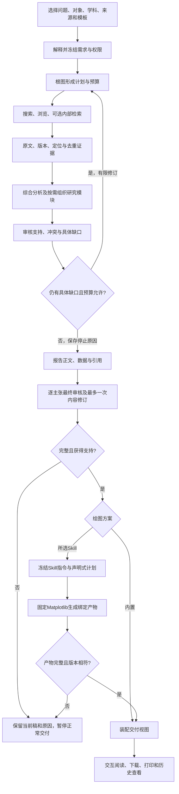

# 完整研究流程基线

OPT-16源码交接见[资料治理与披露ACI](data-governance.md)：实际资料级别传到原工具／模型边界，MCP额外交集；报告审核及输出检查后才发布全文，历史／导出脱敏，原证据与本人重开输入保留真实身份。未运行验证，下一OPT-17，综合场景留到全部实现后统一端到端。

S8—S9继续接入[回答结构、文本历史与图文模板](report-history-templates.md)，在原根owner／execution事务内保存原文及审核关联，复制模板不扩大当前Skill／工具许可；普通研究上下文同步保存。均为源码状态，DDL与功能未运行；下一OPT-16及剩余实现后统一端到端。

S5—S8的[问题证据上下文](evidence-context-selection.md)源码已接入当前问题／成果引用、原始编号／版本锚点、选段损失及阶段缺口；原文入口与实际报告支持度分别呈现，缺口不自动增加外网循环。所有新行为仍未运行验证，下一OPT-15及其余TODO，最后统一端到端。

2026-10-23阶段衔接增量：S3—S4采用[有界外网原文／渲染、任务缓存与明确归档](external-evidence.md)，S4—S5采用[冻结策略的候选融合](candidate-fusion.md)，所有路线保留原始排名及来源，内部／外部独立组织。S8完整支持审核结束后释放审核阶段Token／时间预留，再进入绘图，原根额度／消费／期限不变。相关源码及前端已接入，未运行验证；接续OPT-14和原TODO剩余实现，最后统一端到端。

本轮源码增量：同一Analyst逐问题分析、缺失实验字段补读与同根阶段恢复见[阶段ACI](question-analysis-workflow.md)；所选绘图Skill经声明式计划和固定文件渲染器输出，见[绘图ACI](research-figure-skills.md)。最终未支持、审核未完成、绘图未完成或没有资料均不作为正常完成交付。全部实现后统一端到端，未将下文历史结果当成本轮通过证据。

2026-10-23继续接入[查询变体和通道份额](query-routing.md)、[有界能力升级](model-routing.md)及绘图单图Skill覆盖；均沿原根预算和来源／owner边界，升级决定先持久化、缺证据／身份歧义不猜测。新源码与运行验收分开，后续继续OPT-10及原有剩余项。

2026-10-22继续优化：已接入[按问题选段、正文/图表完整性、审核摘录复用、通用主文/附录与分别导出](research-context-packing.md)。采用普通函数复用原Agent和根预算；已完成七项当前行为的针对性验证，真实自动研究与报告质量单列记录，不覆盖此前人工整编稿或失败状态。

2026-10-22聚焦全文与质量更新：已交付[北大系统团队报告](../outputs/pku-systems-20261022/report.html)，主文按问题比较，逐篇全文及详细课题置于技术附录；[实际记录](acceptance/pku-deep-research-20261022.md)明确自动任务失败、同额续作、人工整编和两项当前修复。后续先做按问题的全文上下文与通用主文/附录，不把此样例算成全链自动通过；统一优先级和状态见TODO FLOW.3、7—12。

2026-10-22后续修复：[总Token及最终审核额度](model-token-budget.md)已接入实际模型请求边界，旧越界记录保留；[下一份北大团队研究](PKU_RESEARCH_BRIEF.md)按明确判断问题、全文和团队材料组织，下文旧样例不是该新调研的交付结果。

2026-10-22运行结果：必要[工具交接](tool-handoff.md)已接入，真实主流程已生成[六页四图报告](../outputs/research-1767bf5c/report.html)，见[证据与不足](acceptance/complete-research-flow-20261022.md)。最终来源审核预算不足、自动支持0/15，模型用量估算越过整体限额，报告保持草稿并在TODO列必要修复；不能将真实交付等同于事实质量或全安全通过。下文“未运行”是此前实施快照。

2026-10-22用户调整：先完成主要内容、各点覆盖、保留扩展空间，优化后置。本文件约束当前交付顺序；[OPTIMIZATION_TODO](OPTIMIZATION_TODO.md)保留完整能力目录和历史状态。源码接入不代表真实研究验收通过。

## 本轮目标

用户选择对象、学科、问题、时间、来源与报告方案后，系统能够形成计划，取证并保留来源，综合与审核，必要时有限补证，最后交付一份有引用、图表、缺口与后续行动的报告。公开研究默认联网，内部资料按需；组织可以单选、多选或混合，未取得资料时明确空缺。

## 18模块的基本路径和扩展位置

| 模块 | 当前主流程选择 | 保留的扩展，不作为首次流程前置 |
| --- | --- | --- |
| 01 接入 | 现有任务证据、上传、受控网页资料 | 更多连接器和增量源 |
| 02 解析 | 已接入文本/网页/PDF结构及失败说明 | 专业公式、复杂版面和更广OCR适配 |
| 03 分块 | 版本化块、父级与原文位置 | 任务特定分块策略 |
| 04 表示 | 词汇表示优先，可选固定版本稠密表示 | 多模态、学习式稀疏 |
| 05 索引 | 直接定位或显式发布词汇/兼容向量索引 | 大规模ANN调优 |
| 06 生命周期 | 任务隔离、修订、可恢复隐藏与到期 | 自动归档策略 |
| 07 理解 | 显式约束、规则解释、已有Planner语义分解 | 独立NER/分类模型 |
| 08 控制 | 现有根图、依赖、有界并行/修订、可见原因 | 自主子研究和分布式调度 |
| 09 路由 | 已选通道、规则/能力/范围检查、既有模型配置 | 学习式路由和性能预测 |
| 10 过滤 | 现有owner/task/组/时间/来源边界 | 自适应位图、过滤感知图 |
| 11 召回 | 网络证据直接定位，内部按需BM25/精确向量 | SPLADE、ColBERT、行为召回 |
| 12 外网 | 已有搜索通道、官网和论文来源策略、受控浏览 | 更多出版商适配及批量策略 |
| 13 融合 | 现有来源/标识去重与词汇/向量RRF | 学习式融合及动态排序 |
| 14 上下文 | 有界证据、引用锚点、统计和缺口 | 跨语料GraphRAG与高级压缩 |
| 15 交付 | 已有生成/来源审核，补齐声明式交付视图和内置图表 | 专业绘图执行器、原生PDF/PPTX |
| 16 治理 | 现有鉴权、范围、工具授权/审批、执行绑定 | 企业SSO和更细组织策略 |
| 17 评估 | 保存实际用量/审核/缺口，统一端到端观察结果 | 标注集、A/B、学习闭环 |
| 18 运行 | 现有持久快照、暂停/恢复与预算 | 独立worker、持久事件流、缓存/资源调优 |

此表是范围与取舍，不能当作所有子项已实施或验收证明。扩展通过现有通道、Skill注册、阶段编译和版本化数据契约进入；没有明确收益时不增加服务或Agent。

## 职责与可扩展交付

根图拥有任务状态、计划、预算、取消及修订。搜索、浏览和RAG是有界取证执行器；Analyst综合，Reflection审核，Report生成；交付视图使用确定性代码展示已有数据，不另开一轮模型思考。Skill约束按已选阶段编译，不能授予工具权限。

报告数据契约使用`schema_version`、`artifact_id`、任务/执行标识、模板描述、页面、图表配方、原始数据、引用及缺口。内置图表先支持数值条形/折线和有来源的关系图；每图有静态数据表。未知年份保留null，证据数量不冒充论文数量。自定义页面只能声明标题、问题、模块和图表偏好，不执行任意HTML、脚本或Skill代码。

手选Skill记录选择和实际版本；缺少可信执行适配器时显示待适配及改选内置入口。模板适配失败、缺数据和绘图失败分别显示，不静默生成替代结论。全量正文和引用仍可查看，导出保留同一版本。

## 实施与验证状态

`add-complete-research-delivery`已完成5项纯实施：有界修订/停止原因、交付数据组装、计划与图文阅读、可移植导出、文档同步；OpenSpec读回5/6，剩余为统一真实端到端。`add-bounded-research-planning`读回3/9，结果交接等原任务仍保留未完成。两组任务计数不能合并为18模块全部完成。

当前变更`add-complete-research-delivery`落实主流程衔接；`add-bounded-research-planning`仍保留未完成细项。当前只有源码/文档审阅，未运行服务、模型、SQL、构建或测试。全部本轮主要内容接入后再统一真实端到端；历史正文引用支持缺口仍须在最终报告中观察，不能由界面完成代替。
