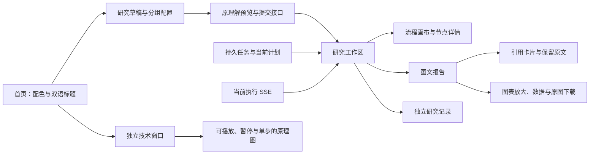

# 前端工作区设计

2026-10-25，OpenSpec：`redesign-research-workspace`。本轮依据用户确认的文案、四套生成背景、黑色蒙版和 Beautiful UI／Bencho 非侧边栏组件交互实施。后端优化目标仍暂停；本次不启动新的付费调研。

## 视觉与标题

| 语言 | 主标题 | 副标题 |
| --- | --- | --- |
| 中文 | 知之为知之，不知则搜之。 | 搜而不思则罔，思而不搜则殆。 |
| 英文 | Research is all you need | In Sources We Trust |

桌面宽度达到 1024px 时，首页主标题为 144px，研究入口为 96px。副标题使用独立的较小字号；窄屏按可读宽度缩放。标题采用本地衬线字体栈，正文采用清晰的本地无衬线字体，移除原外部字体请求。

四套主题分别为纸白苔绿、暖灰赭石、雾白靛蓝、墨黑青绿。对应原图位于 `frontend/public/backgrounds`，均由内置 image_gen 生成，后三套沿用用户确认的原图构图。首页使用独立 CSS 黑色渐变蒙版：浅色标题区 56%、右侧 38%；墨黑主题分别为 30%、22%。原图不烘焙文字或蒙版。

`AppearanceProvider` 管理主题与标题语言，保存至 `deepintel.appearance.v1`，跨窗口同步；存储不可写时仍支持本页切换。主题变量映射到旧 xm／primary／xmgray 工具类，现有领域表单随之换色。内联图表使用主题变量，已生成的绘图文件保留其原绘图样式。

## 页面与操作

静态首页与技术文档可直接打开。首页提供登录、注册；已登录时展示用户名并进入账号页。注册、账号与管理员界面复用主题变量和顶栏，不引入侧边栏。研究、资料、Skill、模型设置经过会话认证，按本人 owner 读取。

`?view=register` 和 `?view=login` 为注册／登录入口，`?view=account` 提供身份、退出和修改密码，管理员另可进入 `?view=admin` 管理账号与注册开关。普通用户不显示管理入口，服务端独立检查角色。登录／退出和身份变化清空查询缓存及挂载的私有组件，移除 URL 任务标识；同一身份的正常重新验证保留研究草稿。会话无法验证时不继续显示私有页面。

认证通知只向 localStorage 写入不含身份和凭证的变更信号；Cookie 保持 HttpOnly。配色／标题偏好仍是浏览器外观偏好，不含个人研究资料。实现见 `AuthGate.tsx`、`AccountPanel.tsx`、`accounts.css`、`App.tsx`；权限契约见[多用户工作区](MULTI_USER_WORKSPACES.md)。

### 研究草稿

多行输入支持正常换行，Ctrl／Command + Enter 提交。首页入口进入草稿页面，不立即发起模型研究。基本选项提供篇幅与报告模板；对象范围、方法与交付、来源与 Skill 放入分组窗口。原对象／学科／评价权重、结构化查询、时间、规划策略、过滤融合、预设／自定义页面及单图 Skill 配置保留。

切换主题和导航保留已挂载草稿。预览与提交继续使用原 request draft key 检查；配置变化后重新预览。新研究清理上一任务的错误状态。只保存外观偏好，不自动把研究正文、凭据和私有资料写入 localStorage。

### 执行画布

`ResearchFlow` 合并当前计划、持久 DAG 与当前执行事件，按依赖布局。初次打开优先保持节点可读并定位受阻／运行步骤；“适应画布”查看全局，“定位当前步骤”恢复阅读焦点。提供缩放、指针拖动、方向键平移和节点弹窗。

节点名称优先展示实际来源文件或计划用途；节点详情展示问题和相关工具调用。计划历史保留调整路径。分析、核对、报告三个根阶段按照现有实际流程呈现，未来步骤为等待，缺记录不推定成功。新一轮分析未完成时，上一轮核对完成事件不进入当前轮次状态。

SSE 使用任务／执行键隔离事件，旧连接关闭后拒绝迟到回调；显式身份不匹配的事件忽略。持久历史与 live 事件合并，连接断开不等于研究失败，终态停止运行样式。原 Token 消耗直接展示，不重新计算原额度或重置截止时间。

### 独立技术窗口

入口 `?view=technology` 在独立窗口／标签打开。顶部提供九个主题：研究编排、对象与匹配、网上取证、证据与 RAG、阶段 Skill、模型与成本、工具接口、边界与恢复、图文交付。

每个主题采用节点卡片、方向连线、流动短线与节点脉冲，提供播放、暂停、单步和节点说明。桌面使用宽幅关系图，窄屏使用竖向排列；减少动效偏好生效。明确标为“原理演示”，与工作区真实执行状态分别呈现。

技术内容沿用核心思想和原 TODO：工具按需取证，同一 Analyst 按子问题分析；Skill 提供阶段方法；数据库保存原文，RAG 按需召回；模型调用服从已授权路由和原额度。这里只增加前端说明，不新增 Agent、A2A 委派、策略服务或权限，因此复用原架构及安全适用评估。

### 报告与证据

默认展示正文、图表与引用，提供章节目录和适合长文的行宽。预算、版本、审核和模型路径进入独立研究记录。旧稿的研究内容与审核状态保持原记录，本次不通过删改研究文字冒充内容质量修复。

数字引用显示为 `[n]` 并打开对应来源；来源卡片保留原始引用数量，不把引用数称为论文数或独立来源数。原文通过原任务 evidence API 读取，允许展开有限上下文。请求在关闭、切换引用或任务时取消；任务及历史稿分别绑定组件身份，避免旧片段残留。

图表具备独立放大窗口、底层数据 CSV 与已有原图格式下载。CSV 保留空值及实际字段，对可能被表格软件解释为公式的字符串作转义。原文、图片和下载仍沿用既有权限，不启动新研究。原模板的主文、附录、逐页／全部阅读和打印继续保留。

## 组件参考与适配

下列为已确认交互参考，代码在本项目自行适配，未拷贝网站源码或侧边栏实现。

| 参考 | 实施位置 |
| --- | --- |
| [Beautiful UI：Task Rows](https://www.beautifului.dev/) | 节点相关调用及阶段状态行 |
| [Beautiful UI：Tool Chips](https://www.beautifului.dev/) | 实际工具标签及前置步骤 |
| [Beautiful UI：Context Cards](https://www.beautifului.dev/) | 报告引用卡片与原文弹窗 |
| [Bencho：Action node](https://bencho.dev/blocks/action-node) | 工作流卡片、状态与展开动作 |
| [Bencho：Trace loader](https://bencho.dev/blocks/trace-loader) | 运行状态短线与加载指示 |
| [Bencho：Hub diagram](https://bencho.dev/blocks/hub-diagram) | 技术图的方向连线、流动标记与关联节点 |
| [Bencho：Tab bar](https://bencho.dev/blocks/tab-bar) | 研究视图、配置分组和技术主题 |
| [Bencho：Palette](https://bencho.dev/blocks/palette) | 固定四套配色选择与保存 |
| [Bencho：Canvas toolbar](https://bencho.dev/blocks/toolbar) | 缩放、适应、定位及原理演示控制 |

## 源码与交付记录

### 追加：暂停／继续与实时反馈

2026-10-26 追加：停止卡片直接显示后端自动诊断、具体待修订主张、已尝试的自动恢复及明确的下一步选择，前三项问题默认展开，其余按需展开；不要求用户自己找错误。SSE 显示自动诊断、恢复动作和 Agent 阶段停止，运行状态随真实恢复动作更新。诊断不进入报告正文。

同日追加：自动恢复按错误类型显示本类尝试次数和上限；SSE 逐次展示等待、输入修改、报告修订轮数和剩余问题。格式／上下文问题展示修正动作，达到上限或无进展时直接说明；用户无需从原始日志自行推断。报告正文不展示这些执行字段。

工作流顶部提供暂停、适用的继续／终止和调整后重新开始入口，并显示实际停止原因。2026-10-26 用户修正后，角色以自绘机器人表示，处于主交接线上；每个角色下方有独立的所属动作容器，突出一项当前动作或最近结果，其余收拢为动作记录。卡片表示实际子问题、工具动作、修订与结果；点开查看反馈、输入和相关调用。取证工具保持工具身份，单列工具工作区。

角色与动作通过 DOM 容器和视觉边界表达归属。主交接线只连接上层角色／阶段，DAG 前置依赖在动作详情中查看。自绘 SVG 采用简洁圆头和胶囊眼睛，各角色用小型标记区分职责；表情从任务、阶段和 SSE 状态推导，不用定时器切换状态。

| 状态 | 表情与动作 |
| --- | --- |
| 等待 | 平视、偶尔眨眼 |
| 执行 | 集中视线、轻微浮动和扫视 |
| 自动修复 | 不对称眼形、小扳手、轻微倾斜 |
| 用户暂停 | 闭眼，停止运行类动效 |
| 系统受阻 | 忧虑眉形，保留具体错误反馈 |
| 完成 | 笑眼和完成标记，单次轻跳后静止 |
| 取消／跳过、未知 | 静态休息或独立未知表情，不显示完成标记 |

减少动效偏好下保留静态表情与文字，停用循环动效及移动光点。表情同时具有可读状态标签。卡片使用实际 SSE 及持久阶段摘要，工具按 call_id／node_id 关联，阶段按 phase 保持身份；打开详情后仍跟随原动作更新。筛选、定位和拖动只控制画布；拖动会停止跟随。桌面能容纳全图时维持整体视野，窄屏定位角色并约束内容边界，避免首个角色居中产生大片留白。完整事件列表进入研究记录。

研究GET中的 `analysis_progress.phases` 提供最多100项已保存阶段、尝试次数与简短结果，按提取批次及冻结模块顺序排列，避免JSONB对象顺序颠倒研究步骤。未知状态不标成功，跳过不标完成；历史终态无运行动画。界面沿用四主题、React／SVG、键盘及减少动效支持。当前界面和真实状态切换见[动态角色工作区](acceptance/agent-stations-20261026.md)；原数据交接记录见[画布动作记录](acceptance/flow-actions-20261026.md)。SSE绕过会缓冲流的压缩中间件，原执行版本及事件ID合并规则保留。

手动暂停在当前图步骤完成并保存后生效；继续沿用原检查点、用量和期限。系统停止沿用原恢复条件；报告需要修订不等同于用户暂停。接口、安全依据及实际操作范围见[任务控制设计](RESEARCH_EXECUTION_CONTROLS.md)和[本轮记录](acceptance/research-controls-sse-20261025.md)。

- `eef59b6`：主题、首页、导航和技术文档。
- `349de93`：研究草稿、执行画布、实时状态及管理界面。
- `900c8f7`：报告阅读、原文卡片和图表导出入口。
- 后续细节与文档提交见当前分支 Git 历史。

### 技术窗口的拆解深度

技术窗口提供全景架构、Agent 执行循环与八个专题。全景将配置与输入、Host 执行边界、Runtime 编排、各角色工作区、取证工具和产物拆开；角色工作区实际包含其处理节点。单循环展开上下文、模型处理、阶段输出、解析校验、结果回写、续题／结束，以及规划／补证的工具请求、执行和证据回流。

网上取证、RAG、Skill、模型成本、对象匹配、ACI、边界恢复和交付分别定义节点与返回分支。图中数据、控制、返回／续轮采用独立线型与颜色；点击节点，在图下方查看具体输入、输出、相邻交接和实现位置。扩展能力使用虚线节点与“扩展位”标签。

图支持暂停原理演示、手动推进、拖动、缩放、适应及定位；减少动效时停用自动播放和循环动效，单步可继续阅读。手机默认保持节点可读尺寸，通过定位选择细节。当前操作与图见[技术架构细化](acceptance/architecture-detail-20261026.md)。研究工作区继续展示原真实事件与已保存动作，技术页的演示路径不作为任务记录。

实际页面操作及未取得的运行证据见 [前端实际操作记录](acceptance/frontend-workspace-20261025.md)。用户禁止非 E2E 检查，本次没有运行构建、类型、lint、schema、单元、回归或浅层探针；源码审阅不替代这些未运行检查，也不替代原 ORG／FLOW 的完整研究交付验收。

所有技术专题统一使用正交折线，按节点和分区标题避让。同一侧的进入和流出端口错开，返回／重试走指定外侧通道；路径选择计入转弯、重叠与交叉代价。标签选择空闲线段，完整交接仍在图下详情中查看。演示复用同一正交路径，路线只在专题结构变化时重新计算。

## 简约的研究选择（2026-10-26）

创建和调整后重新研究共用 `ResearchSetup`、请求转换及选择控件。首屏围绕问题输入，提供研究深度、研究范围和报告样式三个入口，资料与时间以短摘要显示。详细选项一次展开一组，编辑副本后取消或应用；预览随已应用的请求身份变化，旧预览不作为新配置的创建依据。

普通选择采用标签、勾选、日期、具名方法和章节。资料筛选、术语、检索排序、技术分类和成果条件使用结构化控件；不要求用户维护 JSON、UUID 或逗号分隔的内部枚举。自定义报告从本次明确模块或不绑定模块的两个章节开始，避免默认生成未选择的分析内容。非长文样式自动包含网页下载，当前没有适配的幻灯片下载不作为新选项。

`setupFromRequest` 保留原请求，`setupRequest` 在同一契约内覆盖实际选择，并保留未修改的扩展、具名实体身份及原来源；个人评分引用保留指定保存记录，展开只读不会触发默认覆盖。绘图方法按渲染阶段能力筛选，最终由原注册表与交付检查校验。网站、方法和资料选择不增加后台权限。

默认权重由原服务端提供。高级权重保留原配置数据，移除配置版本／规则目录等界面信息。输入错误在应用时定位到相关组，纠正后清除已过期错误。原解释 API 仍是最终请求校验，不以本地摘要代替实际预览。

沿用既有四色与字体，没有采用中国厂商界面参考，没有新增依赖。当前浏览器范围和桌面／手机图见[研究选择记录](acceptance/research-choices-20261026.md)。

## 资料库与 Skills 的集合页面（2026-10-26）

`CollectionUI` 只共享集合标题、页签、提交状态、输入标签与原请求处理，不引入新框架。资料以列表呈现，方法以用途卡片呈现；普通路径不出现新增与编辑并排的大段原文或内部版本号。新增、阅读和编辑使用中部独立窗口，当前页面保留筛选，沿用四色与键盘／手机支持。

资料导入复用原分块、特征、索引与保存契约；共同分组和范围在一次输入后用于文件、粘贴和批量路径。默认任务范围不改变，链接在客户端提取任务身份并由服务端校验。阅读按需请求本人的所保留原文，编辑保留系统属性，其他资料信息采用具名字段。解析、索引及生命周期在处理与维护中按需展开。原状态 `archived` 不代表隐藏，列表以关联的 `lifecycle_state` 作区分。

方法表单显示用途、话题、阶段和指令，导入及原文保留。只修改目标字段与指令章节，原阶段引用／内联章节继续存在；进入原文后需要明确放弃其修改才能回到表单，空原文保持为空并给出错误。原声明和角色能力由原服务端解析校验。停用从运行注册表移出，管理页另读本人的包含停用项目录；不以界面假状态替代真实状态。

本轮实际操作、发现与修复、安全基线引用和截图见[资料与方法记录](acceptance/collections-20261026.md)。未启动原暂停的报告／研究优化工作。

## 全站中英文（2026-10-26）

顶部语言开关覆盖资料、方法、研究选择／运行／记录、设置、账号和技术窗口，使用同一词条目录及既有持久偏好。日期、界面状态、弹窗与已有系统反馈随之更新；表单、筛选、任务及图节点保持身份。英文手机卡片保留完整单词，两列呈现较长选项。

用户命名、输入、资料和报告内容不随界面语言改写。服务端固定渠道／模型说明与诊断模板明确接入；原始研究主张保留。具体实现、操作范围和截图见[中英文界面记录](acceptance/localization-20261026.md)。

20.1源码在方法详情中增加“版本与更新”：显示个人／随附版本、个人差异、默认变化、完整原文和历史；先查看再明确升级，重叠改动保留个人内容，回退生成新修订。来源不明时先对照并由用户决定是否关联。中英文使用同一界面词条，方法原文不翻译。该新增界面仍待统一端到端验证。

20.2源码在研究计划预览显示各阶段准备的方法与未选原因；研究记录基于模型及工具回执区分已发送、处理中、未知、未发送和实际应用的工具规则。固定流程或旧任务不会因方法已编译而显示为已发送。界面沿用当前主题与双语词条，尚待统一端到端验证。

20.3源码在研究记录提供“按问题查看研究依据”：先显示原问题和核心判断，再按实际选择的模块展开正文、模型核对与来源；成果深读显示全文和字段依据，演进区分观察／推断／情景及反向材料，行动显示议题、步骤和所缺条件。没有可靠阶段归属的趋势单列；来源原文不翻译，固定界面词条支持中英文。信息属于研究记录，不混入报告正文；尚待统一端到端验证。

20.4源码在研究记录显示各阶段当时的根余量、审核／报告预留以及补证调整；写作阶段显示扣除审核预留后的可用量。预留不是已经花费的 Token，旧任务没有新分配记录时不伪造；界面跟随中英文切换，尚待统一端到端验证。

## 报告版式编辑（2026-10-27）

研究选项的自定义报告支持导入HTML／DOCX样例、从空白设计或由手动章节的类型和配图建立版式；三条路径进入同一结构化编辑区。预览使用通用标题与空白组件，支持编辑章节、分栏、组件顺序与类型、字号、颜色和允许的交互。样式可保存、读取、修订并应用到本次选择；样例文件名和来源引用只用于本人管理。

上传期间可取消，暂不可应用或切换其他选项组。选项窗口取消只放弃未应用的研究选择，已保存的样式仍在个人样式库。HTML在真实浏览器中的导入、编辑、保存、重读、修订和应用见[版式编辑记录](acceptance/layout-editor-20261027.md)。

19.4源码增加组件的数据类型、缺失策略及逐图绘图方法；从已完成研究调整时，可选择“原研究数据”查看组件匹配、缺口与未放置正文。这一预览只读取本人原任务，不更改新任务的研究问题或资料。19.5源码将同一数据呈现为按模板分栏的报告，支持目录、标签、展开、排序、筛选与提示；手机单栏，打印展开全部章节和数据。离线HTML使用固定应用脚本，PDF由浏览器打印生成。新增绑定、呈现与导出尚待统一端到端验证。

19.6源码将样例解析进度接入编辑器，显示读取、提取、预览和自动恢复状态，并提供取消；网络断开重连同一操作，同标签页刷新后再次打开自定义样式可恢复已创建的操作。完成／取消的状态由服务端裁决，旧响应不会覆盖新草稿。加载本人模板并调整版式时保留来源版本；样例解析及版本冻结尚待统一端到端验证。
