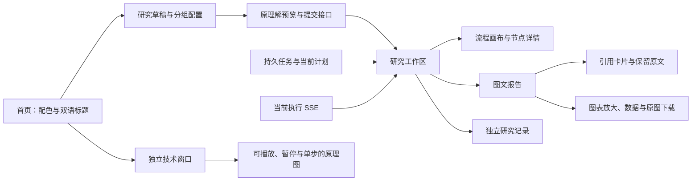

# 前端工作区设计

2026-10-25，OpenSpec：`redesign-research-workspace`。本轮依据用户确认的文案、四套生成背景、黑色蒙版和 Beautiful UI／Bencho 非侧边栏组件交互实施。后端优化目标仍暂停；本次不启动新的付费调研。

## 视觉与标题

| 语言 | 主标题 | 副标题 |
| --- | --- | --- |
| 中文 | 知之为知之，不知则搜之。 | 搜而不思则罔，思而不搜则殆。 |
| 英文 | Research is all you need | In Sources We Trust |

桌面宽度达到 1024px 时，首页主标题为 144px，研究入口为 96px。副标题使用独立的较小字号；窄屏按可读宽度缩放。标题采用本地衬线字体栈，正文采用清晰的本地无衬线字体，移除原外部字体请求。

四套主题分别为纸白苔绿、暖灰赭石、雾白靛蓝、墨黑青绿。对应原图位于 `frontend/public/backgrounds`，均由内置 image_gen 生成，后三套沿用用户确认的原图构图。首页使用独立 CSS 黑色渐变蒙版：浅色标题区 56%、右侧 38%；墨黑主题分别为 30%、22%。原图不烘焙文字或蒙版。

`AppearanceProvider` 管理主题与标题语言，保存至 `deepintel.appearance.v1`，跨窗口同步；存储不可写时仍支持本页切换。主题变量映射到旧 xm／primary／xmgray 工具类，现有领域表单随之换色。内联图表使用主题变量，已生成的绘图文件保留其原绘图样式。

## 页面与操作

静态首页与技术文档可直接打开。首页提供登录、注册；已登录时展示用户名并进入账号页。注册、账号与管理员界面复用主题变量和顶栏，不引入侧边栏。研究、资料、Skill、模型设置经过会话认证，按本人 owner 读取。

`?view=register` 和 `?view=login` 为注册／登录入口，`?view=account` 提供身份、退出和修改密码，管理员另可进入 `?view=admin` 管理账号与注册开关。普通用户不显示管理入口，服务端独立检查角色。登录／退出和身份变化清空查询缓存及挂载的私有组件，移除 URL 任务标识；同一身份的正常重新验证保留研究草稿。会话无法验证时不继续显示私有页面。

认证通知只向 localStorage 写入不含身份和凭证的变更信号；Cookie 保持 HttpOnly。配色／标题偏好仍是浏览器外观偏好，不含个人研究资料。实现见 `AuthGate.tsx`、`AccountPanel.tsx`、`accounts.css`、`App.tsx`；权限契约见[多用户工作区](MULTI_USER_WORKSPACES.md)。

### 研究草稿

多行输入支持正常换行，Ctrl／Command + Enter 提交。首页入口进入草稿页面，不立即发起模型研究。基本选项提供篇幅与报告模板；对象范围、方法与交付、来源与 Skill 放入分组窗口。原对象／学科／评价权重、结构化查询、时间、规划策略、过滤融合、预设／自定义页面及单图 Skill 配置保留。

切换主题和导航保留已挂载草稿。预览与提交继续使用原 request draft key 检查；配置变化后重新预览。新研究清理上一任务的错误状态。只保存外观偏好，不自动把研究正文、凭据和私有资料写入 localStorage。

### 执行画布

`ResearchFlow` 合并当前计划、持久 DAG 与当前执行事件，按依赖布局。初次打开优先保持节点可读并定位受阻／运行步骤；“适应画布”查看全局，“定位当前步骤”恢复阅读焦点。提供缩放、指针拖动、方向键平移和节点弹窗。

节点名称优先展示实际来源文件或计划用途；节点详情展示问题和相关工具调用。计划历史保留调整路径。分析、核对、报告三个根阶段按照现有实际流程呈现，未来步骤为等待，缺记录不推定成功。新一轮分析未完成时，上一轮核对完成事件不进入当前轮次状态。

SSE 使用任务／执行键隔离事件，旧连接关闭后拒绝迟到回调；显式身份不匹配的事件忽略。持久历史与 live 事件合并，连接断开不等于研究失败，终态停止运行样式。原 Token 消耗直接展示，不重新计算原额度或重置截止时间。

### 独立技术窗口

入口 `?view=technology` 在独立窗口／标签打开。顶部提供九个主题：研究编排、对象与匹配、网上取证、证据与 RAG、阶段 Skill、模型与成本、工具接口、边界与恢复、图文交付。

每个主题采用节点卡片、方向连线、流动短线与节点脉冲，提供播放、暂停、单步和节点说明。桌面使用宽幅关系图，窄屏使用竖向排列；减少动效偏好生效。明确标为“原理演示”，与工作区真实执行状态分别呈现。

技术内容沿用核心思想和原 TODO：工具按需取证，同一 Analyst 按子问题分析；Skill 提供阶段方法；数据库保存原文，RAG 按需召回；模型调用服从已授权路由和原额度。这里只增加前端说明，不新增 Agent、A2A 委派、策略服务或权限，因此复用原架构及安全适用评估。

### 报告与证据

默认展示正文、图表与引用，提供章节目录和适合长文的行宽。预算、版本、审核和模型路径进入独立研究记录。旧稿的研究内容与审核状态保持原记录，本次不通过删改研究文字冒充内容质量修复。

数字引用显示为 `[n]` 并打开对应来源；来源卡片保留原始引用数量，不把引用数称为论文数或独立来源数。原文通过原任务 evidence API 读取，允许展开有限上下文。请求在关闭、切换引用或任务时取消；任务及历史稿分别绑定组件身份，避免旧片段残留。

图表具备独立放大窗口、底层数据 CSV 与已有原图格式下载。CSV 保留空值及实际字段，对可能被表格软件解释为公式的字符串作转义。原文、图片和下载仍沿用既有权限，不启动新研究。原模板的主文、附录、逐页／全部阅读和打印继续保留。

## 组件参考与适配

下列为已确认交互参考，代码在本项目自行适配，未拷贝网站源码或侧边栏实现。

| 参考 | 实施位置 |
| --- | --- |
| [Beautiful UI：Task Rows](https://www.beautifului.dev/) | 节点相关调用及阶段状态行 |
| [Beautiful UI：Tool Chips](https://www.beautifului.dev/) | 实际工具标签及前置步骤 |
| [Beautiful UI：Context Cards](https://www.beautifului.dev/) | 报告引用卡片与原文弹窗 |
| [Bencho：Action node](https://bencho.dev/blocks/action-node) | 工作流卡片、状态与展开动作 |
| [Bencho：Trace loader](https://bencho.dev/blocks/trace-loader) | 运行状态短线与加载指示 |
| [Bencho：Hub diagram](https://bencho.dev/blocks/hub-diagram) | 技术图的方向连线、流动标记与关联节点 |
| [Bencho：Tab bar](https://bencho.dev/blocks/tab-bar) | 研究视图、配置分组和技术主题 |
| [Bencho：Palette](https://bencho.dev/blocks/palette) | 固定四套配色选择与保存 |
| [Bencho：Canvas toolbar](https://bencho.dev/blocks/toolbar) | 缩放、适应、定位及原理演示控制 |

## 源码与交付记录

### 追加：暂停／继续与实时反馈

2026-10-26 追加：停止卡片直接显示后端自动诊断、具体待修订主张、已尝试的自动恢复及明确的下一步选择，前三项问题默认展开，其余按需展开；不要求用户自己找错误。SSE 显示自动诊断、恢复动作和 Agent 阶段停止，运行状态随真实恢复动作更新。诊断不进入报告正文。

工作流顶部提供暂停、适用的继续／终止和调整后重新开始入口，并显示实际停止原因。画布下方默认展开 SSE 执行反馈，显示 Agent、具体子问题、工具输入与返回摘要；筛选和停止滚动跟随不改变任务状态。节点采用具体 query，不再统一显示通用用途。SSE 绕过会缓冲流的压缩中间件，图事件产生时即时推送，步骤结束后的记录通过事件 ID 合并。

手动暂停在当前图步骤完成并保存后生效；继续沿用原检查点、用量和期限。系统停止沿用原恢复条件；报告需要修订不等同于用户暂停。接口、安全依据及实际操作范围见[任务控制设计](RESEARCH_EXECUTION_CONTROLS.md)和[本轮记录](acceptance/research-controls-sse-20261025.md)。

- `eef59b6`：主题、首页、导航和技术文档。
- `349de93`：研究草稿、执行画布、实时状态及管理界面。
- `900c8f7`：报告阅读、原文卡片和图表导出入口。
- 后续细节与文档提交见当前分支 Git 历史。

实际页面操作及未取得的运行证据见 [前端实际操作记录](acceptance/frontend-workspace-20261025.md)。用户禁止非 E2E 检查，本次没有运行构建、类型、lint、schema、单元、回归或浅层探针；源码审阅不替代这些未运行检查，也不替代原 ORG／FLOW 的完整研究交付验收。
