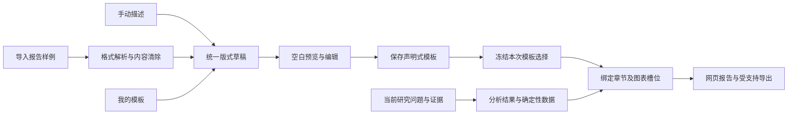

# 从现成报告提取版式

2026-10-26设计，2026-10-27开始按模块实现。ReportLayout、独立本人样例通道、HTML／DOCX格式提取、前端空白预览／编辑、个人模板保存／应用、研究数据绑定、受控报告呈现、模板版本冻结及解析操作的预算、SSE和取消已接入源码。新增功能按用户要求留待全部实现后的统一端到端验证。延续既有图像驱动、可交互报告、自定义模板与可选绘图Skill，不新增自主Agent或服务。

## 目标与入口

“报告样式 → 自定义”提供从空白开始、导入样例、我的模板三个入口，最终进入同一个编辑器。手填可以描述结构与风格，导入可以以现有HTML或文档作为样例；保存的是去内容后的版式，可修改、重复使用，研究问题与研究资料始终由当前任务决定。

导入样例的路径为：选择文件 → 读取结构／样式 → 去除原内容 → 空白预览 → 调整 → 保存或本次使用。预览默认展示通用槽位和空白图形；如已有当前研究结果，可显式切换为当前任务数据预览。不会用样例数字填充“效果图”。短文案与原工作区风格一致，不在报告正文展示审核、产物版本或额度。

## “只取格式”的具体范围

| 提取 | 清除 |
| --- | --- |
| 章节层级、顺序、版面分栏、区块类型 | 具体章节标题中的公司、人名、时间与结论 |
| 字体角色、字号比例、颜色、间距、边框 | 正文、表格单元格、图中数值及数据标签 |
| 标题／摘要／对照／时间线／关系图等通用槽位 | 原建议、观点、排名、因果关系、评价和引用 |
| 图片位置、比例、图注位置、图文密度 | 原图片、Logo、水印、图片中的文字与事实 |
| 标准目录、标签页、筛选、展开、提示等交互需求 | 原JS、表单提交、网络请求、文件访问与执行指令 |

例如“腾讯2020—2026网络研究布局”成为标题槽位；带21篇论文的统计卡成为指标卡；原合作高校关系图成为关系图槽位。原公司、年份、21和合作边均不进入模板。新任务若是生物实验室，标题、时间、指标与关系只能取当前任务的真实结果。

版式可以保留通用章节角色，如概览、比较、演进、建议；未知标题降为通用章节槽位，不把原题目改写成新的研究问题。字体大小、区块数量等几何信息允许保留；这些数值不能进入研究统计。样例长度只映射为紧凑／标准／详尽等密度，不成为强制凑字要求。

## 内容隔离需要程序控制

1. 样例采用独立的本人模板文件记录，不进入document_sources、证据集、搜索缓存或RAG。清楚标记用途为版式输入；若用户另行将同一文件加入研究资料，产生独立的资料记录与授权。
2. 本地解析器先读取DOM／文档结构与可计算样式，清除脚本、隐藏文本、批注、元数据、公式或链接载荷、CSS文本内容和外部资源URL。保留的只是允许的格式值、几何关系和通用组件。
3. 复杂图像解析可采用已授权的识别服务；原文只在这次隔离解析中可见，不进入Planner／搜索／分析／Report上下文。默认不自动向外部服务上传样例；未启用识别能力时明确该文件可解析的范围。
4. 解析结果只准输出类型化字段。源文自由文本、任意HTML／CSS／JS、工具指令、检索词、事实／数字／引用或任意数据查询表达式不能成为模板指令。被拒绝字段进入解析记录，不靠一句“忽略内容”的提示来清除。
5. 模板编译器只把合规版式编译为已有受控组件；研究阶段只得到模板引用与去内容结构。原文件名、模板显示名和原件位置只作管理元数据，不进入研究模型上下文。Report输入和证据引用构建器不接受template_source类对象。
6. 重新用另一主题测试同一版式：原对象与观点不能出现在问题、查询、证据、正文或图表；它们若恰好也是当前研究对象，只能追溯至当前输入或研究证据。

这是后续实现的验收目标，并非本轮已经证明原文影响被完全消除。自由文本分类或视觉模型仍需独立的内容残留检查；主链的数据隔离和字段限制由服务端执行。

## 统一版式数据契约

现有DeliveryRequest只有模板类型、主题、页面标题／问题／图型与绘图选择，不能承载任意排版。现有research_delivery_templates保存其不可变修订，应在此基础上扩展，避免再建一套不兼容的保存体系。

新增版本化ReportLayout，至少包含：

| 字段组 | 内容 |
| --- | --- |
| 身份与来源 | schema版本、本人模板ID／修订、输入格式、解析器版本、原文件受控引用；原样例不作为研究证据 |
| 设计值 | 字体角色、有限字号／间距、色板、列宽、画幅、背景样式；禁止任意CSS及URL |
| 结构 | 有限深度的章节与组件树，标题、正文、图、表、注释及参考资料槽位 |
| 数据需求 | 槽位对应的输出类型、单位／维度要求及所需事实关系；绑定许可字段，禁止任意代码／SQL／表达式 |
| 交互与响应式 | 组件允许的排序、筛选、展开、提示、目录与标签页，手机／打印布局 |
| 适配与缺失 | 对象类型／学科的通用映射、必要／可省略模块、缺失数据处理及优先顺序 |

当前最多24个逻辑页面、12张绘图的上限需要保持，扩展组件树要另设总块数、深度、输入资源与渲染时间上限；不能把嵌套组件当作绕过原预算的方式。物理打印分页与逻辑章节分开。

手动描述、直接编辑和文件导入都生成同一草稿。手写描述也不能直接成为原始HTML或无限制模型指令。DeliveryRequest扩展为引用已保存的布局修订，或提交经同一校验的临时布局；旧模板继续按原契约呈现。

当前界面提供“从空白设计”和文件导入，均进入相同的结构化版式草稿。旧手动章节可按章节类型和明确选择的图形生成版式，原手填章节保留在草稿中，供切换回旧模式；章节标题和问题不写入去内容的版式。散点图、热力图在版式中暂以自动图形占位。加载本人模板也使用相同编辑器，名称与样例引用只用于管理。取消选项窗口舍弃未应用的本次研究选择，已保存的模板保留；上传中可取消，迟到结果不会覆盖草稿。

## 数据绑定、学科与方法优先级

优先级为：事实／证据与数据语义约束 → 用户本次显式选择 → 模板布局 → 所选Skill方法 → 自动建议。布局决定呈现位置，不决定哪些观点必须成立。绘图Skill可改变图型与展示建议，不能提供数据或突破受信渲染器。

对象映射采用企业／高校／科研机构等实体角色，领域术语来自本次学科配置。企业的产品转化区块可以由用户改为高校的科研成果与合作资源；不能只把“腾讯”替换成“北大”而保留原业务结论。计算机CCF或其他学科的评价权重继续沿研究配置，不由样例写死。

图形槽位声明数据形状：时间线需要时间与事件，关系图需要有来源的节点和边，数值图需要单位、维度与可比较口径。不能从图片推断原数值再复用，不能用一张无依据的网络图凑版式。缺数据时预览定位模块，并让用户选择省略、转为文字／表格或补充当前研究；自动补采仍受当前问题、来源许可与根预算限制。

14项报告结构Skill与布局模板分别承担写作方法和视觉结构。用户选定版式后，不允许多个方法各自强制加入自己的整套章节；实际采用的内容留研究记录。

### 19.4 版式与研究数据的绑定

`app/report_layout_binding.py` 接收受校验的 `ReportLayout`、同一任务的报告章节、引用、统计快照、关系与技术阅读结果，输出章节和组件的结构化绑定。具名章节先按当前报告标题匹配，通用章节依次接收未分配的当前内容；段落按顺序分配，不为填槽重复或编造内容。没有匹配到正文槽位的现有报告内容保存在 `unplaced_sections`，交给后续渲染器处理。对象与学科使用当前任务的实体和学科配置，不从样例继承名称、结论或分类。

统计图只使用已建立样本、同一快照及指标注册表中的数值和单位，未观察年份保留缺失；关系图只使用能关联当前引用的关系记录，技术对照仅保留有来源定位的字段。折线／时间线需要有序年份及至少两个已观察值；表格、关系图和数值图分别匹配其数据形状。不满足数据条件时，槽位遵循“省略组件／使用已有文字／等待所需资料”；要求资料的槽位若未满足，在报告阶段保留结果并暂停，诊断定位具体章节和组件。已有文字按实际段落分配，不能通过重复段落伪造填充。

绘图方法优先级是单组件指定 → 对应数据图指定 → 整体绘图选择。每个图形保留真实数据身份、图型和所选方法；方法仍需通过本人的注册表、render阶段与受信Matplotlib适配器，不增加工具权限。若全部图形按照用户选择省略或使用已有文字，不额外调用绘图模型。界面可设置每个组件的数据类型和缺失策略；在已完成研究的“调整后重新研究”中，可显式用原研究结果预览匹配与缺口，未放置的正文也会列出。

**ACI：** `POST /api/v1/research/{session_id}/layout-preview` 接收受限 `DeliveryRequest`，仅在当前认证主体拥有、已完成且有报告的任务上，返回槽位绑定及与当前报告对应的图表数据；缺版式返回422、任务不存在或不属于本人返回404、任务尚未完成返回409。它不修改任务、不运行模型或发起网络检索。预览使用原任务内容，不把其资料复制到新研究。对无布局的旧请求保持原路径。19.5的实际呈现源码接入后，移除 `layout_binding_pending`；报告仍受当前资料、绘图、缺失要求及最终审核条件约束。

本模块依据 A2ABreak 基线 v1.0：A2AB-01《技能声明验证与委派准入》工程解决方案1、3、4，复用 render 注册表准入和受限数据契约；A2AB-03《上下文归属与跨租户隔离》工程解决方案1—3，预览复用任务 owner 鉴权和本人结果；A2AB-08《结构化授权请求与权限不放大》工程解决方案1—4，版式绑定不新增资料、工具、网络或模型权限。具体条目分别为 Basic Memory main `main/engineering/security/a2abreak/solutions/a2-ab-01-技能声明验证与委派准入`、`.../a2-ab-03-上下文归属与跨租户隔离`、`.../a2-ab-08-结构化授权请求与权限不放大`。A2AB-05《产物分块校验与断流恢复》v1.0工程解决方案1—4在本次不新增分块或流式产物传输，沿用原报告出口；其他编号沿用19.3适用性。上述为源码控制点与待验收目标，不宣称安全验收已经通过。

### 19.5 受控呈现与格式能力

`ReportLayoutView` 使用绑定后的章节、组件、真实图表与引用，按版式颜色、字体、字号、间距、分栏及图形比例呈现。页面标题和正文来自本次研究；同一正文不为填槽复制，未放入模板的正文按原顺序附于报告中。原样例HTML、CSS、脚本、图片及正文均不参与报告执行。要求资料的组件未满足时沿19.4停在原任务；普通缺口可在独立研究记录中查看，不塞入报告正文。

交互按版式勾选启用：目录跳转、章节标签、展开／收起、表格排序／筛选和悬停提示。排序／筛选覆盖绑定表格、图表数据表及正文Markdown表格，引用在线打开当前任务的来源详情。手机视图采用单栏及表格横向滚动；打印前展开章节与数据表并恢复筛选掉的行，打印后恢复阅读状态。图表继续使用当前任务的内置数据图或已选Skill生成图，不从样例取图，也不将原文图号冒充已经取得的图片。

| 输出 | 支持与限制 |
| --- | --- |
| 在线网页 | 受控组件、所选交互、图表放大／数据CSV、本人引用详情；页面不附加审核、版本及用量文字 |
| 下载HTML | 自包含样式、生成的内嵌图及固定应用脚本；目录、标签、展开、排序、筛选和原生提示可离线使用，引用变为本文件内来源链接；在线原文详情和图表放大／CSV按钮不复制到离线版，外部来源链接需联网 |
| 打印／PDF | 使用浏览器打印／另存PDF，输出完整章节、数据表与引用的静态版；交互和网页颜色依浏览器打印设置降级，页眉页脚是文档位置而非保证每张物理页重复 |
| Markdown | 当前读者正文及来源链接，不承载所选排版、交互或嵌入图 |
| JSON | 原任务的结构化交付、版式绑定和研究记录，不是视觉排版 |
| PPTX／原生服务端PDF | 未实现；PDF可用上述浏览器打印，PPTX继续明确拒绝 |

HTML导出仅克隆已呈现的本人结果；去除原有可执行元素，并加入固定应用脚本和限制性CSP。原始图像链接不自动下载，样例脚本不执行。导出前恢复筛选和图形选择，避免把当前阅读状态误当作完整结果。19.5依据 A2ABreak v1.0：A2AB-03《上下文归属与跨租户隔离》工程解决方案1—3，结果仍经本人任务的服务端查询后生成；A2AB-06《并发状态版本与审批绑定》工程解决方案1—3，报告取本次冻结描述与现有执行绑定，不在导出时重读最新模板；A2AB-08《结构化授权请求与权限不放大》工程解决方案1—4，呈现与导出不新增工具或数据授权。条目为 Basic Memory main `main/engineering/security/a2abreak/solutions/a2-ab-03-上下文归属与跨租户隔离`、`.../a2-ab-06-并发状态版本与审批绑定`、`.../a2-ab-08-结构化授权请求与权限不放大`。本模块未新增A2A委派、事件传输或分块产物，其他方案沿用既有评估；这些是源码控制点，不是已验证的安全结论。

## 格式与交互支持分期

| 输入 | 规划顺序 | 可提取范围及边界 |
| --- | --- | --- |
| HTML | 首期优先，适配用户已提供的图文样例 | DOM结构、局部样式、表格及组件位置；重建允许的交互，原脚本不执行 |
| DOCX | 首期结构化文档适配 | 标题样式、段落、表格、分节及页眉／页脚角色；浮动和复杂分页另记差异 |
| PPTX | 后续 | 页面比例、占位、分组及图文布局；不等于同时实现原生PPTX导出 |
| 带文字层PDF | 后续 | 基于坐标重建版面，阅读顺序和图表类型有歧义时允许手动修正 |
| 扫描PDF／图片 | 最后 | 依赖图像识别，先解决阅读顺序、内容去除与成本；不与结构化格式承诺相同还原度 |

解析接口按输入格式返回实际支持范围与差异，不能只凭扩展名显示成功。输出沿已有网页／Markdown／JSON和打印PDF，PPTX输出要有自己的实际适配器。网页可交互，打印版需要表格／注释等静态对应物；不能把动画或悬停内容直接丢失。

完整报告不复制源页面；由受控组件生成。保留原站风格、响应式和减少动态效果偏好；窄屏、打印、字号较大和长文本需要独立布局规则。设计交互效果在技术文档中演示，运行反馈通过现有SSE展示实际状态。

## 版本、隔离、成本与失败

模板保存／复制／修订复用本人owner、request_id与expected_version。编辑导入草稿不覆盖原模板；任务应用时冻结确切布局修订、绘图选择和数据绑定。以后改模板不改变旧报告，禁用方法不能通过旧模板重新启用。系统预设和个人模板分开展示，管理员发布预设需要明确动作，个人上传不自动共享。

19.6.1源码在预览与创建时按当前主体读取明确指定的模板ID／版本，将该来源、是否为本次任务调整过以及实际布局和绘图选择冻结在任务描述中；这些内容也进入解释身份及研究记录。选用样式后编辑布局保留来源版本，导入新样例或从空白开始则清除来源。模板版本本身保持不可变，改动不回写旧任务；实际使用的Skill仍需通过当前注册与阶段准入。此源码尚未进行统一端到端验证。

19.6.2新增独立解析操作：本地子进程只读取上传字节并返回受限版式，无模型调用与主动网络读取，也不创建研究或占用研究根额度。保存后的模板重复使用不必重读样例。操作自入队起最多45秒，每次解析最多15秒，瞬时进程异常在原总期限内最多尝试3次；文件损坏、受限格式、超出资源及解析超时不重复原输入，界面提示重新选择或精简样例。上传和进度连接中断则按同一操作ID有限重连，服务端不会重复保存样例。

单个文件上限2 MiB，完整multipart上限另加32 KiB，上传读取最多45秒；每个服务进程同时接收最多8个上传，每个账号同时最多有2个排队或执行中的操作，所有服务进程合计最多4个执行中操作。每个账号最多保存50份成功样例、500条操作记录；结束的操作元数据在后续账号操作时清理7天前的记录。解析中的临时字节在成功、失败或取消后清除；成功样例原文件按原本人样例通道单独保存，不进入研究证据或RAG。上述限额只描述当前实现，不承诺操作记录按时自动清理。

**ACI：** `POST /api/v1/research/layout-samples/operations` 接收HTML／DOCX和客户端生成的 `request_id`，返回202及本人操作状态；同ID、同文件和文件名重试返回原状态，同ID不同输入返回409。`GET /operations/{operation_id}` 读取本人状态；`GET /operations/{operation_id}/events` 以持久事件序号和 `Last-Event-ID` 恢复读取、清理、预览、重试和终态，按当前凭据及owner持续检查，每次连接最多60秒；事件仅携带状态和分类，不传源文件。`DELETE /operations/{operation_id}` 取消未完成操作；先于上传到达时建立取消记录，晚到的同ID上传不得启动。完成和取消以同一行的事务状态裁决，旧执行令牌不得提交结果。旧 `POST /layout-samples` 复用同一操作并等待结果。

浏览器在同一标签页为当前账号及研究选择记录操作ID；刷新后重新打开自定义样式可恢复已创建的解析，上传尚未到达服务端时需重新选择文件。用户离开编辑器时取消待处理操作；客户端同时用代次屏蔽迟到结果。服务重启后的未终态操作在租约过期后仅可在原有截止时间与尝试次数内恢复，失败、额度耗尽和账户权限变化不会触发无限重试。部分网络中断时取消未获确认，界面会提示；最终以服务端状态为准。

19.6依据A2ABreak v1.0：A2AB-03《上下文归属与跨租户隔离》工程解决方案1—3用于样例、操作及进度的owner查询；A2AB-04《长连接撤权与事件出口鉴权》工程解决方案1—4用于事件出口的凭据复核与连接期限；A2AB-06《并发状态版本与审批绑定》工程解决方案1、3用于事务状态、单调事件及执行令牌；A2AB-10《委派环路检测与全链预算》工程解决方案1、3、4借鉴于独立解析操作的次数、时限与并发约束，本模块不增加Agent委派；A2AB-11《中断任务租约与有界资源回收》工程解决方案1、2、4用于租约、子进程终止及暂存回收。条目位于Basic Memory main `main/engineering/security/a2abreak/solutions/` 下对应编号。A2AB-05《产物分块校验与断流恢复》不适用：SSE只传状态，完整版式通过本人样例接口读取，不分块传输产物。其他编号沿用既有评估。以上是按源码落实的控制点，统一端到端验证尚未进行。

## 已有、需改造与需新增

| 能力 | 当前依据 | 下一步 |
| --- | --- | --- |
| 自定义页面与研究重点 | DeliveryRequest／ResearchChoiceFields／writing_plan | 改造为共用布局草稿；问题内容与版式字段分离 |
| 模板保存／复制／不可变修订 | research_delivery_templates与原owner接口 | 扩展版本化布局和来源引用，保持旧版兼容 |
| 文档解析 | 现有研究资料解析能力 | 复用文件读取方法，新增隔离的版式解析结果，不能把全文当模板 |
| 图像／绘图Skill与输出 | 原render阶段及受信Matplotlib／网页组件 | 增加槽位数据匹配与逐图映射，保留数据绑定和授权 |
| 报告保存与旧稿 | research_report_versions | 保存冻结布局，历史回放不重新解析源文件 |
| 上传、取消、SSE和预算 | 原工作区及研究运行契约 | 复用语义，补独立解析操作，不将上传计为付费研究 |
| 去内容与残留判定 | 当前没有报告样例专用实现 | 新增字段许可、内容隔离、跨主题案例及可修正差异 |
| 组件树编辑／空白预览／格式兼容表 | 当前页面编辑能力较简单 | 新增共用编辑器与受控布局渲染，逐输入／输出格式交付 |

## 建议深化顺序与本轮范围

当前进度：OpenSpec19.2—19.6、RUN.17.1—17.6已交付解析、编辑、绑定、呈现、版本及解析操作源码；前两项实际范围详见[样例解析记录](acceptance/layout-import-20261027.md)和[版式编辑记录](acceptance/layout-editor-20261027.md)，19.4—19.6尚待统一端到端验证。旧手填章节沿原契约使用。下一模块为20.1，20.1—20.4已拆为独立后续任务。

先固定版式Schema与隔离契约，再做HTML样例的完整导入、空白预览、编辑、保存、应用闭环；随后做当前研究数据与图表绑定，最后扩展复杂文档格式与交互。不要先堆上传格式却无法生成可用模板。

此外，默认Skill的升级／回退及个人副本差异、明确选择与自动匹配的冲突解释、报告中关键判断的证据覆盖、预算在取证／核对／写作之间的实际分配，仍值得分别深入。前两项与本次模板闭环相邻；后两项沿原TODO继续规划，暂停中的完整研究与后端优化本轮不恢复。

## 设计依据与验收

依据A2ABreak基线v1.0：A2AB-01《技能声明验证与委派准入》工程解决方案1、3、4，用于受控模板组件／方法及结果准入；A2AB-03《上下文归属与跨租户隔离》工程解决方案1—3，用于样例、模板、缓存与任务的owner范围；A2AB-08《结构化授权请求与权限不放大》工程解决方案1—4，用于格式字段许可与工具权限交集。原文分别为Basic Memory main `main/engineering/security/a2abreak/solutions/a2-ab-01-技能声明验证与委派准入`、`.../a2-ab-03-上下文归属与跨租户隔离`、`.../a2-ab-08-结构化授权请求与权限不放大`。

默认方法分发已有当前行为用例；版式编辑的HTML浏览器路径已有记录，跨主题数据绑定、报告输出和独立解析操作已接入源码，仍需在全部实现后统一验证。02／07／09没有新增Card、Webhook和多跳凭据；04、05、06、10和11的本次适用性见上文。来源核对的工程建议不表示安全能力已经验证。

后续最小目标包含：同一企业样例用于另一企业／高校／学科；清理隐藏内容和原图；脚本不执行且无样例网络请求；结构异常可修正；缺图数据不伪造；用户取消与重试只保存一次；不同owner不能取用；网页和打印使用同一事实／引用映射。每项只验证相应新增行为，不自动执行既有回归或探针。
