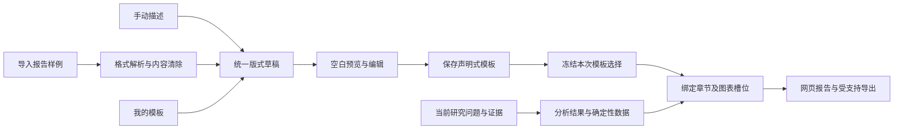

# 从现成报告提取版式

2026-10-26设计，2026-10-27开始按模块实现。ReportLayout、独立本人样例通道、HTML／DOCX格式提取、前端空白预览／编辑及个人模板保存和应用已实现；研究数据绑定、报告呈现与解析SSE尚未完成，下面相应部分仍为设计目标。延续既有图像驱动、可交互报告、自定义模板与可选绘图Skill，不新增自主Agent或服务。

## 目标与入口

“报告样式 → 自定义”提供从空白开始、导入样例、我的模板三个入口，最终进入同一个编辑器。手填可以描述结构与风格，导入可以以现有HTML或文档作为样例；保存的是去内容后的版式，可修改、重复使用，研究问题与研究资料始终由当前任务决定。

导入样例的路径为：选择文件 → 读取结构／样式 → 去除原内容 → 空白预览 → 调整 → 保存或本次使用。预览默认展示通用槽位和空白图形；如已有当前研究结果，可显式切换为当前任务数据预览。不会用样例数字填充“效果图”。短文案与原工作区风格一致，不在报告正文展示审核、产物版本或额度。

## “只取格式”的具体范围

| 提取 | 清除 |
| --- | --- |
| 章节层级、顺序、版面分栏、区块类型 | 具体章节标题中的公司、人名、时间与结论 |
| 字体角色、字号比例、颜色、间距、边框 | 正文、表格单元格、图中数值及数据标签 |
| 标题／摘要／对照／时间线／关系图等通用槽位 | 原建议、观点、排名、因果关系、评价和引用 |
| 图片位置、比例、图注位置、图文密度 | 原图片、Logo、水印、图片中的文字与事实 |
| 标准目录、标签页、筛选、展开、提示等交互需求 | 原JS、表单提交、网络请求、文件访问与执行指令 |

例如“腾讯2020—2026网络研究布局”成为标题槽位；带21篇论文的统计卡成为指标卡；原合作高校关系图成为关系图槽位。原公司、年份、21和合作边均不进入模板。新任务若是生物实验室，标题、时间、指标与关系只能取当前任务的真实结果。

版式可以保留通用章节角色，如概览、比较、演进、建议；未知标题降为通用章节槽位，不把原题目改写成新的研究问题。字体大小、区块数量等几何信息允许保留；这些数值不能进入研究统计。样例长度只映射为紧凑／标准／详尽等密度，不成为强制凑字要求。

## 内容隔离需要程序控制

1. 样例采用独立的本人模板文件记录，不进入document_sources、证据集、搜索缓存或RAG。清楚标记用途为版式输入；若用户另行将同一文件加入研究资料，产生独立的资料记录与授权。
2. 本地解析器先读取DOM／文档结构与可计算样式，清除脚本、隐藏文本、批注、元数据、公式或链接载荷、CSS文本内容和外部资源URL。保留的只是允许的格式值、几何关系和通用组件。
3. 复杂图像解析可采用已授权的识别服务；原文只在这次隔离解析中可见，不进入Planner／搜索／分析／Report上下文。默认不自动向外部服务上传样例；未启用识别能力时明确该文件可解析的范围。
4. 解析结果只准输出类型化字段。源文自由文本、任意HTML／CSS／JS、工具指令、检索词、事实／数字／引用或任意数据查询表达式不能成为模板指令。被拒绝字段进入解析记录，不靠一句“忽略内容”的提示来清除。
5. 模板编译器只把合规版式编译为已有受控组件；研究阶段只得到模板引用与去内容结构。原文件名、模板显示名和原件位置只作管理元数据，不进入研究模型上下文。Report输入和证据引用构建器不接受template_source类对象。
6. 重新用另一主题测试同一版式：原对象与观点不能出现在问题、查询、证据、正文或图表；它们若恰好也是当前研究对象，只能追溯至当前输入或研究证据。

这是后续实现的验收目标，并非本轮已经证明原文影响被完全消除。自由文本分类或视觉模型仍需独立的内容残留检查；主链的数据隔离和字段限制由服务端执行。

## 统一版式数据契约

现有DeliveryRequest只有模板类型、主题、页面标题／问题／图型与绘图选择，不能承载任意排版。现有research_delivery_templates保存其不可变修订，应在此基础上扩展，避免再建一套不兼容的保存体系。

新增版本化ReportLayout，至少包含：

| 字段组 | 内容 |
| --- | --- |
| 身份与来源 | schema版本、本人模板ID／修订、输入格式、解析器版本、原文件受控引用；原样例不作为研究证据 |
| 设计值 | 字体角色、有限字号／间距、色板、列宽、画幅、背景样式；禁止任意CSS及URL |
| 结构 | 有限深度的章节与组件树，标题、正文、图、表、注释及参考资料槽位 |
| 数据需求 | 槽位对应的输出类型、单位／维度要求及所需事实关系；绑定许可字段，禁止任意代码／SQL／表达式 |
| 交互与响应式 | 组件允许的排序、筛选、展开、提示、目录与标签页，手机／打印布局 |
| 适配与缺失 | 对象类型／学科的通用映射、必要／可省略模块、缺失数据处理及优先顺序 |

当前最多24个逻辑页面、12张绘图的上限需要保持，扩展组件树要另设总块数、深度、输入资源与渲染时间上限；不能把嵌套组件当作绕过原预算的方式。物理打印分页与逻辑章节分开。

手动描述、直接编辑和文件导入都生成同一草稿。手写描述也不能直接成为原始HTML或无限制模型指令。DeliveryRequest扩展为引用已保存的布局修订，或提交经同一校验的临时布局；旧模板继续按原契约呈现。

当前界面提供“从空白设计”和文件导入，均进入相同的结构化版式草稿。旧手动章节可按章节类型和明确选择的图形生成版式，原手填章节保留在草稿中，供切换回旧模式；章节标题和问题不写入去内容的版式。散点图、热力图在版式中暂以自动图形占位。加载本人模板也使用相同编辑器，名称与样例引用只用于管理。取消选项窗口舍弃未应用的本次研究选择，已保存的模板保留；上传中可取消，迟到结果不会覆盖草稿。

## 数据绑定、学科与方法优先级

优先级为：事实／证据与数据语义约束 → 用户本次显式选择 → 模板布局 → 所选Skill方法 → 自动建议。布局决定呈现位置，不决定哪些观点必须成立。绘图Skill可改变图型与展示建议，不能提供数据或突破受信渲染器。

对象映射采用企业／高校／科研机构等实体角色，领域术语来自本次学科配置。企业的产品转化区块可以由用户改为高校的科研成果与合作资源；不能只把“腾讯”替换成“北大”而保留原业务结论。计算机CCF或其他学科的评价权重继续沿研究配置，不由样例写死。

图形槽位声明数据形状：时间线需要时间与事件，关系图需要有来源的节点和边，数值图需要单位、维度与可比较口径。不能从图片推断原数值再复用，不能用一张无依据的网络图凑版式。缺数据时预览定位模块，并让用户选择省略、转为文字／表格或补充当前研究；自动补采仍受当前问题、来源许可与根预算限制。

14项报告结构Skill与布局模板分别承担写作方法和视觉结构。用户选定版式后，不允许多个方法各自强制加入自己的整套章节；实际采用的内容留研究记录。

## 格式与交互支持分期

| 输入 | 规划顺序 | 可提取范围及边界 |
| --- | --- | --- |
| HTML | 首期优先，适配用户已提供的图文样例 | DOM结构、局部样式、表格及组件位置；重建允许的交互，原脚本不执行 |
| DOCX | 首期结构化文档适配 | 标题样式、段落、表格、分节及页眉／页脚角色；浮动和复杂分页另记差异 |
| PPTX | 后续 | 页面比例、占位、分组及图文布局；不等于同时实现原生PPTX导出 |
| 带文字层PDF | 后续 | 基于坐标重建版面，阅读顺序和图表类型有歧义时允许手动修正 |
| 扫描PDF／图片 | 最后 | 依赖图像识别，先解决阅读顺序、内容去除与成本；不与结构化格式承诺相同还原度 |

解析接口按输入格式返回实际支持范围与差异，不能只凭扩展名显示成功。输出沿已有网页／Markdown／JSON和打印PDF，PPTX输出要有自己的实际适配器。网页可交互，打印版需要表格／注释等静态对应物；不能把动画或悬停内容直接丢失。

完整报告不复制源页面；由受控组件生成。保留原站风格、响应式和减少动态效果偏好；窄屏、打印、字号较大和长文本需要独立布局规则。设计交互效果在技术文档中演示，运行反馈通过现有SSE展示实际状态。

## 版本、隔离、成本与失败

模板保存／复制／修订复用本人owner、request_id与expected_version。编辑导入草稿不覆盖原模板；任务应用时冻结确切布局修订、绘图选择和数据绑定。以后改模板不改变旧报告，禁用方法不能通过旧模板重新启用。系统预设和个人模板分开展示，管理员发布预设需要明确动作，个人上传不自动共享。

解析优先本地确定性处理。需要模型时只处理必要结构，记录调用量；导入发生于研究前，采用独立有上限的本人解析操作，不能偷偷创建研究根或预支新任务额度。保存后的模板反复使用无需重读样例或重复调用模型。

解析为可取消操作，SSE投递读取、清理、预览与失败阶段。格式损坏／加密不重复同参数尝试；可恢复网络或服务限流沿分类退避；模型结构无效只对拒绝字段作有限修正。每类次数与总时间／费用同时限制；取消后迟到结果不能覆盖用户新草稿。同一操作重试只保存一个模板效果。

## 已有、需改造与需新增

| 能力 | 当前依据 | 下一步 |
| --- | --- | --- |
| 自定义页面与研究重点 | DeliveryRequest／ResearchChoiceFields／writing_plan | 改造为共用布局草稿；问题内容与版式字段分离 |
| 模板保存／复制／不可变修订 | research_delivery_templates与原owner接口 | 扩展版本化布局和来源引用，保持旧版兼容 |
| 文档解析 | 现有研究资料解析能力 | 复用文件读取方法，新增隔离的版式解析结果，不能把全文当模板 |
| 图像／绘图Skill与输出 | 原render阶段及受信Matplotlib／网页组件 | 增加槽位数据匹配与逐图映射，保留数据绑定和授权 |
| 报告保存与旧稿 | research_report_versions | 保存冻结布局，历史回放不重新解析源文件 |
| 上传、取消、SSE和预算 | 原工作区及研究运行契约 | 复用语义，补独立解析操作，不将上传计为付费研究 |
| 去内容与残留判定 | 当前没有报告样例专用实现 | 新增字段许可、内容隔离、跨主题案例及可修正差异 |
| 组件树编辑／空白预览／格式兼容表 | 当前页面编辑能力较简单 | 新增共用编辑器与受控布局渲染，逐输入／输出格式交付 |

## 建议深化顺序与本轮范围

当前进度：OpenSpec19.2—19.3、RUN.17.1—17.3已交付解析接口与编辑界面，详见[样例解析记录](acceptance/layout-import-20261027.md)和[版式编辑记录](acceptance/layout-editor-20261027.md)。新布局还未接入报告适配器，查询预览明确阻止其启动研究，避免忽略布局；旧手填章节沿原契约使用。下一模块为19.4，随后实现19.5—19.6。20.1—20.4已拆为独立后续任务。

先固定版式Schema与隔离契约，再做HTML样例的完整导入、空白预览、编辑、保存、应用闭环；随后做当前研究数据与图表绑定，最后扩展复杂文档格式与交互。不要先堆上传格式却无法生成可用模板。

此外，默认Skill的升级／回退及个人副本差异、明确选择与自动匹配的冲突解释、报告中关键判断的证据覆盖、预算在取证／核对／写作之间的实际分配，仍值得分别深入。前两项与本次模板闭环相邻；后两项沿原TODO继续规划，暂停中的完整研究与后端优化本轮不恢复。

## 设计依据与验收

依据A2ABreak基线v1.0：A2AB-01《技能声明验证与委派准入》工程解决方案1、3、4，用于受控模板组件／方法及结果准入；A2AB-03《上下文归属与跨租户隔离》工程解决方案1—3，用于样例、模板、缓存与任务的owner范围；A2AB-08《结构化授权请求与权限不放大》工程解决方案1—4，用于格式字段许可与工具权限交集。原文分别为Basic Memory main `main/engineering/security/a2abreak/solutions/a2-ab-01-技能声明验证与委派准入`、`.../a2-ab-03-上下文归属与跨租户隔离`、`.../a2-ab-08-结构化授权请求与权限不放大`。

默认方法分发已有当前行为用例；版式编辑的HTML浏览器路径已有记录，跨主题研究数据绑定和报告输出尚待实现与验证。06的版本与幂等、10的预算、11的取消／迟到处理沿现有项目评估，实施解析作业时重新检查；02／07／09没有新增Card、Webhook和多跳凭据，04沿原SSE出口，05沿原报告产物绑定。本地方案为来源核对的工程建议，不表示全部安全能力通过。

后续最小目标包含：同一企业样例用于另一企业／高校／学科；清理隐藏内容和原图；脚本不执行且无样例网络请求；结构异常可修正；缺图数据不伪造；用户取消与重试只保存一次；不同owner不能取用；网页和打印使用同一事实／引用映射。每项只验证相应新增行为，不自动执行既有回归或探针。
