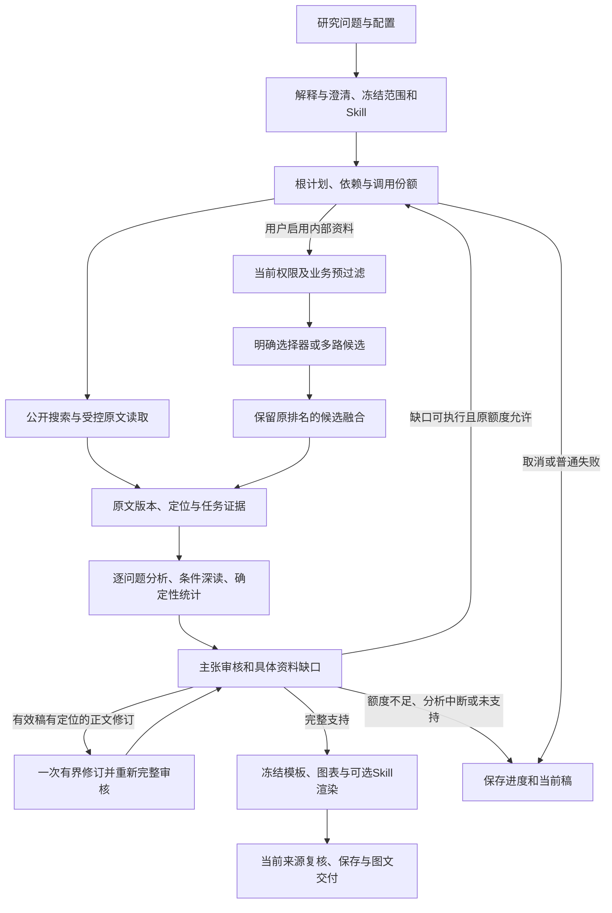

# 代表性研究计划与工具入口

2026-10-23。对应TODO X.2／X.3／X.6，本文描述当前源码的执行契约与调用示例，尚未运行这些案例。执行事实以最后统一端到端记录为准。根流程、Agent／工具／Skill职责见[流程设计](RESEARCH_WORKFLOW_DESIGN.md)，各模块的采用／候选与交付状态见[实施账本](IMPLEMENTATION_LEDGER.md)。

## 同一条根流程



图中的循环是根的有限决策，不是搜索、浏览、RAG分别开启自主研究。报告的常规读者视图仅显示研究内容、图表和引用；计划、审核、错误、用量与版本在工作区或独立记录中查看。

## 创建方式

以下JSON都是`ResearchRequest`配置示例。客户端先将同一配置交给`POST /api/v1/research/understanding`，展示澄清与生效配置，再将返回的当前`interpretation_id`作为`query_preview_id`连同原请求交给`POST /api/v1/research`。修改配置需重新预览，不能复用旧预览身份。API凭据由当前登录会话提供，不写入请求示例。

创建返回`session_id`与执行身份；本人可读取`GET /api/v1/research/{session_id}`、`GET /api/v1/research/status/{session_id}`及`GET /api/v1/research/stream/{session_id}`。事件断档时重新读取已保存结果，事件不作为永久事实库。下面的来源group和资料ID需来自用户自己的实际资料，示例不授予读取权。

### 1. 仅联网的研究

```json
{
  "query": "调研北京大学公开发表的RDMA拥塞控制研究，比较2020至2025年的技术路线、实验条件和关键限制",
  "channels": ["web"],
  "use_internal_docs": false,
  "output_length": "long",
  "query_options": {
    "query_type": "exploration",
    "time_mode": "historical",
    "start_date": "2020-01-01",
    "end_date": "2025-12-31",
    "depth": "deep"
  },
  "planning_policy": {"strategy": "hybrid", "max_parallel": 2, "max_replans": 1}
}
```

根计划先发现论文与官方团队资料，再读取允许来源的出版页／全文。只有已知可独立研究的问题才并行，受同一根额度约束。模型综合按问题和代表成果深读；年度、论文家族、合作成员及图表分母由已有统计代码产生。预计得到技术路线和条件对照，而非仅有论文数量；全文未取得保留覆盖缺口，不能把搜索摘要写成已读全文。机构类型、候选实体、学科体系及合作目的需要细化时，复用组织研究配置与[组织实现计划](RESEARCH_DEVELOPMENT_PLAN.md)，不能从一条自然语言问题捏造已确认成员或合作资格。

### 2. 联网并补充本人内部资料

```json
{
  "query": "比较公开RDMA拥塞控制方案与本人已上传的实验条件，分析适配差异",
  "channels": ["web"],
  "use_internal_docs": true,
  "rag_group": "本人实验资料",
  "query_options": {
    "query_type": "comparison",
    "data_policy": {
      "input_class": "internal",
      "max_model_class": "internal",
      "public_search_queries": ["RDMA congestion control evaluation workload baseline"]
    }
  },
  "planning_policy": {"max_parallel": 2, "max_replans": 1}
}
```

公开取证与授权内部查询均保留，内部命中不关闭联网。内部内容、内部检索词和配置不能自动发往公开搜索；此示例显式提供可出站的公开查询。模型路由还需满足当前资料等级和已配置服务能力；没有合格模型时暂停或拒绝，不能因模型主备而绕过披露策略。来源group只是额外条件，实际owner、生命周期、来源版本与资料权限由服务端添加。

### 3. 过滤后精确取证

```json
{
  "query": "phrase:实验基线",
  "channels": ["web"],
  "use_internal_docs": true,
  "rag_group": "本人实验资料",
  "query_options": {
    "query_type": "fact",
    "internal_filter": {
      "any_of": [{"all_of": [{"field": "source_name", "op": "eq", "value": "已上传的实验记录"}]}]
    },
    "candidate_fusion": {"per_route_top_k": 10, "global_top_k": 5}
  },
  "planning_policy": {"strategy": "fixed", "max_parallel": 1, "autonomy": "single_pass"}
}
```

该示例演示内部明确短语选择器；联网步骤仍按当前计划执行。也可用`source:<本人来源UUID>`或`chunk:<本人片段UUID>`替换内部查询。业务OR组始终与当前权限条件相交，不能将owner写进用户filter。精确命中保持原文定位，无命中与调用错误分别返回；内部未启用时不偷偷查询。需要取结构化资料记录时可显式使用`internal_retrieval_mode: structured`，其确定次序不代表相关性排名。

### 4. 多路召回与融合

```json
{
  "query": "比较公开论文与本人资料中的拥塞控制方法、负载和结果边界",
  "channels": ["web"],
  "use_internal_docs": true,
  "rag_group": "本人实验资料",
  "query_options": {
    "internal_retrieval_mode": "hybrid",
    "max_query_variants": 2,
    "term_aliases": {"拥塞控制": ["congestion control"]},
    "candidate_fusion": {"method": "rrf", "per_route_top_k": 20, "global_top_k": 10}
  },
  "planning_policy": {"max_parallel": 2, "max_replans": 1}
}
```

候选可来自FTS、BM25、明确选择器、同源结构扩展，以及已配置且编码profile相容的稠密路径。内部与外部保持各自原始通道记录，融合只组织候选；缺失稠密配置不捏造向量命中。近重复与来源家族保留来源差异，相关性高不等于独立支持。若实际资料含内部内容，此例须补用上一例的资料策略及安全公开查询，服务端不以该简略例子放宽出站权限。

### 5. 证据不足后的有限补证

```json
{
  "query": "分析某项公开网络研究的实验负载、对照基线和适用边界，重点解释结果差异",
  "channels": ["web"],
  "query_options": {"depth": "deep", "query_type": "comparison"},
  "planning_policy": {"strategy": "hybrid", "autonomy": "bounded", "max_replans": 1, "no_gain_rounds": 1},
  "max_revision": 2,
  "output_length": "long"
}
```

实际使用时把“某项”换成具体成果，歧义先澄清。审核必须指出缺失条件或反证等可执行问题，才能在原预算内补证；不能因报告短、模型自报置信不足或工具失败就反复搜索。根轮次取请求与策略较小上限，无增益停止；图中文字修订不反向创建新的取证根。一次定位修订后仍需完整审核。原额度／期限耗尽保存当前稿；可恢复分析只使用已有分析恢复API和原预算，普通失败通过复制配置创建新任务，不能伪称原根恢复。

## 实际工具ACI索引与调用示例

下列工具由可信根构造包络，用户与模型不能填写owner、execution或新预算。调用例描述实际工具输入，省略的根包络由[交接ACI](tool-handoff.md)生成，不能将示例当无鉴权HTTP接口。

| 工具／组件 | 用途与输入例 | 输出与失败后的动作 | 完整契约 |
| --- | --- | --- | --- |
| SearchAgent／搜索节点 | `query="RDMA congestion control"`；来源限定和已选channels从冻结请求读取，允许的变体在原份额中执行。 | 来源URL、标题、发现片段及真实渠道尝试；片段只是发现线索。空结果不等于错误；超时／429按类别与原额度重试，禁止自动增加渠道权限。 | [查询路由](query-routing.md)、[渠道](research-channels.md)、[外网取证](external-evidence.md) |
| BrowserAgent／公开原文网关 | `query="https://www.pku.edu.cn/"`；读取已发现真实URL，按source／rendered策略。 | 原文、取得时间、HTTP声明、覆盖和后端；逐跳域名、出站和资源份额，最多既有有界渲染补充。解析或权限失败保留类别；不自动登录、跨来源或使用凭据转发代理。 | [外网取证](external-evidence.md)、[资料披露](data-governance.md) |
| RAGAgent／内部检索 | `query="phrase:实验基线", group="本人实验资料", context_mode="parent"`；根绑定owner及filter。 | 合法块、原匹配和扩展定位、通道排名、覆盖与当前版本；撤销即不返回。多路全失败不能成为成功空结果；不足不扩展至他人资料。 | [过滤](metadata-filtering.md)、[候选](retrieval-candidates.md)、[上下文](evidence-context-selection.md) |
| scoped_knowledge_base_search | `{ "query":"实验基线", "top_k":5, "group":"本人实验资料", "context_mode":"matched" }`；只由`get_retrieval_tools`绑定实际owner／session。 | JSON块列表，top_k为1—10；显示实际截断，缺owner拒绝。兼容工具入口不替代主流程当前filter／包络，按调用入口区分证明。 | [内部检索说明](internal-document-retrieval-verification.md)、[源码](../app/tools/retrieval_tools.py) |
| MCP节点／McpPolicyProxy | 当前根节点query形如`registered_server:registered_tool`，真实适配器收到`requested_args={query: 原节点query}`。仅匹配该输入schema的已注册工具适用。 | 受信结果、错误或绑定具体动作的awaiting_approval。信任／指纹／schema／数据级别／工具许可必须同时通过；不兼容schema不强行调用，写入沿原明确审批。任意MCP工具参数通用编辑尚无该根适配。 | [治理边界](data-governance.md)、[源码](../app/governance/mcp.py)、[交接](tool-handoff.md) |
| 原文／定位读取 | `GET /api/v1/research/{session_id}/evidence/{evidence_id}`，片段入口在`.../chunks`。 | 本人保留文字、版本、偏移／页码及局部内容；读取不启动新模型。版本不存在或权限变化显式拒绝，不改旧报告。 | [证据接入](task-evidence-ingestion.md)、[版本分块](versioned-evidence-chunks.md) |
| 组织只读分析／匹配 | 读取当前会话relationships／technical-reading／trends／actions／statistics；匹配preview绑定本人不可变证据快照及权重。 | 有原文支持的关系／机制／情景／行动、统计成员／分母、权重贡献／缺失区间；统计代码不补缺失事实，改权重不重新采集。 | [关系](organization-relationships.md)、[深读](organization-technical-reading.md)、[演进](organization-trends.md)、[行动](organization-actions.md)、[统计](organization-statistics.md)、[匹配](research-matching-preview.md) |
| 注册Skill编译 | 显式技能ID＋当前stage／学科／模板；读取注册版本与必要内联reference。 | 生效版本、原因、受限工具及指令；缺参考、必要上下文超限或工具冲突需处理，不加载网页声明的技能、不执行任意技能脚本。 | [阶段编译](bounded-research-planning.md)、[绘图](research-figure-skills.md) |
| 绘图计划／固定renderer | 受信数据图如`chart_id="existing_chart", kind="matrix", width=9, height=5.5, dpi=180, palette="colorblind"`；ID／图型必须属于当前数据和模板允许范围。 | 绑定SVG／PNG／图表PDF、数据、配方、Skill和renderer版本；模型不得编造数值或运行代码。失败保存稿并暂停正常交付，有效同任务图表可复用。 | [绘图ACI](research-figure-skills.md)、[用量及复用](runtime-accounting-cache.md) |
| 索引／资料维护 | 管理界面读取本人source head／revision，再显式rebuild／activate／disable或生命周期动作，稳定request_id同参数重试。 | 同事务新代发布、完整同版本代激活或direct回退；预期版本冲突重新读取，未知结果重放原request_id，不能盲目生成新操作。 | [索引](versioned-retrieval-indexes.md)、[生命周期](evidence-lifecycle.md) |
| 取消／恢复／反馈 | 当前execution＋稳定请求UUID取消；仅符合条件的分析暂停使用`.../analysis/resume`；质量反馈绑定当前证据与候选。 | 取消保留实际／未知用量；迟到结果不能改变当前研究。恢复不重置额度；反馈记录本身不训练、不回写事实。 | [取消](research-cancellation.md)、[问题分析](question-analysis-workflow.md)、[反馈](research-quality-feedback.md) |

## 当前采纳与扩展边界

日常模型和Cortensor沿已有冻结模型路由选择，服务故障fallback与内容能力升级各有触发、名额及实际计量；配置存在不等于当前端点可用。SDK／OpenMinion沿[独立ACI](openminion-research.md)描述其工具、产物和有限自主循环，单次运行仍只有自己的根额度；SDK成功不证明主应用路径成功。

沿用[流程安全方案](RESEARCH_WORKFLOW_DESIGN.md#9-安全方案与验证状态)的A2ABreak **v1.0**全11项判断及各专门ACI的工程章节／控制点。本文组织已有契约，没有新增Agent、出站协议或凭据传递。涉及身份、撤权、并发、产物及预算的03／04／05／06／08／10／11仍需在最后统一端到端取得证据；01沿受信注册，02／07／09沿原不新增Card／Webhook／跨组织换证判断。示例与文档审阅不构成运行或安全通过。
