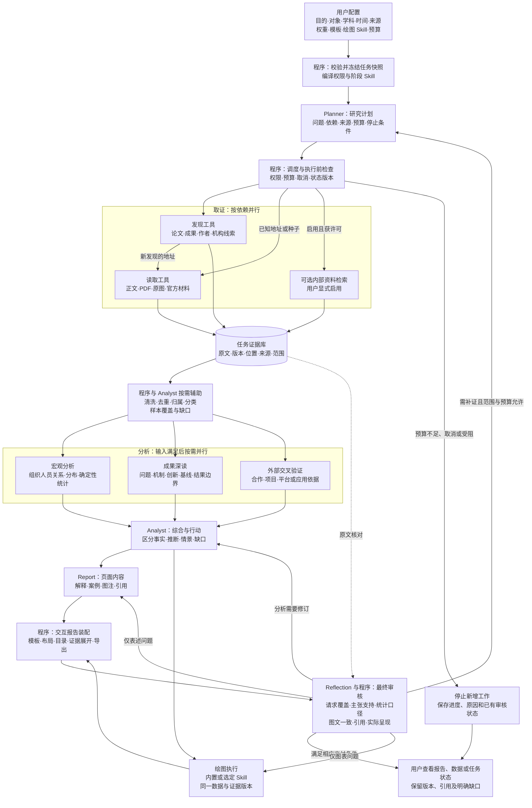
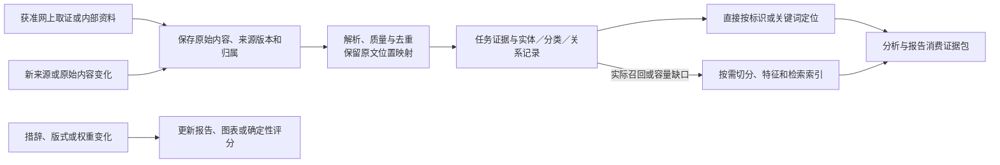

# 完整调研流程与 Agent、工具、Skill 分工

S8—S9的[文本历史与图文模板](report-history-templates.md)源码接入原根持久化／结果API及工作区：报告、草稿、响应分别保留，模板独立于评价权重，按实际问题选择回答结构。DDL与功能未运行；继续OPT-16及剩余模块后统一端到端。

S5—S8继续以原Analyst／Report内的[问题证据选段](evidence-context-selection.md)保存实际原文、原始引用编号／保留版本和预算遗漏；选段相关性不等于支持度，阶段诊断留工作区、写作输入只保留证据所需字段。源码完成未运行，后续继续OPT-15及剩余实现，最后统一端到端。

2026-10-23源码增量：[外网取证与会话复用](external-evidence.md)、[候选融合及来源协调](candidate-fusion.md)接入原Search／Browser／RAG工具与冻结交接。候选相关性、数据重复和事实支持分别记录；根审核完整结束才释放该阶段预留给绘图，原额度／期限不变。当前仅源码完成，接续OPT-14及剩余任务，全部实施后统一端到端。

2026-10-23源码继续：S2–S3使用[冻结查询变体和渠道份额](query-routing.md)，S5内部资料使用[类型化业务过滤与当前范围](metadata-filtering.md)，S6–S8可在原根累计名额内按实际失败进行[能力升级](model-routing.md)，S8绘图可保存[单图Skill覆盖](research-figure-skills.md)。均未运行验证，后续继续OPT-11及剩余模块；角色与唯一根状态／预算所有者不增加。

2026-10-22优先级调整：先交付一条完整研究流程，性能和候选算法后置，逐模块基本路径见[完整流程基线](COMPLETE_RESEARCH_FLOW.md)。当前根图已接具体缺口/材料版本驱动的有限补证与停止原因；S8新增普通确定性交付组装器及React图文阅读，不新增Agent、模型循环或数据库。阶段Skill、权限及预算仍由已有根执行边界管理。模板、图表和导出契约见[交付ACI](research-delivery.md)；源码接入尚需统一真实E2E，原08结构化结果接纳等未完成边界继续保留。下列日期段为历史实施记录。

2026-10-22：S0–S1的OPT-07 [查询解释与快照](query-understanding.md)代码已接入未运行；普通规则/字典模块做明确槽位与必要澄清，Planner继续语义分解，不新增Agent/模型轮。显式本人历史仅传身份，不继承证据/权限；创建复算后将同一问题、时间、目的、交付与真实配置身份传到规划/综合/审核/报告和恢复。模板完整渲染仍接续S8/OPT-15，下一OPT-08，统一E2E时序不变。

2026-10-22，S4–S5及S6–S8前的 OPT-06 [生命周期](evidence-lifecycle.md)代码已接入、未迁移／验证：普通函数和同一数据库保存来源版本族、任务／明确复用范围、生效期与变化事件，原子发布或显式清理。RAG各通道、N／DF、父级／开头与新综合复核当前权限和版本，失效片段显示缺口；S8回访旧报告仍读原任务证据。没有新增Agent或后台同步器，下一OPT-07，全部实现后才统一端到端。

2026-10-21 最新实现状态：7.4–7.8 代码已顺序接入，新增[行动数据契约](organization-actions.md)与[统计数据契约](organization-statistics.md)，待全部 TODO 实现后的统一端到端验收。S7 复用现有硬条件／分层权重输出条件行动卡；S8 前由普通函数冻结统计，Report 引用指标 ID，现有图表／表格／导出使用同一数据版本。同证据重分类附独立统计，不改变原报告。没有新增 Agent 或模型循环，含验收的任务仍为29/34历史基线；后续继续OPT-01–18，不能提前视为全流程交付。

S3–S4 的 OPT-01 [接入账本与批次](task-evidence-ingestion.md)已在代码接入、未验证：现有工具结果按任务版本化，在原execution事务中保存；显式文件／目录选择逐项提交，公开证据不自动向量化。错误／恢复与样本流转可在同会话查看，权限和预算继续由可信组件执行。

S4 的 OPT-02 [结构与质量](structured-document-parsing.md)已在代码接入、未验证：普通解析函数和有限子进程交付正文块、表格／图像及原位置；本机OCR需显式选择且服务端允许，未调用视觉模型。来源保存完整解析，片段只带引用；人工结构审核与事实核实分别记录。下一步OPT-03稳定分块和元数据，不先行运行验证。

S4–S5 的 OPT-03 [版本块与稳定定位](versioned-evidence-chunks.md)已在代码接入、未验证：结构／固定／滑动／递归切块产生父子原范围，上传保存实际策略和可选词面元数据；RAG按当前权限／分组／状态／版本有限扩展，证据账本保存当次返回文字。S6主张摘录、S7报告引用与S8原文消费沿同一任务证据定位；重切和新解析不覆盖旧依据。仅小块进入现有索引，父级不重复嵌入。下一OPT-04，仍按全部实现后统一验收。

S4–S5 的 OPT-04 [特征视图与成本](versioned-retrieval-features.md)已在代码接入、未验证：普通函数构造词项及源内统计，稠密选择不自动扩大工具或出站许可；编码／查询模型身份、输入覆盖、时间声明与模态缺口可见。词汇路径独立于嵌入／重排，后两者默认关闭；检索节点保存实际通道状态，主张证据保留表示依据。来源详情读取不触发模型，下一OPT-05索引构建。

S4–S5 的 OPT-05 [索引发布与范围](versioned-retrieval-indexes.md)代码已接入、未迁移／验证：直接定位来源仅保存，词汇来源同事务发布Posting代际；当前owner／group／active／head与表示版本共同约束查询。范围BM25、FTS和可选精确向量按独立通道融合，结果携带代际和统计依据。本人索引操作由可信事务与revision／幂等控制，旧任务仍读账本原文。下一OPT-06，不先行运行。

更新日期：2026-10-21。本文描述目标流程，并逐项标明已有基础、需要改造及需要新增的能力；最新交付至 OpenSpec 7.3（29/34），含组织研究主链、范围／家族、评价适配、权重、owner 快照、重排、学科分类版本及报告口径／三种导出；完整流程仍按任务推进。

依据：[核心思想](DESIGN_PRINCIPLES.md)、[优化 TODO](OPTIMIZATION_TODO.md)、[组织研究计划](RESEARCH_DEVELOPMENT_PLAN.md)及其 [OpenSpec 设计](../openspec/changes/add-organization-research-matching/design.md)。当前代码分层见 [架构层级说明](ARCHITECTURE_HIERARCHY.md)。

## 1. 研究目标与状态口径

高校、科研实验室、企业可独立或组合研究，学科、主题、时间和来源由用户配置。研究目的可选布局与演进、合作资源发现、综合研究；目的、评价权重、报告模板及绘图方案分别保存。

采用统一编排、按需取证、并行分析、独立终审。Planner、Analyst、Reflection、Report 是四类逻辑角色，可由同一模型服务在不同上下文中承担；调度、授权、状态、预算、统计、存储和渲染由程序执行。18 个 OPT 模块是能力目录，每次研究只启用需要的步骤。

本文状态解释：

- **已有**：本轮已阅读对应代码，或有明确专项交付记录；不表示所有部署、输入或目标流程均已验证。
- **需改造**：复用已有实现，补足目标契约、执行方式或范围；不能因已有类名就视为目标已完成。
- **需新增**：尚未形成对应产品契约或运行能力，已有外部 Skill／样例不算 ADRS 已接入。
- **文档已完成**：仅指说明、流程图和状态梳理，不代表运行任务已完成。

## 2. 当前两条入口与目标流程的关系

主应用由 `app/api/research.py` 和 `app/graph/compiler.py` 编排：Planner → DAG 工具批次与聚合 → Analyst → Reflection → 重规划或 Report。Reflection 当前位于报告前；`app/agents/report.py` 另外调用 `app/claim_verification.py` 对最终 Markdown 进行来源支持审计。两者不能描述成已经具备“交互报告装配后的统一终审节点”。

OpenMinion 是可选的本地 CLI 路径，具有受限搜索／读取、PDF 正文保留、结构化综合与最终引用审计。一次完整真实任务的范围见 [交付记录](acceptance/openminion-delivery-20261018.md)；它不证明跨学科组织匹配、模板编辑器或绘图选择器已实现。SDK 当前通过进程级环境绑定和锁隔离，不直接作为共享多租户并行服务。

目标是在工具、证据、状态事件和预算契约上复用能力；每次运行明确由哪一个编排器拥有状态，避免 LangGraph 与 SDK 各自维护独立计划、预算及取消循环。

同步领域入口提供范围／归属／家族、评价适配及权重预览，不单独联网或触发模型；第4、5组已另行接入主应用研究、冻结配置、原文归属和界面。完整候选消歧、自动评价及 S0／S4／S5 的剩余分析目标继续实施，不能由预览接口推断已经完成。

3.2–3.5 交付[owner 证据快照与匹配预览](research-matching-preview.md)，第4、5组已将其接入原研究及界面重排：先硬筛选，再按共同口径和家族等权计算贡献／缺失区间；只读重排不采集。当前自动分项仍仅标题词面／有界时效，完整评价／特征、目的与行动继续实施。

## 3. 在线研究完整流程图

图中包括已有与规划能力，状态以第 8 节为准。所有分支按任务配置启用；汇合只等待当前启用且有依赖的分支，未启用分支记录跳过原因。箭头表示任务依赖，所有阶段调用和修订都由调度器经执行网关检查后执行；图中回到 Analyst、Report 或绘图的连线不表示绕过权限、预算或取消校验。

发现与读取存在依赖，不能将未知地址的全文下载排到检索之前。已有种子读取、其他独立检索、用户启用的内部检索可以并行。补证再次经过 Planner 与调度器，不允许工作节点绕过来源或预算。审核回路同样累计调用、时间和修订次数。

## 4. 各阶段分工与交付物

| 阶段／OPT | 决策或分析角色 | 执行工具／程序 | 按需 Skill 或约束 | 阶段产物 | 状态 |
| --- | --- | --- | --- | --- | --- |
| S0 任务配置；07、15 | Planner 辅助澄清，程序校验 | API、对象／来源／权重／模板界面 | 范围、学科、目的与模板契约 | 不可变任务配置 | 查询、渠道、内部资料、长度、通用 Skill、对象／学科／日期及分层权重已接入；目的／模块、严格来源范围及模板仍待实现 |
| S1 计划与路由；08、09、18 | Planner | DAG、依赖调度、预算、工具准入 | 研究规划、来源策略、阶段指令 | 可见计划、分析模块、停止条件 | 已有基础，需改造 |
| S2 成果发现；01、09、12 | 工具执行；Planner 按缺口调整 | 搜索、学术接口、官方目录 | `paper-search`、`literature-search-openalex`；计算机领域可选 `dblp-cli` | 候选、检索记录、排除与覆盖 | 公开检索已有；学术 Skill 产品接入及完整样本契约需新增 |
| S3 正文取证；02、12 | 工具执行；复杂抽取按需用 Analyst | HTTP／受控浏览、PDF 解析；OCR 与原图提取按需 | 文档读取和来源核对 | 原文、页码／偏移、来源版本 | 浏览已有；SDK PDF 已有；统一图表与多模态提取需改造／新增 |
| S4 证据整理；03、06、10 | 程序＋Analyst 辅助消歧／分类 | 标识关联、实体表、去重、分类与确定性计算 | 领域分类；身份线索可选 `orcid-api` | 成果家族、实体、分类、关系和覆盖数据 | 原文位置、发表署名、样本去重及有来源的实体／家族契约已接主链；版本化问题／方法／应用及同证据重分类已接入；完整消歧／语义分类及其他关系需新增 |
| S5 宏观分析；04、11、14 | Analyst | 分组统计、关系计算、原文定位 | 学科分析、关系语义；可用 `networkx` 处理关系数据 | 分布、合作频次／持续性、可比指标 | 已有对象样本计数、同口径组及汇总并集；已具发表级分类年度样本与规则变化说明；完整频次／持续性、演进及跨图文统计仍待实施 |
| S6 深读与验证；02、12、14 | Analyst 的独立子任务上下文 | 原文、图表／公式定位、获准外部读取 | `academic-paper-review` 的方法约束；趋势可借鉴 `research-gap` | 深读卡、实验条件、支持／反证与缺口 | 通用原文综合已有；结构化深读及趋势约束需改造／新增 |
| S7 综合及行动；14、15 | Analyst | 跨来源对照、确定性权重与缺失区间 | 路线综合、趋势情景、可选合作分析 | 事实、推断、情景、研究或合作行动 | 确定性匹配／区间已接本人证据及结果页重排；自动特征仅标题词面／有界时效，目的分派和行动模型需新增 |
| S8 写作与绘图；15、18 | Report；绘图执行按需调用模型 | 页面内容生成、图表渲染、原图裁剪 | 模板；内置绘图或用户选定绘图 Skill | 内容块、图像／交互组件、图注及数据配方 | Markdown、冻结口径和确定性表格已有；图像页面、资源打包与可选绘图适配需新增 |
| S9 装配与终审；14–17 | 渲染程序＋Reflection | HTML 装配、确定性核算、原文审计、实际呈现审阅 | 引用支持、统计和图表表达约束 | 可交付版本或具体修订清单 | 报告前 Reflection、最终 Markdown 审计已有；装配后统一终审需改造／新增 |
| S10 交付与修改；06、15、18 | 程序按修改类型调用对应角色 | 版本保存、导出、恢复与原文查看 | 原配置及相应阶段指令 | 报告、数据、审计与历史版本 | 会话／引用／SDK 产物、个人配置版本、Markdown／JSON／离线 HTML 导出已有；图文版本和差异更新需新增 |

Skill 是方法与约束包，工具才是实际操作接口。上述现成 Skill 在本机可见，不表示已注册到产品或部署服务可用；接口、依赖、来源范围及授权须经过现有注册／准入适配。用户只启用某些来源时，多源搜索 Skill 也只能执行获许可部分；不可用时说明原因。

领域分类、布局综合、合作行动和模板编排目前是待完善的阶段指令／数据契约，不虚构已经存在的专用 Skill。适配外部 Skill 时只取当前阶段需要的方法，不直接套用其自动委派、报告或全流程搜索。

### 四类逻辑 Agent 的边界

| 角色 | 负责判断 | 操作边界 |
| --- | --- | --- |
| Planner | 回答哪些问题、步骤依赖、补证与停止方案 | 不能扩大用户范围或自行授予工具权限；计划由程序校验后执行 |
| Analyst | 证据解释、机制、比较、冲突、推断和行动依据 | 使用获准证据；新读取需求交给受控工具调度，不自建无预算循环 |
| Reflection | 报告覆盖、原文支持、矛盾、缺口及修订类型 | 使用独立审核上下文；返回缺陷，由调度器决定后续动作 |
| Report | 页面文字、解释、案例、图注和引用组织 | 引用结构化分析和证据；新增事实回到分析／取证，不自行填补 |

当前代码还存在 SearchAgent、BrowserAgent、RAGAgent 类。目标分工不要求立即删类：先保留兼容接口，再分离查询构造、实际读取、内容分析和重试预算。已有模型调用不因改称“工具”而自动消失。

### 绘图选择

内置绘图、手选 Skill、用户启用的自动匹配三种路径分别保存。报告默认方案可被单图覆盖；手选方案失败不得静默替换。`scientific-data-visualization` 适合可复现科研数据图，`scipilot-figure-skill` 提供选图与数据图方法，`networkx` 适合真实关系网络；具体静态／交互／导出能力由已适配路径声明。

输入为图表问题、结构化数据、单位、时间、分组、缺失与样本量、证据和样式；输出为图像／交互组件、图注、数据与来源、配方／代码和版本。原论文图走提取与来源标注路径。绘图不是独立的强制 Agent；关系图也不要求先引入 GraphRAG。

## 5. 任务证据准备、保存与按需索引

任务内复用资料不单独构成引入 RAG 的理由。先保存原文和引用关系；已知来源按 ID／页码／位置读取，查找困难时再选全文、向量或关系检索。项目沿用与跨任务检索明确范围。

原文版本稳定保存，索引可以重建；历史报告不回灌为独立事实依据。新增资料触发必要的增量处理，纯排版不重抓资料，权重修改不自动取证。修改资料导致引用受影响时，标记对应报告版本和待重审项。

## 6. 通信、控制与并行

任务交接使用结构化对象：运行／任务／父任务／尝试标识、由可信组件绑定的原主体和执行者、配置及策略版本、输入证据引用、输出结构、预算和截止时间。返回事实、来源位置、推断、缺口、错误、实际用量和产物引用。传证据标识及必要片段，避免广播全部对话。

原始资料、主张和派生图表分别有稳定标识与版本。当前 `ResearchState`、`PlanNode`、`NodeOutcome`、`Evidence`、`Citation` 和工具轨迹可以复用，但尚不能据此宣称完整交接信封、原子版本提交、跨入口数据模型已经实现。新字段是项目契约，不冒称 A2A 标准字段。

同一小型应用中的普通组件即可承载这些职责。子调用不能因为自报身份、提示文本、角色或 Skill 选择而改变授权。

并行分三类：独立请求并行、检索通道并行、研究子任务并行。分析和绘图只有在其输入版本满足依赖后才调度，不能以全局共享可变对象“谁最后返回谁覆盖”。明确根任务并发配额、原子预算预留／结算、状态版本比较和重复结果幂等；迟到或取消后结果不得覆盖当前结果。

## 7. 补证、修订与完成条件

| 触发 | 后续路径 | 边界 |
| --- | --- | --- |
| 新证据缺口 | Reflection／Analyst 描述缺口 → Planner → 调度 → 取证 | 仅在现有范围、授权、剩余预算和修订次数允许时执行 |
| 解释或推断不受支持 | 回 Analyst 修订，再更新页面并审核 | 保留原文与缺口，不用措辞掩盖无依据事实 |
| 仅文字或版式变化 | Report／渲染后审核受影响产物 | 复用有效图表与证据，实际新增主张仍需核对 |
| 图表错误 | 回绘图／统计对应阶段 | 数据错先修数据和口径，风格变化只重绘必要部分 |
| 调整权重 | 固定证据上确定性重算，更新分项及相关图文 | 不改变已核关系和硬条件，不自动联网 |
| 来源不可用或预算不足 | 保留已覆盖结果、未知和原因 | 不满足完整交付时标为受限；依赖缺失则受阻，不强标完成 |
| 取消或过期 | 停止新调用、保存进度及已审核状态、回收资源 | 不把未审核草稿当成已审核最终报告 |

完整交付要求请求范围有明确覆盖、关键事实与引用可追溯、统计与图文口径一致、所用配置与版本可恢复。受限交付明确缺口及其影响；受阻、失败、取消分别记录。模型来源支持与人工复核状态分开，原文引语匹配不能保证语义事实必然正确。

## 8. 已有、需改造与需新增清单

以下为 2026-10-19 对现有代码及指定交付记录的审阅，不是本轮运行测试结果。

| 能力 | 已有基础／证据位置 | 需要改造或新增的部分 | TODO 对应 |
| --- | --- | --- | --- |
| 请求与用户控制 | `ResearchRequest`；`ResearchDashboard`、`OrganizationResearchPanel`、`OrganizationWeightsPanel` | 对象／学科／日期／分层权重与快照已接入；目的／模块／模板／绘图及严格来源范围继续新增；旧通用请求保留 | 07.9–10、ORG.1–4 |
| 范围与历史归属预览 | `research_scope.py`；范围 API；Analyst 的有来源成果抽取 | 正式请求、证据／报告和界面已集成；完整候选发现、消歧质量和独立语义核验仍待实施 | ORG.1、03.6、14.12 的基础部分 |
| 家族、评价与匹配预览 | 范围／评价／匹配模块、`db/matching.py`、`research_matching_bridge.py` | owner 快照、硬筛选、区间、主链保存及只读界面重排已有真实 PostgreSQL 业务证据；完整评价来源与自动特征仍有缺口 | ORG.1–3 的后端基础 |
| DAG、工具批次与恢复 | `app/graph/compiler.py`、`state.py`；`governance/runtime.py`、`harness.py` | 改造为分析分支与产物依赖、统一预算和细粒度修订；SDK／主应用契约对齐 | 08.9–11、18.12 |
| 搜索与浏览 | `app/agents/search.py` 查询扩展；`browser.py` 的渠道读取及页面分析；`channels/`、`tools/public_browser.py` | 分离规则优先路径与必要模型增强，明确每步费用／预算，避免重复决策 | 09.10–11、12 |
| 来源选择与 PDF | `research_sources.py`、`research_documents.py`、`openminion_research.py` 及 SDK 交付记录 | CLI 来源快照接入主应用；原图／表格／公式提取、多模态和版本契约按需新增 | 01–03、12.12–13 |
| 内部资料检索 | `app/agents/rag.py`、`app/rag/`，owner／分组过滤和可选入口 | 保留按需补充；任务证据统一定位、可选索引和项目复用边界需改造 | 05.13、06.8–9、11.14 |
| 证据与引用 | `Evidence`／`Citation`、原文位置、样本署名／日期及家族；SDK 原文 | 主链归属与原文位置已集成；跨入口版本一致、完整分类／其他关系与报告影响关联仍待实施 | 01.7、03.8–9、14.12–14 |
| 技能注册与选择 | `app/skills/models.py`、`registry.py`、`service.py`；`SkillManager.tsx` 和请求 Skill ID | 阶段加载、冲突与约束编译需改造；能力需求与权限限制分开，空限制语义明确 | 08.12、16.11 |
| 专业分析与评分 | 通用综合、样本归属／计数、固定证据匹配及缺失区间 | 新增学科分类、专题关系、深读、情景、完整评价及跨图文统计；现有通用提示不能充当这些能力已完成 | 14.14、15.19–20、17.12；OpenSpec 1–7 组 |
| 反思与引用审计 | `reflection.py` 报告前反思；`report.py`／`claim_verification.py` 最终 Markdown 审计；SDK 专项记录 | 新增装配后图文／口径／交互检查及按缺陷分流；覆盖未检查项和取消状态 | 14–17 |
| 报告界面 | Markdown／引用、冻结摘要、原生折叠及 Markdown／JSON／离线 HTML 下载 | 新增图像驱动页面数据模型、预设／自定义编辑、绘图、资源打包及图文版本 | 15.11–18 |
| 绘图 Skill | 本机 `scientific-data-visualization`、`scipilot-figure-skill`、`networkx` 可作候选 | 新增产品适配、可用性声明、报告默认／单图覆盖、配方保存、回退与可视审阅 | 09.12、15.16–17、18.14 |
| 模型与费用 | `app/llm_client.py` 的主服务／故障 fallback 和用量记录 | 新增按阶段能力路由、价格版本、未知费用状态及完整账本；现未知价格返回 0，不能按免费理解 | 09.10–11、18.11–12 |
| 可信执行与事件 | `governance/`、`security/`、`source_policy.py`、`sse_manager.py` 有权限、暂停、预算和事件基础 | 针对新增产物和并发路径补状态版本、租约、撤权传播与完整权限覆盖；不宣称已满足全部基线 | 16、18；第 9 节 |

已存在的搜索类会调用模型扩展查询；浏览的部分渠道为直接读取，页面路径仍可能调用 `PageAnalyzer`。技能工具列表目前按并集合并、提示段按字符串拼接，编译器对空列表也存在“未指定／拒绝全部”的语义区分需求。当前故障 fallback 不是阶段复杂度路由。上述差异均属于改造入口，本轮不修改这些行为。

## 9. 安全方案与验证状态

2026-10-20 实施增量：主应用范围请求／运行字段、对象选择面板、证据定位、结构化成果及报告回访已接入，OpenSpec 当前 22/34（4.1–4.4、5.1–5.3）。Planner／Analyst／Reflection／Report 共用配置；对象来源仍经过原工具和预算。Analyst 同一调用提出记录，普通函数定位原文、处理日期精度并计算对象、同口径组和去重统计，Report 消费并追加确定性表；见[成果 ACI](organization-findings.md)与[三方共同成果端到端记录](acceptance/organization-findings-20261020.md)。证据提及与成果计数分别保存，完整候选消歧和自动评价／匹配继续实施。[运行 ACI](organization-research-runtime.md)记录 A2AB-03、06、08 v1.0 控制点及验证范围。

沿用 [TODO 的安全评估](OPTIMIZATION_TODO.md#安全方案引用与规划状态)和本地 [A2ABreak 基线 v1.0](<C:/Users/wblxr/basic-memory/engineering/security/a2abreak/A2ABreak 多Agent安全基线与11项方案索引.md>)；下列引用均指对应方案的“工程解决方案／验收办法”章节。已有有效评估继续复用，这些方案是来源核对后的工程建议，尚不能当作全部部署控制已经验证。

| v1.0 方案 | 执行组件、控制点与后续验收关注 |
| --- | --- |
| A2AB-01 技能声明验证与委派准入 | 技能注册／阶段分派：版本、来源和能力准入；自声明不能取得授权。阶段与绘图适配待实现验证。 |
| A2AB-02 Agent Card可信密钥与身份绑定 | 本流程不新增外部 Agent Card；第三方 A2A 接入时重新评估。 |
| A2AB-03 上下文归属与跨租户隔离 | 证据／缓存／产物存储和读取：校验主体、任务及项目归属；已有 owner 过滤，新增图文与关系路径待验证。 |
| A2AB-04 长连接撤权与事件出口鉴权 | SSE 与产物输出：权限复核和撤权后停止；已有 SSE 代码／专项说明，新增流式产物仍需验证。 |
| A2AB-05 产物分块校验与断流恢复 | 当前通过共享产物引用交接，不引入跨 Agent 分块传输；后续增加该协议时重新评估。流式草稿仍受 04 约束。 |
| A2AB-06 并发状态版本与审批绑定 | 状态提交／已有审批：版本、幂等及具体动作绑定；重复／迟到结果不重复生效，目标并发契约待实现验证。 |
| A2AB-07 Webhook归属验证与受控出站 | 搜索／浏览网关：逐跳来源、出站及重试边界；现有受控读取可复用。未新增 Webhook，未来回调另评端点归属。 |
| A2AB-08 结构化授权请求与权限不放大 | 网关：主体、任务、角色和资源权限交集；新增 Skill 和绘图路径不能扩大权限，待适配验证。 |
| A2AB-09 多跳主体溯源与凭据防转用 | 调度／凭据服务：保留原主体与执行者，凭据不进入模型；未引入远程凭据委派，完整 STS／持钥证明机制不在当前拓扑中。 |
| A2AB-10 委派环路检测与全链预算 | 根调度器：累计补证、修订、绘图、重试与模型调用；已有预算基础，完整费用与并发预留待实现验证。 |
| A2AB-11 中断任务租约与有界资源回收 | 调度／恢复／工具运行：期限、取消、过期提交拒绝与资源回收；已有部分超时／恢复基础，完整目标待验证。 |

## 10. 规划归属与本次交付

组织范围、评价、权重与分析深度由 `add-organization-research-matching` 的 34 项任务维护，目前已交付至 5.4（23/34），余 11 项待实现；模板、绘图及其他候选按 TODO 继续形成相应实施契约。已完成的 OpenMinion 7 项交付不因本文而重新计作未完成，也不能抵消组织规划的未实施部分。

本次完成流程、分工、现状对照及文档入口同步；只进行代码／内容一致性审阅和相关 OpenSpec 规范校验，不运行代码测试、回归、smoke、导入／启动／存在性／hash 或文字断言探针。后续实现以真正的消费结果、状态和边界验证目标契约；当前文档不能替代运行、语义或安全证据。

2026-10-20 后续增量：4.2 已冻结评价目录和版本化预设，并通过改变默认值、重启 API 后的真实暂停恢复；4.3 已提供 owner 个人预设及不可变版本；4.4 已接入有来源的样本归属、比较、汇总和建议；5.1 已验证独立高校／实验室选择、输入拒绝及渠道配置独立。当前 22/34；5.3 已接入[固定证据重排及独立新研究](research-reranking.md)，有[真实 PostgreSQL／双 owner／优先关系反转](acceptance/organization-rerank-20261021.md)证据。5.2 已接入评价适用性、数据可用性及分层权重界面，真实 UI 保存／选择个人 v2 后的研究保留同一版本和比例。见[编辑器 ACI](organization-weight-editor.md)及[端到端记录](acceptance/organization-weights-ui-20261020.md)。其余详见[4.2](acceptance/organization-resume-20261020.md)、[4.3](acceptance/organization-presets-20261020.md)、[4.4](acceptance/organization-findings-20261020.md)、[5.1](acceptance/organization-selection-20261020.md)。第 5 组其余交互继续实施；生成正文的引用错配和未核主张仍由 OPT-15 修正，不能当成报告全面审核通过。

2026-10-21 最新增量：5.4 已交付[冻结报告摘要与三种导出](organization-report-export.md)，当前 **23/34**。范围、原始／生效权重、版本、实际来源、样本与缺口经 Report 后的确定性函数进入原结果；页面与 Markdown／JSON／离线 HTML 共用保存数据，不另行取证或改写报告。新研究、PostgreSQL、实际下载与断网原生折叠的[消费记录](acceptance/organization-report-export-20261021.md)已交付。下一项为 6.1；图像模板、绘图 Skill、分析深度及正文全面审核仍待后续实现。

2026-10-21 的 6.1 增量：新增[腾讯 Harp 公开有界运行案例](acceptance/tencent-network-case-20261021.md)，当前24/34，下一项6.2。沿用主链而非引入另一组Agent；真实取证和报告、版本及失败与缺口一起交付，同名噪声和正文待复核不因状态completed而被掩盖。

2026-10-21 的6.2–6.3增量：独立高校、混合对象、真实材料学期刊均已由同证据界面重排消费，范围／原报告不变；现状分工、来源缺口及使用说明同步，当前26/34，下一项7.1。见[跨对象／学科记录](acceptance/organization-cross-domain-20261021.md)和[使用说明](organization-research-guide.md)。图像模板与目的／分类／关系／深读／趋势／行动仍未交付，不以26项完成代替完整流程。

2026-10-21 的 7.1 增量：已接入[三种研究目的及可选模块](organization-analysis-modules.md)，与权重和模板分别保存；复用现有 Planner／Analyst／Report 调用，可信程序组装所选章节。独立高校仅演进、合作默认四模块和综合六模块有[实际端到端记录](acceptance/organization-purpose-20261021.md)，包含真实失败、数据库、页面、JSON 及综合离线 HTML。当前 **27/34**，下一项 7.2；模块结构合法不代表全文事实通过，样本／分类／关系／深读／趋势／行动和统一交付仍未整体完成。

2026-10-21 的 7.2 增量：已接入[样本基线、来源范围与流转](organization-corpus.md)，声明与执行式、候选与发表／家族、采纳与全文取得分别保存。只读种子、真实检索及日期精度交叠有[实际消费记录](acceptance/organization-corpus-20261021.md)，包含源范围拒绝、并行配置传递修复、任务内材料复用、数据库、页面和下载。当前 **28/34**，下一项 7.3；正文语义审核、完整分类／关系／深读／趋势／行动／统计及统一交付仍未完成。

2026-10-21 的 7.3 增量：已接入[学科问题／方法／应用分类与版本](organization-taxonomy.md)，采用材料／计算机／商科预设或已选学科自定义，保留核心／关联、多标签、层次与原文位置。新的材料期刊研究及同证据页面重分类有[真实端到端记录](acceptance/organization-taxonomy-20261021.md)：5 标签变 6 标签，未知不填零，原报告／预算／原文不变，2025 未覆盖不冒称增长。实际修复出版商作者元数据被解析器丢弃的问题。当前 **29/34**，下一项 7.4；词面映射不证明所有学科语义准确率，关系／深读／趋势／行动／统一统计和全系统端到端仍待完成。

2026-10-21 后续实施策略由用户改为“全部实现后再做验证”。7.4 关系时间／地域、7.5 代表成果深读、7.6 演进与条件情景的数据契约、原文定位、既有 Analyst、本人证据只读预览及报告／界面已在代码接入，尚未运行接口、模型、浏览器、构建或其他检查，运行服务仍为之前加载的版本。7.4 的接口缺失基线发生于策略调整前，不作为新实现通过证据。具体状态见 [TODO](OPTIMIZATION_TODO.md)、[关系 ACI](organization-relationships.md)、[深读 ACI](organization-technical-reading.md)、[趋势 ACI](organization-trends.md)。含验收要求的 OpenSpec 任务暂未勾选，已完成复合任务基线保持29/34；继续按顺序实施7.7、7.8及其他ORG／OPT，最后统一端到端验收。
