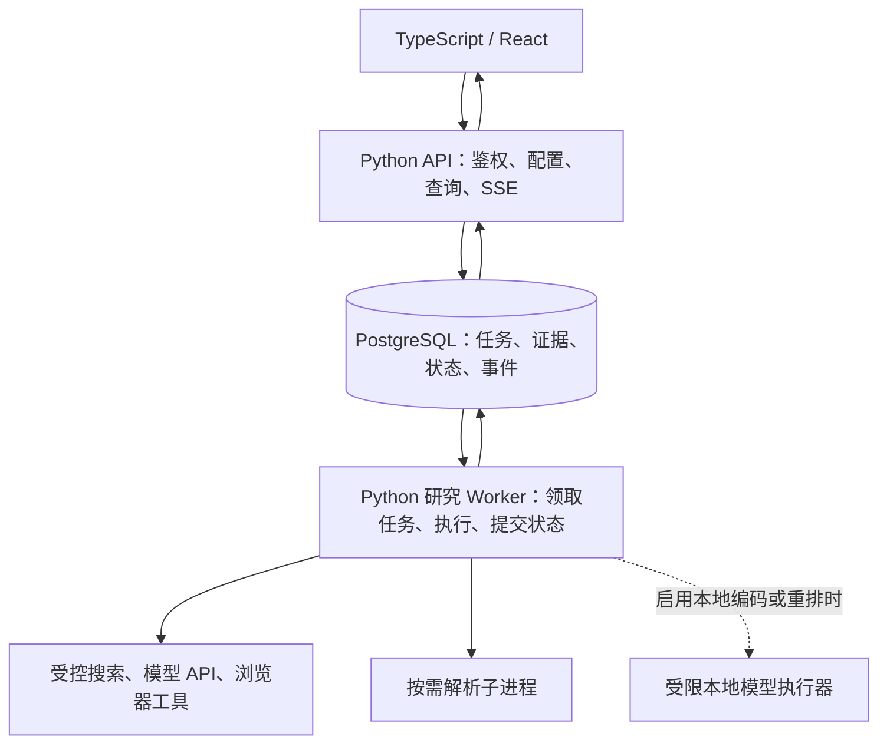

# ADRS 技术栈评估：Python 主栈与按需异构

评估日期：2026-10-22。方法：`tech-stack-evaluator`，按实际代码、部署和项目核心思想筛查 14 个维度。状态：**架构建议，尚未实施迁移，也没有性能测量结论**。本次不修改已排定的 OpenSpec 实施任务或把建议勾成完成。

## 结论与决策边界

2026-10-22后续用户明确优先完成主流程、暂不优化。当前实施沿用Python/React；下文worker/事件/依赖隔离及有条件Go/Rust仅保留为后续重构建议，不作为当前流程交付前置，也不增加新语言或服务。

**当前继续以 Python 承担后端研究业务是合适的；优先重构运行职责和依赖边界。现有证据不足以支持全量迁往 Go 或 Rust。** 前端已经是 TypeScript/React，数据库和浏览器也不是 Python 实现，所以实际问题是后端哪些职责应继续使用 Python。

研究范围、论文与机构数据、统计口径、评价权重、证据追溯、模型路由和报告内容继续用 Python。API、长任务、浏览器/解析和可选本地模型分别管理生命周期；逻辑划分不等于每项都部署成服务。若后续真实负载证明连接管理或任务监督超出资源预算，再考虑 Go；若证明某个纯计算热点占据显著成本，再考虑 Rust 扩展。两种语言不作为默认后续阶段同时引入。

本轮完成条件是查清现状、核实会改变选择的官方技术事实、给出边界与迁移顺序。没有实际并发目标、延迟目标、内存预算和团队 Go/Rust 维护经验，不能宣布某候选在这些约束下已经通过，更不能估算固定节省比例。

## 直接读到的项目证据

| 位置 | 实际状态 | 对判断的影响 |
| --- | --- | --- |
| [前端依赖](../frontend/package.json) | React、TypeScript、Vite | 保留现有交互报告与界面栈 |
| [研究 API](../app/api/research.py) `create_research` / `run_research_workflow` | 研究创建后通过 `BackgroundTasks` 在 API 进程内执行；恢复路径也使用进程内调度 | 长任务与 API 生命周期耦合；数据库留有状态并不自动完成故障后的重新领取 |
| [运行持久化](../app/governance/runtime.py) `RuntimePersistence` | PostgreSQL 保存快照，校验实际 owner 和 execution_id，拒绝旧执行写入 | 有可复用的恢复与隔离基础，不能描述为完全没有持久化 |
| [本机监督状态](../app/governance/harness.py) | 文件、锁、备份及租约字段 | 可保留为本机视图；多 worker 时避免与数据库同时成为调度权威 |
| [SSE](../app/observability/sse_manager.py) | 会话队列、锁及最多 500 条历史保存在进程内；队列满时丢弃事件 | 多进程事件不可自然共享；重连需权威快照和事件位置，不能只增加 Uvicorn worker |
| [编排](../app/graph/compiler.py) | 已有部分 `to_thread`；异步 Report 节点仍直接调用同步 `generate_stream`；图检查点可退回 MemorySaver | 应继续处理阻塞与恢复语义；声明 async 或更换语言不自动解决这些问题 |
| [文档解析](../app/research_documents.py) | 已由受限命令运行 Python 子进程 | 不重复建设已有隔离；继续明确进程限额、取消和容量调度 |
| [嵌入](../app/rag/embedder.py) / [检索](../app/db/retrieval_indexes.py) | 模型延迟加载、PyTorch/SentenceTransformer 编码；BM25 在 SQL 内计算 | 模型权重和数据库工作不能简单归因于 Python 解释器速度 |
| [SDK 适配](../app/openminion_research.py) | 进程全局锁及临时修改 SDK 环境变量 | 保持受限串行或隔离到专用进程，不在通用 API 并发路径扩大这类状态 |
| [Dockerfile](../Dockerfile)、[依赖](../requirements.txt)、[本机依赖](../requirements-local.txt) | 默认 API 镜像安装模型、Chromium、解析和开发依赖；大量版本仅指定下限 | 先拆依赖与构建配置、锁定兼容组合，避免把部署问题误判为语言问题 |
| [Compose](../docker-compose.yml) / [数据库初始化](../app/db/connection.py) | 暂无独立研究 worker；应用启动执行建表/调整结构 | 新 worker 不应同时承担迁移；迁移执行角色与日常运行角色需要明确 |

以上是源码观察，不是故障复现或性能基准。内存队列、多进程模型复制和同步调用存在具体架构影响，但当前实际耗时占比、RSS、饱和点仍未知。`requirements.txt` 未显式列出 Redis checkpointer 适配包，实际环境能否使用该路径需在最终允许的验收中确认，不能仅凭清单断言当前已发生降级。

## 候选与 14 维取舍

比较基线是“保留 Python，按职责重构”，不是保持当前所有实现细节。Go/Rust 全量重写需要重建或跨进程保留已有研究库、模型与解析能力，当前没有足以抵消迁移成本的证据。

| 维度 | Python 重构基线 | 局部 Go / 局部 Rust 的判断 |
| --- | --- | --- |
| 功能契合 | 已覆盖研究、机构、证据、模型和文档业务 | Go 适合候选连接/调度职责；Rust 适合候选计算核；不能替代领域证据规则 |
| 开发速度 | 可复用当前业务和契约，修改范围较小 | 新语言增加协议、构建及调试工作；团队经验未知，不编造工期 |
| 运行速度 | 需分辨外部 API、浏览器、SQL、本地推理和纯 Python 耗时 | 只有目标模块的实际耗时能支持迁移收益；语言微基准不能预测研究总耗时 |
| 资源性能 | 可通过限制浏览器、模型副本、线程与进程数量控制资源 | Go 运行时与 Rust 原生模块是可评估候选；当前没有同负载测量证明节省多少 |
| 安全 | 已有 owner、执行编号、权限与预算控制，仍需最终验证 | 新语言不自动保证跨租户、审批和工具权限；跨进程接口增加边界 |
| 开源生态 | 所需 Python 研究、解析、推理组件已有直接接入 | Go/Rust 的基础设施能力有官方库依据，不推断其全部研究生态缺库 |
| 可复用性 | 最大限度保留领域模块、SQL、配置与报告契约 | 通过版本化任务/事件契约复用；避免复制两套业务规则 |
| 库质量 | 当前库的能力有官方依据；兼容组合和当前安装状态仍待确认 | 只核实下表能力，未对候选进行完整供应链或缺陷审计 |
| 有效库供给 | 浏览器、SQL、PDF、模型与编排均有现有入口 | 局部基础设施有候选；全量改写的等价库适配并未证明，不能视为低成本替换 |
| 可靠性 | 现有 DB 快照和执行隔离可沿用；补持久领取、续租和恢复调度 | Go/Rust 同样需要事务、幂等、租约与故障处理，语言不是可靠性的充分条件 |
| 维护 | 先减少编排大文件、双重状态权威和混装依赖 | 多语言增加发布矩阵、契约版本和故障定位成本 |
| 部署兼容 | 保留现有 Windows 开发和 Linux 容器；明确可选依赖 | 原生分发可能支持 Go 候选；Rust 扩展需承担 Windows/Linux wheel 和 ABI 兼容工作 |
| 总成本 | 优先减少无效模型调用、重复取证、模型复制和浏览器资源 | 迁移只有在机器/运维收益超过开发与维护成本时成立；未作价格或比例承诺 |
| 迁移与退出 | 保留数据格式、证据 ID、SQL 约束和外部 API | 稳定契约允许逐模块替换与回退；避免形成跨语言双写和新框架绑定 |

## 关键库与实际供给

| 能力 | 主选及可用替代范围 | 核实结果与边界 |
| --- | --- | --- |
| API 与流 | 现有 FastAPI/Uvicorn/SSE | 官方说明 BackgroundTasks 与多进程内存边界；无需为了拆 worker 更换 API 框架 |
| 研究编排 | 现有 LangGraph + 普通 Python 领域函数 | 保留分支、预算、暂停恢复；部分规则可简化为函数，不重新引入第二编排器。当前官方文档不是当前已安装版本的兼容证明 |
| 数据库 | 当前 asyncpg；另有 Psycopg 3 异步 API 可作未来候选 | asyncpg 官方覆盖 Python 3.11 与 PG16；Psycopg 3 不是现有 psycopg2 的原位替换，本次不新增依赖 |
| 浏览器 | 现有 Playwright Python；官方也有 JavaScript 接口 | 官方语言实现共享底层能力；现有功能无需迁移到新语言。Go/Rust 绑定另行评估，不能假定与官方接口等价 |
| PDF | 当前 pdfplumber、pypdf 互补 | 前者提供字符/几何/表格信息，后者提供 PDF 处理及文本；均不能单独解决扫描件 OCR。官网最新支持线不证明旧版本区间已锁定兼容 |
| 本地模型 | 当前 SentenceTransformers/PyTorch | 当前官方支持 Python 3.10+；具体模型、依赖版本和设备需冻结组合，不能把最新文档当作升级授权 |
| Go 基础设施候选 | 标准库 net/http + pgx/v5 | 已核实 HTTP 与 PostgreSQL 能力；未采用、未测量，尚无必要再叠加 Web 框架 |
| Rust 计算候选 | PyO3，按实际 CPU 工作考虑 Rayon | 官方提供解除 Python 解释器占用并运行 Rust 工作的路径；没有已定位的热点就不增加扩展。若独立异步服务再评估 Tokio/SQLx，本次不采用 |

不是所有主选都需要增加一个备用依赖。库许可、完整依赖树与平台产物在真正新增或锁定组合时复核；本轮未声称完成许可证或供应链审计。最新官方库的支持版本与本项目当前实际安装版本分别记录。

## 建议的最小运行结构

这是建议目标图，不是当前部署图。第一步只需一个仓库、API 与研究 worker 两个入口；解析复用现有子进程，本地模型关闭时不启动模型执行器。SSE 从已提交事件或快照恢复；Redis 可以通知有新事件，不能把可能丢失的通知当作唯一事实。可选 Go/Rust 不放入默认部署，避免为了候选语言增加常驻组件。

## 重构顺序与保留契约

1. **先分清模块与依赖。** 将 API 中长任务执行器移到运行模块，编排大文件按阶段拆函数；保留公共请求与报告契约。区分 core、browser、documents、local-model、dev 依赖及镜像 profile，移动重依赖的顶层导入，并锁定经过实际兼容确认的组合。可选模型关闭时不能仍要求 API 安装/导入完整模型栈。
2. **再分离 API 和长任务。** 研究创建与待执行记录在同一数据库事务提交；独立 Python worker 原子领取、续租、完成或有界恢复。可沿用 PostgreSQL 做小规模持久任务队列，避免先增加消息中间件；其任务语义仍须自行明确，不能将 `SKIP LOCKED` 当成完整任务框架。状态检查与提交沿用 owner、execution_id，并增加明确领取版本/期限；不把本机文件租约升级为第二套跨机器调度权威。
3. **处理事件与阻塞。** 建立绑定 owner、task、execution、递增事件位置的已提交事件记录；支持鉴权补发、多个订阅者和完整快照。Report 同步流要改为异步消费或在受限执行器中通过线程安全通道传递回调；只给整个函数套 `to_thread` 会使现有 `create_task` 回调失去正确事件循环，不能照搬。取消线程不等于终止外部调用，超时和取消必须落实到 HTTP、浏览器及子进程。
4. **按实际资源隔离重工作。** 解析已有子进程，继续补容量与回收；浏览器上下文/进程池有明确上限；本地模型只在需要时加载，限制模型副本和线程。SDK 全局环境适配保留单独受限进程边界。只有资源或故障隔离需要时，才将相应执行器独立部署。
5. **最后再决定语言迁移。** 同负载确认 API/连接管理已成为资源瓶颈、且 Python 结构优化仍不满足约束时，优先局部 Go；确认批量文本/图计算等纯计算热点仍占主要成本时，优先局部 Rust 扩展或现成原生库。SQL 耗时优化数据库，模型耗时优化模型与批处理，浏览器耗时优化取证策略；这些不能直接作为改写 API 的依据。

任务消息传不可变引用和版本，而非复制全量文档或模型可控的权限声明。建议最小契约含 task_id、execution_id、request/config version、证据引用、预算/期限引用；owner 从已认证请求及数据库绑定取得，不能相信消息自报。任务与写入状态单一权威，提交使用原子版本校验。重试可能重复送达，业务副作用按稳定操作 ID 幂等；外部系统不支持幂等时，保留结果未知并对账，不能承诺端到端 exactly-once 或不重复模型计费。

API/worker 共享代码可以降低迁移成本，但并不自动共享进程内状态。数据库连接池须按所有进程合计预算，迁移由单独受控步骤执行。模型副本、Chromium 和数据库资源仍需计入完整部署成本，不能只比较 API 进程内存。

## 安全基线增量适用性

复用已存在的 A2ABreak **v1.0** 评估，本次新增关注跨进程任务与事件；04、05完整条目已重新读取，03、06、08、10、11沿用本任务此前读过且仍适用的完整条目。以下均为本地工程建议，待项目验证，不宣称官方修复或已通过。

方案来源：[A2ABreak 基线索引](C:/Users/wblxr/basic-memory/engineering/security/a2abreak/A2ABreak%20多Agent安全基线与11项方案索引.md)，Basic Memory `main/engineering/security/a2abreak/a2-abreak-多-agent-安全基线与-11-项方案索引`。各项引用 v1.0 的“工程解决方案”“验收办法”两节，条目标题如下。

| 方案与标题 | 本次控制点、验收要求或具体不适用理由 |
| --- | --- |
| A2AB-01 技能声明验证与委派准入 | 复用现有技能准入；增加 worker 不增加技能声明信任。执行器只能装载冻结允许的工具/技能版本 |
| A2AB-02 Agent Card可信密钥与身份绑定 | 不新增 Agent Card 或跨组织 A2A 提供者；此次没有新的 Card 密钥机制，沿用当前适用性判断 |
| A2AB-03 上下文归属与跨租户隔离 | API、worker、证据存储均复核实际 owner/task；最终 E2E 覆盖不同 owner 与引用转用 |
| A2AB-04 长连接撤权与事件出口鉴权 | SSE 补发与每个出口执行当前权限检查；最终 E2E 覆盖撤权、积压、重连和历史事件 |
| A2AB-05 产物分块校验与断流恢复 | 事件位置及产物版本不得混用；权威完整报告供恢复，不能将断流的局部文字当成完整报告。若加入校验清单，在交付协议中明确，不自行声称为 A2A 原生字段 |
| A2AB-06 并发状态版本与审批绑定 | PostgreSQL 原子领取/提交，保留 execution fencing、请求幂等和审批所绑定的操作；最终 E2E 覆盖重复交付、旧执行迟到与恢复竞态 |
| A2AB-07 Webhook归属验证与受控出站 | 不新增外部 webhook；工具出站继续复用已有来源/网络策略，不因为 worker 拆分扩权 |
| A2AB-08 结构化授权请求与权限不放大 | worker 只取得任务和操作所需权限；服务端取工具 allowlist 与已确认范围交集，拒绝模型自报扩权 |
| A2AB-09 多跳主体溯源与凭据防转用 | 本次内部 worker 不新增跨组织多跳换证；不能为方便跨进程执行而广播用户长期凭据 |
| A2AB-10 委派环路检测与全链预算 | 同一任务预算贯穿重试/恢复；并发调用先预留后结算，模型/工具调用不因队列重投获得新预算 |
| A2AB-11 中断任务租约与有界资源回收 | 持久期限、有限续租、取消传播和浏览器/子进程回收；最终 E2E 覆盖进程退出、API 重启、超期和合法恢复 |

这些是未来完整端到端场景中的要求。本轮没有执行安全用例、非端到端测试或运行探针。

## 代价、复评条件与交付边界

接受的代价是保留 Python 环境与领域生态，同时承担少量 worker 调度、事件持久化和配置分层工作。API 与 worker 分离会增加运维入口，但先保持同仓库、同语言和一份状态契约，控制这部分成本。没有为了“未来可能高并发”立即引入 Go、Rust、Kafka 或新编排框架。

只有会改变结论的未知项需要后续补证：真实同时运行研究数与 SSE 连接数、任务阶段耗时、CPU/RSS/模型副本、目标设备预算、API/事件延迟目标、原生单文件分发要求，以及维护者对新语言的承担能力。重构评估应把模型/搜索/浏览器费用与 API 机器费用分别观察。

后续验证继续遵守当前任务约定：**全部已授权功能实现后统一端到端验收**。届时观察真实研究结果、引用正确性、恢复与取消、跨 owner 边界、事件续接及运行资源；本轮没有提前运行基准、安装依赖、启动服务或执行测试。语言评估不改变现有 ORG/OPT 未验收状态。

## 官方来源与适用范围

- [FastAPI Background Tasks](https://fastapi.tiangolo.com/tutorial/background-tasks/#caveat)：重型后台工作可独立进程执行，增加任务设施也有配置成本。
- [FastAPI 部署与进程内存](https://fastapi.tiangolo.com/deployment/concepts/#memory-per-process)：多个进程通常不共享普通内存和模型对象。
- [Python 3.11 asyncio.to_thread](https://docs.python.org/3.11/library/asyncio-task.html#asyncio.to_thread)：线程可卸载阻塞调用；纯 Python CPU 并行仍受该版本 GIL 约束，释放 GIL 的扩展另论。
- [LangGraph persistence](https://docs.langchain.com/oss/python/langgraph/persistence)：框架检查点的用途；不能据此推出本项目已有可靠独立任务调度。
- [Playwright 语言支持](https://playwright.dev/docs/languages)：官方各语言共享底层浏览器自动化实现，选语言需结合约束。
- [asyncpg](https://magicstack.github.io/asyncpg/current/)、[Psycopg 异步接口](https://www.psycopg.org/psycopg3/docs/advanced/async.html)：数据库客户端能力；后者页面为开发文档，采用时需改查选定稳定版本。
- [pdfplumber](https://github.com/jsvine/pdfplumber)、[pypdf](https://pypdf.readthedocs.io/en/stable/)：PDF 结构/文本能力和适用限制。
- [SentenceTransformers 安装支持](https://www.sbert.net/docs/installation.html)：当前推荐依赖线；不代表本项目下限区间已经解析或兼容验证。
- [PostgreSQL SELECT](https://www.postgresql.org/docs/16/sql-select.html)：`SKIP LOCKED` 适用于队列消费者避免锁竞争，不提供完整调度语义。
- [Go net/http](https://pkg.go.dev/net/http)、[pgx/v5](https://github.com/jackc/pgx)：候选基础设施的具体库能力，不提供本项目性能收益证明。
- [PyO3 parallelism](https://pyo3.rs/main/parallelism)、[Tokio spawn_blocking](https://docs.rs/tokio/latest/tokio/task/fn.spawn_blocking.html)：Rust 与 Python/异步执行的边界；Rust 异步同样需要限制阻塞与 CPU 工作。
