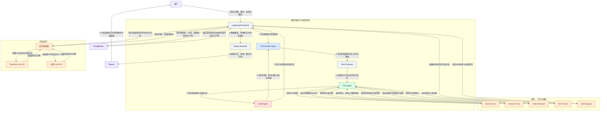

# 三角色研究架构候选

日期：2026-11-01。分支：`codex/three-role-agents`。状态：方案保存、未实现。当前实施路线仍是[原架构精简分支](https://github.com/wblxr408/Agentic-Deep-Research-System/tree/codex/simplify-existing-architecture)。本方案仅定义角色迁移差量，共用功能、质量、内容、缓存和成本要求沿[完整实施计划](IMPLEMENTATION_PLAN.md)与[成本专项](RESEARCH_TOKEN_COST_PLAN.md)维护。

## 1. 从用户输入到报告输出

下图是拟议运行协作，方框为组件，动作写在连线上。外框表示能力边界，组件名不使用源码文件名；发布、权限、预算和恢复由可信运行代码执行。正常路径只在开始提交模式，运行期间自动流转；工作台展示状态及可选干预，不是每阶段的人工门。

颜色：蓝色编排、绿色任务、红色审计、灰色可信执行、橙色工具／Skill／初判、紫色持久化与产物。组件间模型请求和结果交接均经过原Runtime的权限、版本和预算准入；图上任务至审计等箭头表达业务交接，不授予模型直接写数据库或发布的权限。图中“审核组合提交”只有当前必要审核完成才可交付，不是忽略问题的并行发布捷径。

## 2. 原七组件如何承接

| 原组件 | 新角色／组件 | 保留及实质差量 |
|---|---|---|
| Planner／replan | Orchestrator Agent | 保留动态计划与反馈重规划，统一下一步选择和计划理由；不在每个已知工具前增加规划请求 |
| Search | Search Tool | 保留工具契约及独立有界批次，不强制自治循环 |
| Browser | Browser Tool | 保留获取、解析、来源版本和失败收据；分析由任务能力完成 |
| RAG | RAG Retriever | 保留按需内部证据检索，复用现有索引与授权；公开研究不强制先RAG |
| Analyst | Task Agent的分析任务 | 保留领域分析提示与类型化输出，输入只含当前任务必要材料 |
| Reflection | Audit Agent的缺口任务 | 独有研究缺口职责保留；与事实／读者审核重合部分对照覆盖后删减 |
| Report | Task Agent的写作／修订任务＋原可信交付 | 保留写作、章节和局部修改专门合同；交付裁决及导出仍由代码负责 |

三个逻辑角色不要求三个进程、三个模型品牌或三套无限循环。分析和写作保留不同任务上下文／合同，角色整合不把全部历史拼进Task Agent。编排按问题派任务，任务按已授权计划处理工具／分析／写作，审计按必要范围审查当前产物；复杂调查的工具—观察循环受原任务边界限制。

## 3. 交接与所有权

编排输出目标、任务类型、依赖、来源范围、预期产物、完成条件和计划变化理由。任务输出证据／分析／内容单元与位置、依赖、缺口及实际操作收据。审计输出问题ID、类别、依据、影响、全部受影响范围和最小修复建议；返回引用而非复制整份报告。

编排决定补证、局部修复、扩大复核或停止；修改由任务能力执行。若已有计划和材料足以执行，不额外调用编排。审计可以读取当前获准证据，但新增外部采集或扩大任务范围须经编排与原准入，不隐式启动第二研究任务。

可信Runtime接纳提议、裁决发布和维护原根状态。角色不批准权限、调高额度、重置修订机会或直接发布。审计同时满足事实／阅读／图文当前组合后，仍需原交付流程确认实际呈现、引用和导出状态。失败时保留当前成果和具体缺口。

## 4. LangGraph、DAG及初判的职责

LangGraph承接原状态流转、条件路由、有界并发、checkpoint和恢复。业务DAG是依赖计划，执行器只选择ready节点、管理该批状态并提交工具交接；并发派发和恢复复用原运行层。重复拓扑／状态投影可以归并，但不能删除末批结果聚合中独有的补读检查。

Jev仅承担边界清楚的语义初判，例如候选相关性或主张类型；确定性的ID、权限、版本、预算由代码检查。配置了获准Jev API就使用，未配置就由现有获准LLM完成同一判断，输出共用合同、记录实际后端／模型版本，一次选择一个后端。概率或结构合法不等于来源支持，核心事实不能据此免审。请求失败／低置信／未知消费沿后续接入合同与原恢复边界处理，不默认无限重试。

## 5. 缓存、审核与成本

角色之间传递产物引用和必要上下文，原文／解析／页面、分析、付费章节响应、事实判定、读者维度、图文解释和恢复收据均沿现有持久化复用。有效性依赖主体、任务、主张含义、必要条件、来源版本／范围、权限、模型与合同；读者全局关系变化时扩大复核，不把文字未变当作充分依据。

同根同完整操作的并发请求合并，一次实际消费；已完成产物先读回，未知消费先对账。Jev、编排、任务、审计和格式修复全部进入原根账本。供应商提示缓存与应用免调用分别报告；角色数变化不证明省费。具体机制、原任务映射和价格／usage边界沿[成本专项](RESEARCH_TOKEN_COST_PLAN.md)，不另建缓存管理Agent、第二数据库或额外预算。

核验范围与实质影响分开：决定性前提必核，纯风格不触发整稿重写；原始条件不能为去重而删除。第一轮全局阅读，局部改动重核受影响依赖，跨章结构／主论证变化才重新全局审阅。最终交付组合必须覆盖当前稿。

## 6. 原功能与迁移增量

ORG／18个OPT／FLOW／REL、R1—R8、M1—M3、账号／渠道／模板／方法及原生格式范围沿总计划F／W／Q身份保留。同步／CDC、视觉／语义处理、稀疏／多向量／图文／BSR保持显式可选、已实现待验收状态。行为推荐、大规模ANN、GraphRAG社区摘要、新音频及无实际瓶颈的复杂优化继续冻结。

本分支[迁移任务](../openspec/changes/refactor-three-role-research/tasks.md)只跟踪三角色交接／消费者适配／角色级投影与启用边界。共用内容、审核、缓存、账本差量只在原变更实现一次；从精简分支引入对应已交付提交及证据后补角色差量，不把同一审核器写两遍。

未来如选用此候选，先核对新任务冻结版本与已有根兼容，逐项替换责任消费者；旧根保持原控制合同。角色边界不提供收益或增加轮次时，可保留原组件执行方式；不建设长驻双运行器。当前只保存规划，不注册角色、不修改生产默认、不创建真实研究或付费比较。

## 7. A2ABreak v1.0适用性

复用已读取的[原设计D11](../openspec/changes/refactor-single-research-agent/design.md#d11-安全基线与本次适用性)全部11项评估与原件链接。本次同应用内三角色与Jev不新增远端Agent协议；以下是工程建议及后续观察，均未实施／运行安全验证。

| ID／标题／版本／章节 | 三角色的执行点与观察目标 |
|---|---|
| A2AB-01 技能声明验证与委派准入／v1.0／工程1—4、T1—T3 | 原Skill注册与handoff只接受获准冻结能力，角色不能声明任意新能力 |
| A2AB-02 Agent Card可信密钥与身份绑定／v1.0／索引适用条件 | 无远端Card发现或签名，具体机制不适用；Jev是配置的模型端点 |
| A2AB-03 上下文归属与跨租户隔离／v1.0／工程1—4、T1—T3 | 原上下文／检索／缓存入口核主体、任务、权限；角色共享引用不跨租户 |
| A2AB-04 长连接撤权与事件出口鉴权／v1.0／工程1—4、T1—T3 | 原SSE出口核执行与当前访问，角色事件不能绕过撤权 |
| A2AB-05 产物分块校验与断流恢复／v1.0／工程1—4、T1—T3 | 原报告／模型响应先持久化再审核，未完成输出不冒充合格报告 |
| A2AB-06 并发状态版本与审批绑定／v1.0／工程1—4、T1—T3 | 计划接纳、局部补丁与迟到判断沿原版本事务，同操作一次提交 |
| A2AB-07 Webhook归属验证与受控出站／v1.0／工程2／4及原ACI | 保留原签名入站；无新任务出站回调，模型资料外发沿原供应方治理 |
| A2AB-08 结构化授权请求与权限不放大／v1.0／工程1—4、T1—T3 | 原执行准入取权限交集；角色或Jev不批准扩权、换未准模型或发布 |
| A2AB-09 多跳主体溯源与凭据防转用／v1.0／索引适用条件 | 无跨组织Agent多跳，具体换证机制不适用；供应方凭据不进入角色上下文 |
| A2AB-10 委派环路检测与全链预算／v1.0／工程1—4、T1—T3 | 三角色／Jev共用原根，问题回流共享次数及停止条件，不重领额度 |
| A2AB-11 中断任务租约与有界资源回收／v1.0／工程1—4、T1—T3 | 原恢复控制保留deadline、未知消费和租约，迟到结果不写新执行 |

## 8. 当前可审阅内容

本页展示协作图、职责和迁移边界；[OpenSpec提案](../openspec/changes/refactor-three-role-research/proposal.md)、[设计](../openspec/changes/refactor-three-role-research/design.md)、[行为合同](../openspec/changes/refactor-three-role-research/specs/research-role-collaboration/spec.md)及任务提供后续选择依据。官方实践与成本论证引用沿成本专项及原设计；没有把公开实践当作该候选已验证有效的证据。
