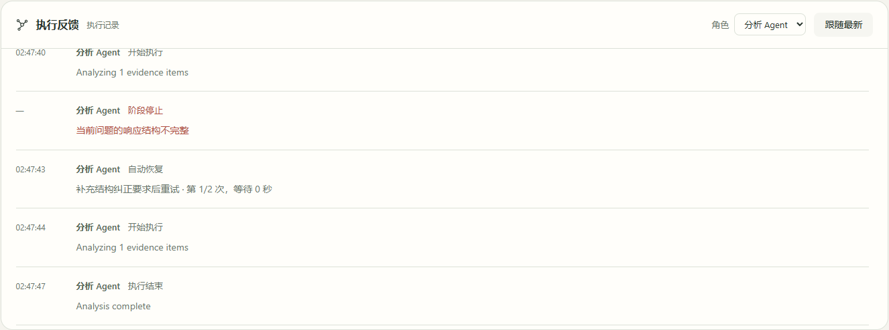

# 分类修复与自动重试 · 2026-10-26

用户要求错误应分别安排尝试次数，并先自行修改可修复内容再重试。本次取代统一一次恢复：分析连接3次、超时／服务端2次、临时限流4次；结构、长度和可压缩上下文各最多2次。报告一般2轮、有矛盾主张3轮，未解决问题数不下降则提前停止。详细接口和执行边界见[研究执行控制](../RESEARCH_EXECUTION_CONTROLS.md)。

## 实际路径

本地专用 API 8011、独立 PostgreSQL `adrs_accounts_fcf222f896`、Vite 5181 和隔离 Edge。通过本人登录、保存模型配置、已有研究检查点的继续接口、真实图步骤、模型收据、任务读取及浏览器执行反馈完成当前新增行为。模型指向本机兼容 HTTP 端点，返回受控故障、结构化回答和核对结果；没有使用外部付费推理。输入材料是明确的受控存储原型样本，成功报告证明恢复流程，不能作为真实学术研究质量证据。

| 输入情况 | 实际结果 |
| --- | --- |
| 连接拒绝 | 原版实跑停在1次自动恢复，未满足3次目标；修改后同类故障记录3次恢复、4次阶段尝试 |
| 连续 HTTP 503 | 3次实际请求：初始请求加2次恢复后停止 |
| 连续 HTTP 429 临时限流 | 5次实际请求：初始请求加4次恢复；保存本阶段分类计数和递增等待 |
| HTTP 401 | 首次请求后停止，没有把凭证错误当临时故障 |
| HTTP 429 `insufficient_quota` | 首次请求后停止，直接说明模型账号额度问题 |
| 首次无效 JSON | 后续请求含结构纠正要求，保留原文和同一研究绑定；分析完成，后续报告完成 |
| 修改后仍返回相同无效内容 | 2次实际请求后以无进展停止，没有继续用完所有上限 |
| 首次输出 `finish_reason=length` | 下一请求改为4096输出上限及压缩原文窗口，分析和后续报告完成 |
| 首次 HTTP 400 `context_length_exceeded` | 自动按上下文类型重打包并调整输出，分析和后续报告完成 |
| 一般报告主张问题 | 修改对应段落并逐轮重新核对，问题数2→1→0，两轮后完成 |
| 矛盾报告主张 | 三轮修改及重新核对，问题数3→2→1→0后完成 |
| 报告修改没有进展 | 正文发生修改，重新核对仍为2项问题；第一轮后主动停止，保留修订结果和具体问题 |

每个兼容模型场景均实际核对原总Token上限和原状态创建时间保留。失败请求沿现有保守收据计量，不退款或清零；端点给出的成功请求usage仅为本机契约样本，不是外部供应商账单。未重跑此前用户暂停、跨账号或完整安全检查，沿用原边界及先前记录。

## 浏览器与持久记录

- 直接显示限流“本类已尝试4/4次”和具体动作。
- 报告停止直接显示已修改并核对1轮、问题没有减少及具体主张。
- 重新打开已完成的研究，切到研究流程，筛选分析Agent，可读到真实结构纠正动作；事件已保存，服务重启后仍能显示。
- 修复历史恢复事件回放将已完成任务显示为运行中的问题；已完成任务的反馈区显示“执行记录”。
- 当前浏览器旅程无页面异常。界面图见下方。

修订动作保存为原事件ID，SSE即时反馈和持久研究记录复用同一事件。报告正文没有加入恢复次数或内部状态。

## 证据与范围

忽略目录 `outputs/adaptive-recovery-20261026/` 保存 `model-results.json`、各场景 `*-observed.json`、连接失败的 `observed-recovery.json`、`browser-results.json` 和图片。一次性脚本在 `.codex-homework/`，不提交账号、环境或端点请求原始记录。

最初的脚本路径配置失败不计作行为失败证据。浏览器首次选取控件时，已完成任务默认打开报告面板，改为先选择流程；同时实际发现并修复终态被历史恢复事件覆盖的问题。一次停止值先于最终研究事件写入，最终读取同一任务确认2条报告恢复事件已持久化，没有重新执行该研究来掩盖时序。

超时、TLS证书错误、HTTP日期形式的Retry-After、长冷却、根8次／问题10次混合上限及崩溃竞争未单独构造本轮实跑。源码有对应边界，不能宣称这些部署路径均已验证。没有执行回归、局部／TDD、构建、类型、lint、schema、启动／导入／文件／hash／文字或健康探针。原长研究与完整报告质量优化继续暂停。

本地8009升级前确认运行／待运行研究为0，部署本轮源码；原5177页面、凭证、任务归属、预算及原暂停记录保留。没有启动旧任务或迁移他人资料。

## 安全依据

沿用A2ABreak v1.0及[原11项适用性评估](../RESEARCH_WORKFLOW_DESIGN.md)。A2AB-03《上下文归属与跨租户隔离》“工程解决方案”1—3由资料／输入绑定落实；A2AB-04《长连接撤权与事件出口鉴权》1—3沿用原事件出口；A2AB-06《并发状态版本与审批绑定》1／3由owner/execution行锁及原图检查点落实；A2AB-10《委派环路检测与全链预算》1／3由可信分类计数、进度条件、原份额准入落实；A2AB-11《中断任务租约与有界资源回收》1／4由原期限和暂停优先落实。引用条目、版本及此前证据见[执行控制文档](../RESEARCH_EXECUTION_CONTROLS.md#增量安全依据)，本轮不把局部路径当成完整攻击评估。
