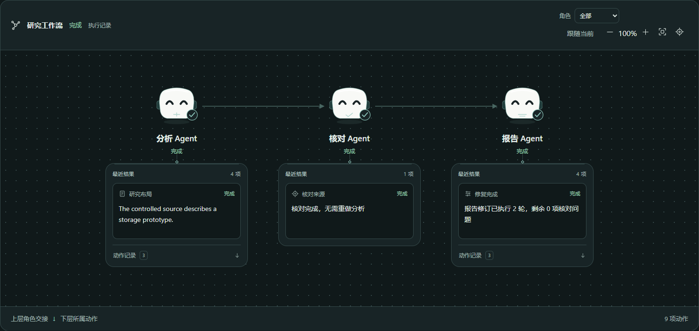
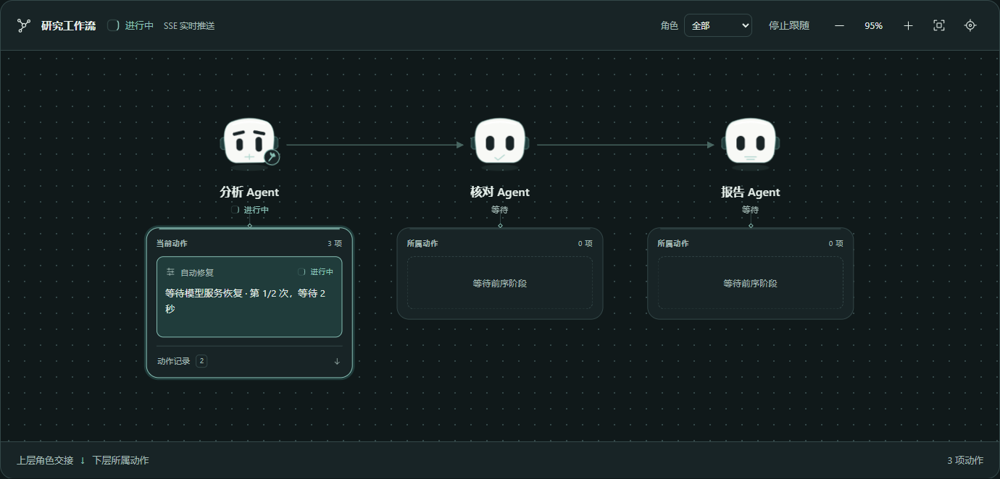
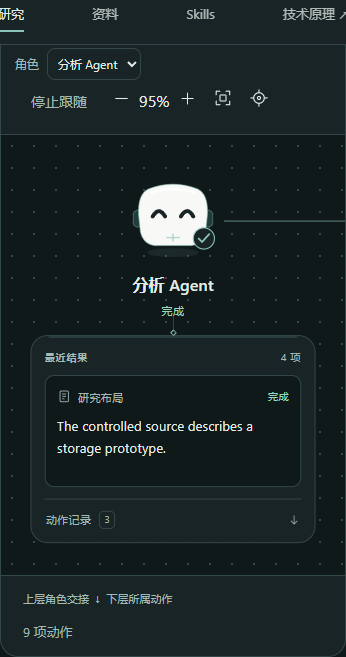

# 动态角色工作区 · 2026-10-26

角色是动作的负责人。上层连接执行角色，下层用独立容器收纳其动作，突出一项当前动作或最近结果，其余记录按需展开。取证步骤使用工具工作区。此布局取代初版胶囊与方卡的平铺关系。

## 形象与层级

自绘简洁 SVG 机器人，以眼形、视线和轻微动作表示真实状态：等待眨眼、执行扫视、修复显示扳手、用户暂停闭眼、系统受阻显忧虑眉形、完成显示笑眼和勾选。取消／跳过使用静态休息表情，未知状态有独立标记。完成仅做一次轻跳；减少动效偏好下保留静态表情和文字。

Agent 工作区在 DOM 中实际包含所属动作区。角色、工具和动作保持不同视觉身份。主交接线连接上层，DAG 前置依赖、工具输入、实际反馈和相关调用在动作详情中查看。阶段、调用及失败尝试沿用原稳定身份。

桌面可容纳全图时维持整体视野；窄屏按角色定位，并约束相机边界。拖动和手动缩放停止跟随，执行本身继续。

## 当前功能的实际操作

使用专用账号、API8011、隔离数据库、Vite5181及独立 Edge。页面读取真实任务 GET、持久事件和原 SSE，没有拦截浏览器接口或伪造推送。

| 路径 | 实际结果 |
| --- | --- |
| 历史任务的层级与详情 | 分析 Agent 包含所属动作区；打开研究布局结果，展开早期修复记录后可读原反馈 |
| 暂停检查点继续 | 从准备好的本人暂停检查点，经页面继续产生新执行与原 SSE；暂停表情切换为执行，后续角色等待 |
| 临时服务错误与修复 | 本机受控兼容模型首请求返回503；真实恢复事件显示扳手及等待次数，下一请求时恢复执行表情，最终转为完成笑眼 |
| 工具工作区 | 重开原取证任务，在工具所属动作内查看原 `https://example.com` 输入及 `private_context_network_query_not_authorized` 拒绝结果；未重新调用工具或放宽资料边界 |
| 系统停止 | 读取此前保存的服务故障任务，显示受阻表情，与用户暂停区分 |
| 桌面与手机 | 深浅主题可读；390px 可定位角色并打开同一实际结果；减少动效后节点详情仍可操作 |

受控模型只返回固定样本内容，无外部付费推理；准备的暂停检查点用于本次消费路径，既有手动暂停命令的验证见[控制记录](research-controls-sse-20261025.md)。本轮验证当前界面状态和交接，原完整研究及报告质量优化仍暂停。

专用证据在忽略目录 `outputs/agent-stations-20261026/` 与 `outputs/agent-stations-live-20261026/`；账号、环境和原始任务文件不提交。仅执行当前功能的实际浏览器旅程，按当前约束没有运行回归、局部、构建、类型、lint、schema或探针。

## 原执行边界

沿用[执行控制的全11项增量评估](../RESEARCH_EXECUTION_CONTROLS.md#增量安全依据)。A2AB-03《上下文归属与跨租户隔离》、A2AB-04《长连接撤权与事件出口鉴权》、A2AB-06《并发状态版本与审批绑定》、A2AB-10《委派环路检测与全链预算》、A2AB-11《中断任务租约与有界资源回收》均为v1.0，“工程解决方案／验收办法”；执行点仍是本人任务查询、原SSE出口、执行版本和根预算／期限。其余方案沿用原适用性说明。本次为呈现改造，没有新增Agent或修改权限、调度和恢复政策；没有重复执行安全攻击旅程。
