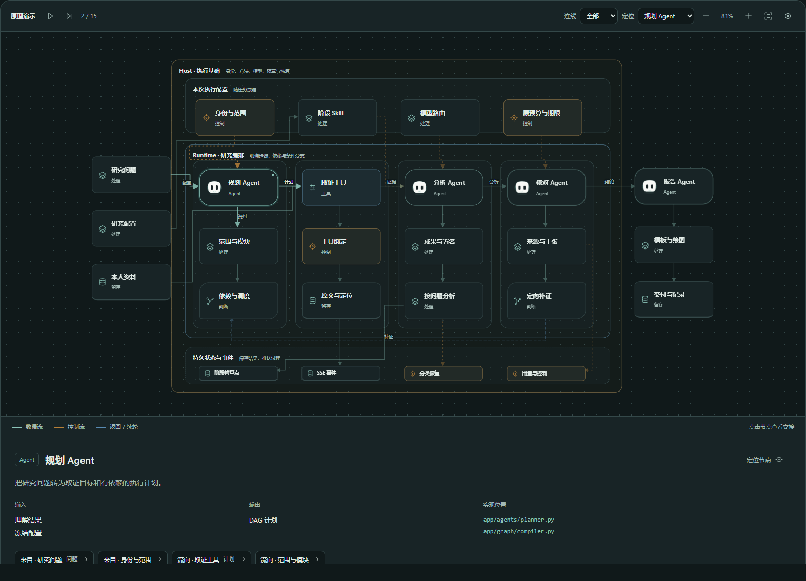
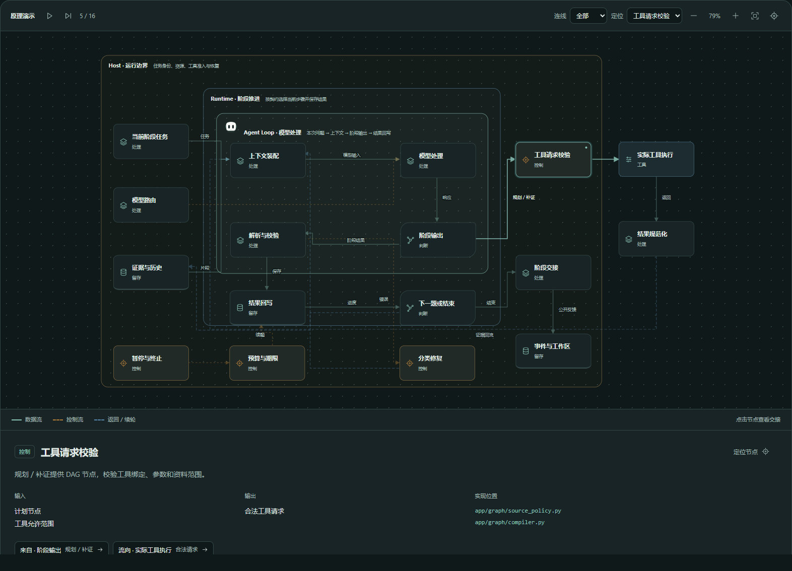
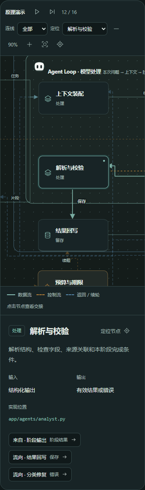
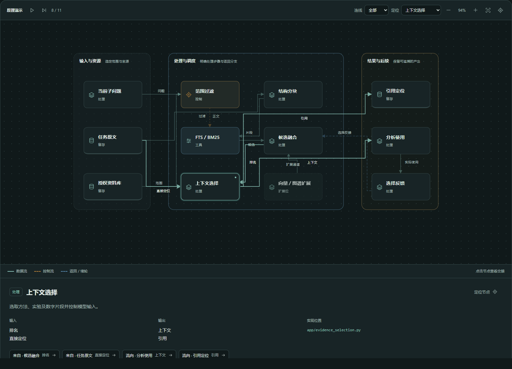

# 技术架构的细化呈现 · 2026-10-26

依据用户提供的分层架构与执行循环参考图，技术窗口拆为全景架构、Agent执行循环及八个专题。顶部切换专题，节点详情位于图下方。

## 图中呈现的实际职责

- Host：任务身份、方法配置、模型路由、原预算、执行控制与分类恢复。
- Runtime：规划、依赖调度、工具绑定、证据回收、问题分析、核对与交付。
- Agent循环：当前问题、上下文、模型响应、阶段输出、解析校验、结果回写及续题／结束。
- 工具交接：规划／补证产生DAG节点，准入后执行工具，返回内容规范化为证据。
- 状态与产物：检查点、公开SSE、用量收据、图表及可重开的报告。

全景图的角色工作区实际包含其处理节点；单循环图将模型处理放在所属循环中，工具准入、实际工具和回写路径分别呈现。数据流、控制流与返回／续轮使用不同线型和颜色。暂停、单步、缩放、拖动、节点定位及减少动效共同支持阅读。

## 专题及交接口径

| 专题 | 展开的处理关系 |
| --- | --- |
| 对象与匹配 | 实体／历史隶属、成果、学科分类、指标口径、演进、深读及合作资源 |
| 网上取证 | 查询、搜索、访问准入、HTML／PDF读取、结构解析、去重、定位与留存 |
| 证据与RAG | 任务原文／资料库、范围过滤、分块、FTS／BM25、融合、选择与引用 |
| 阶段Skill | 自动匹配、用户覆盖、可信编译、工具允许范围、加载与产出 |
| 模型与成本 | 规则处理、路由、额度预留、请求、主备回退、能力升级及结算 |
| 工具接口 | 用途、绑定、参数、准入、执行、结果规范化、分类恢复与调用记录 |
| 边界与恢复 | 身份／资料／预算、步骤执行、保存、诊断、修复、继续与停止 |
| 图文交付 | 主张核对、报告计划、正文、确定性统计、绘图、修订和交付 |

点击节点展示具体输入、输出、相邻交接和仓库实现位置。图中向量／图谱仅标为扩展位；默认检索通道仍按现有词法路径说明。动画标明“原理演示”，真实任务事件仍由研究画布消费。

## 当前功能的实际浏览器旅程

独立 Edge 在本地Vite5181打开实际技术页，完成：

1. 在Host→Runtime→分析角色工作区内打开成果与署名，读取全文批次输入和成果记录输出。
2. 手动推进全景演示，查看规划节点及其DAG产出；切换深浅配色并查看全图。
3. 展开单Agent循环，打开上下文节点，沿模型输入跳转到模型处理；再查看工具校验的合法请求输出。
4. 切换连线类型，逐个打开八个专题的实际处理节点和详情，并定位到原画布节点。
5. 减少动效偏好下停止播放，单步仍可用；390px定位到解析校验节点，阅读输出和实现位置。

上述旅程通过，未发生页面异常。第一次脚本定位“模型输入”同时命中输出与连线标签，已改为定位输出列表后完成同一旅程；这不属于产品错误。

证据在忽略目录 `outputs/architecture-detail-20261026/`。本轮没有进行新的外部研究、模型调用或后端架构迁移；前端沿用React／SVG／CSS。执行边界与已有安全依据见[动态角色记录](agent-stations-20261026.md#原执行边界)。按用户约束仅走当前功能端到端，未运行回归及构建、类型、lint、schema、探针。原完整研究交付清单保持原状态。

## 正交连线修正

用户要求连线正交且有秩序后，十个专题统一改为水平／垂直折线。节点与可见分区标题参与避让，直行链路保持直接；返回和重试沿外侧通道，同侧进入与流出错开端口。标签放在不与节点及其他标签重合的空闲位置，完整交接名称仍保留在节点详情。移动信号和主线使用同一路径。

当前正交版本在实际技术页面重复走通全景的节点契约、单Agent循环交接、八个专题定位、深浅主题、手动演示及390px节点阅读，没有页面异常。人工查看全景、循环和密集RAG专题截图，线段保持水平／垂直，返回路径可区分。正交版本证据保存在忽略目录 `outputs/architecture-orthogonal-20261026/`；上方交付图片同步为该版本。

