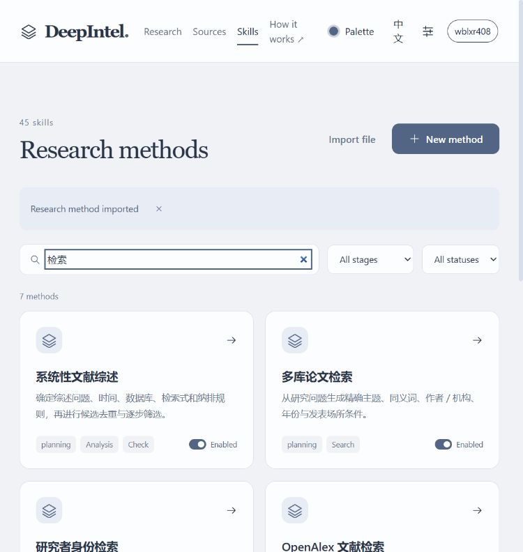
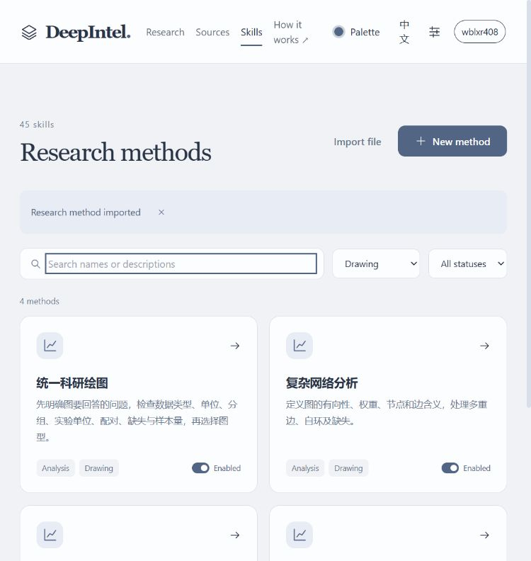
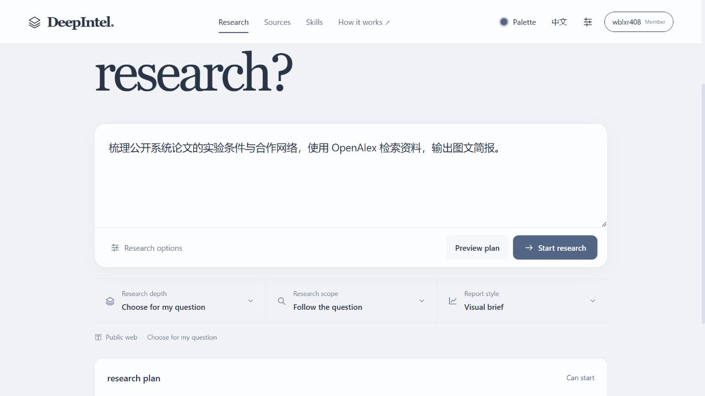

# 研究方法书架：实际导入记录

2026-10-26，本机5177、原生产API和当前登录的个人账号。通过用户的 IAB Skills 页面导入，没有提取浏览器凭据或使用测试账号替代。

## 来源与筛选

书架当前目录实际166项，纳入45项；发布包元数据的165项另行保留。每项决策保存在[清单](../../resources/research-skills/bookshelf/manifest.json)。研究与文献19项全部纳入，另含学术写作、审查、研究输入、绘图、文档和14项报告结构方法。State of Art 原文是艺术展示，未被中文目录名误导为学术综述。

Firecrawl因额度不足未执行抓取，改为直接读取网站目录、公开原包及固定来源。原包已保存，未运行其中的安装器或脚本。

## 当前功能操作

| 操作 | 实际结果 |
| --- | --- |
| 当前账号导入45个 Markdown | 每项保存后弹窗关闭，列表最终显示45项 |
| OpenAlex 详情和完整原文 | 显示阶段方法、固定来源及归档原文 |
| 写作阶段筛选 | 25项；修复界面 reporter 与服务端 report 不对应的问题 |
| 绘图阶段筛选 | 4项，可阅读和选择 |
| 研究方法选择 | OpenAlex、多库论文检索及科研绘图可设为本次使用 |
| 手选科研绘图并预览图文简报 | 原确定性计划预览返回 Can start |

预览使用临时同源窗口；未点击 Start research，没有创建付费研究。没有运行构建、类型、lint、schema、局部、单元、回归、文字、哈希或浅层探针检查。本轮证明注册、回读、选择及预览，不证明所有外部计算环境可执行或新的完整报告已交付。

辅助操作中，HTML summary 与原生AX角色不同，改用已观察的原生点击；一次报告按钮同时匹配背景和弹窗，限定当前弹窗后继续。45次实际导入均成功，没有重复重交。

## 边界与依据

沿用 A2ABreak 基线 v1.0：A2AB-01《技能声明验证与委派准入》工程解决方案1—4，落实到现有 parser／registry／阶段编译器和固定来源；A2AB-03《上下文归属与跨租户隔离》工程解决方案1—3，通过当前认证主体上传与回读。

原工具授权、top-k与阶段字符预算保持；归档原文未声明为 stage_references。02、04—11沿用既有评估，本次未新增对应机制或重跑其安全验收。这些是来源核对的工程建议，验证范围限于上述实际路径。知识库条目为 Basic Memory main 的 `main/engineering/security/a2abreak/solutions/a2-ab-01-技能声明验证与委派准入` 与 `.../a2-ab-03-上下文归属与跨租户隔离`。

适配方法与规划提交为 `74e6f67`。使用方法见[书架说明](../BOOKSHELF_RESEARCH_SKILLS.md)。

## 界面

