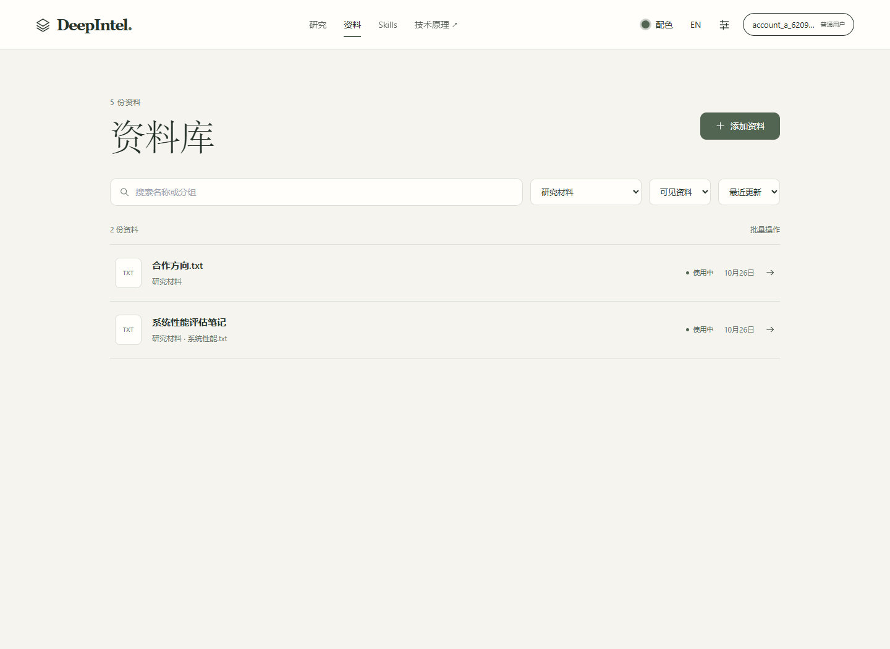
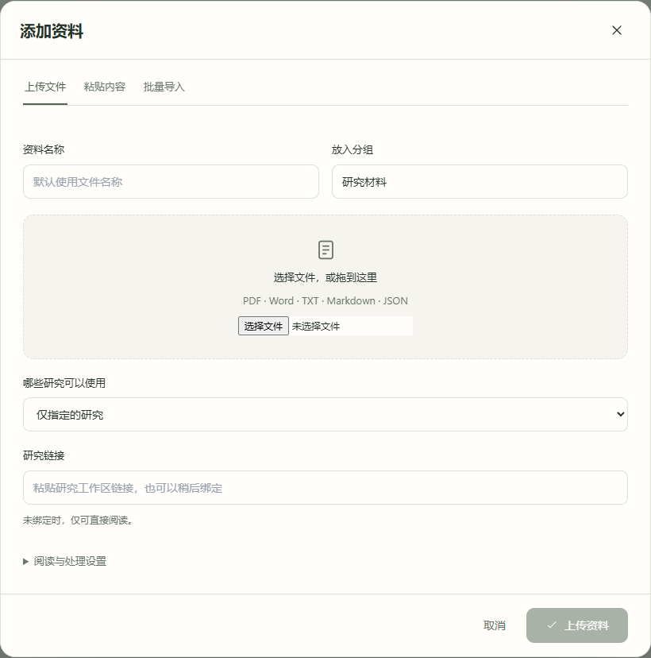
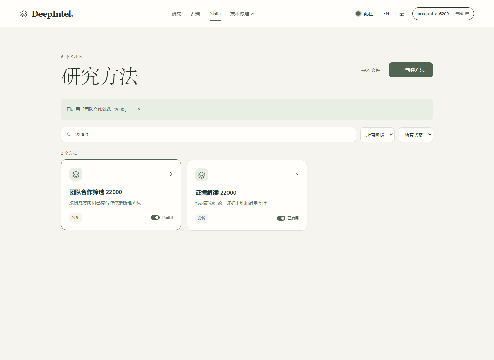
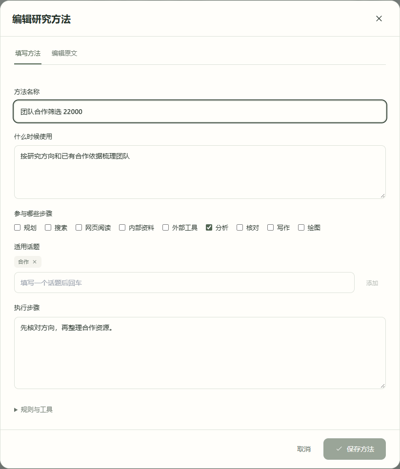

# 资料库与 Skills：界面和实际操作

2026-10-26，本机 Windows、独立 Edge、原 API 与 PostgreSQL，使用专用账号和数据库。OpenSpec `redesign-research-workspace` 第15组。本轮延续简约研究配置的四色、字体和无侧边栏布局，没有采用中国厂商界面参考，也没有新增依赖。

## 界面与交接

资料库默认显示集合，按名称／分组搜索，按分组、状态及更新顺序筛选。添加资料在同一窗口选择上传、粘贴或批量导入，共用名称、分组和使用范围。片段、编码和时间参数按需展开；研究绑定使用页面链接，默认复用范围继续为原任务范围，不自动扩大到其他研究。

阅读窗口直接展示所保留的原文。资料设置负责名称、分组、归档及具名属性，复杂属性和系统记录保留；处理与维护按解析、片段、检索、特征、版本与恢复分组展开。批量选择默认收起。隐藏与恢复沿用原维护接口及请求／修订身份。

Skills 以“研究方法”的名称、用途和阶段展示，提供搜索、阶段／状态筛选及直接启停。新建采用名称、用途、话题、阶段和指令表单，原文编辑另行进入；放弃原文修改会明确返回原表单。话题使用原关键词契约，未填写话题的新方法按名称声明匹配词。导入保留 Markdown，表单更新只替换明确修改的声明／指令部分。

提交中锁定重复操作，错误保留草稿；清空原文不会悄悄回填旧内容。批量处理中锁定配置和弹窗关闭，现有停止／继续／失败项重试保留。手机编辑可滚动，主要保存动作可达，页签支持方向键。

## 实际操作结果

| 当前功能路径 | 结果 |
| --- | --- |
| 粘贴文本、选择分组复用、保存 | 原 API 保存成功；可从列表回访原文 |
| 改名、移动分组、归档与组合筛选 | 保存后列表与筛选显示正确资料 |
| 文件上传、添加具名资料属性 | 原文可阅读；属性保存回访，保存后不保持假修改状态 |
| 两文件批量导入 | 每项实际提交并显示结果，完成后列表可阅读 |
| 隐藏／恢复与隐藏筛选 | 实际维护操作成功；列表区分隐藏和普通归档；恢复后的手机阅读成功 |
| 新建方法与双击提交 | 原 API 只保留一个同名样例，话题和阶段正确进入记录 |
| 空字段／空原文、放弃原文修改 | 本地定位错误；空草稿保留，不被旧文覆盖；明确返回后保留之前的表单选择 |
| 方法停用及重新启用 | 管理页显示真实状态；默认运行目录实际排除停用项、重新纳入启用项 |
| 导入内联方法后只改名称 | 原 `stage_references`、Reference／Stage 章节和执行规则保留 |
| 深浅主题、390px 手机、键盘页签 | 实际走通方法编辑／取消、资料阅读与输入方式切换，并取得截图 |

上述旅程通过真实浏览器及原接口执行，未替换响应。没有启动调研、模型或论文抓取；未执行构建、类型、lint、schema、单元、回归或浅层探针。原多用户边界由原认证、主体查询及缓存归属继续执行，本次未另跑跨账号回归，也不把该范围称作完整安全验收。

## 本轮发现并修复的交接错误

1. 更新接口返回停用，但运行缓存仍驻留旧启用元数据。`SkillRegistry.upsert` 现在先移出旧驻留项，再依新状态入索引；管理 API 的 `include_disabled=true` 读取本人的当前未删除元数据，前端管理缓存单独命名。默认目录保留运行语义。
2. 原维护把隐藏也保存为 `archived`，仅凭来源状态无法正确分类。资料列表在主体条件下关联本人的维护状态，前端依据 `tombstone` 区分隐藏。没有记录的历史资料保留原状态，不推断隐藏。

首次操作另遇到本机数据库服务未运行；通过既有 Docker 原生启动桥恢复现有容器和服务，未重建数据库。辅助脚本误选已有属性而留下空的新属性；更正定位后，资料属性实际保存成功。脚本问题不计作产品功能通过。

## 安全基线引用与证据边界

本增量沿用 A2ABreak 基线 v1.0。条目为本地来源核对的工程提案；本次只提供下列项目路径证据。

| 方案、章节 | 控制点与证据 |
| --- | --- |
| A2AB-01／技能声明验证与委派准入／“工程解决方案”第1点、“验收办法”T2 | 可信运行注册表移除停用版本，管理目录分离；浏览器＋原默认目录观测停用／启用变化，未据此宣称完成远端能力证明验证 |
| A2AB-03／上下文归属与跨租户隔离／“工程解决方案”第1—3点 | 管理方法固定 `principal.id`，资料关联使用来源所有者和同一所有者维护记录；沿用原认证。归属条件做源码审阅，本轮未增加身份边界或重跑完整隔离评估 |

Basic Memory main 条目：`main/engineering/security/a2abreak/solutions/a2-ab-01-技能声明验证与委派准入` 与 `main/engineering/security/a2abreak/solutions/a2-ab-03-上下文归属与跨租户隔离`。其余01以外的Card密钥、长连接、产物分块、审批并发、Webhook、多跳、授权委派、环路预算和租约机制没有新增；沿用既有评估，不记为本轮验证。修复记录也保存在 `main/engineering/adrs/adrs-skill-管理目录与运行缓存必须分离`。

## 实现提交

- `2f58373`：Skill 停用缓存与本人管理目录。
- `c412ca6`：共享集合控件与资料库。
- `24877b6`：方法集合、表单、导入与启停。
- `dad45ba`：来源隐藏与归档状态交接。

## 界面

