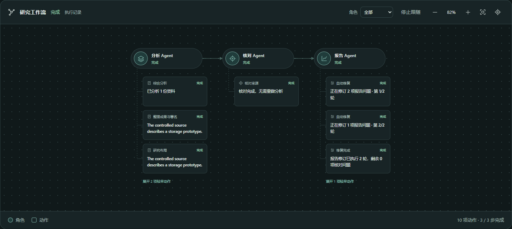
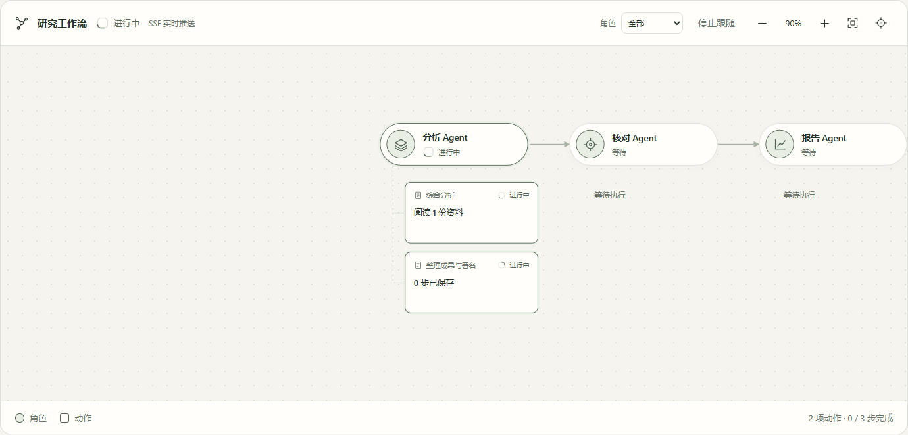
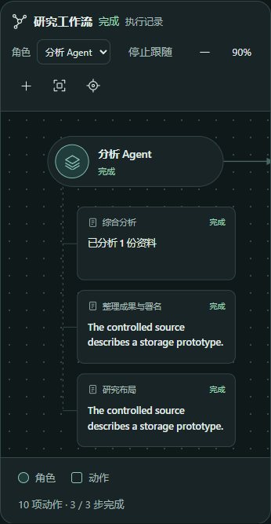

# 流程图内的角色与动作 · 2026-10-26

执行反馈已融入研究流程图。圆形图标与胶囊节点表示实际角色，方形卡片表示具体动作，虚线表示归属；DAG箭头继续表示原依赖。工具仍是取证动作，未为展示效果新增自治Agent或修改执行分工。

卡片显示实际子问题、调用结果和修订状态；点开可查看反馈、输入、相关调用与过程记录。默认显示最近3项动作，可展开较早动作；支持角色筛选、定位、跟随、拖动、缩放、键盘和移动端。完整事件列表进入研究记录，工作流下方不再放独立的大列表。

## 实际操作

本地专用API8011、既有隔离PostgreSQL、Vite5181及独立Edge完成以下当前功能路径。界面使用真实本人任务GET、持久事件和原SSE；未拦截或伪造浏览器API／SSE。

| 路径 | 观察到的结果 |
| --- | --- |
| 修改前打开已有本人任务 | 画布没有“分析Agent”角色节点，反馈仍是下面的独立列表，未满足新目标 |
| 重开真实保存的阶段 | 角色胶囊与动作卡片区分；直接打开研究布局摘要和此前结构修复反馈 |
| 展开／收起较早动作 | 提取阶段仍在原角色下，动作详情和输入保留 |
| 完整事件记录 | 工作流不再重复显示独立列表，研究记录仍可读原事件 |
| 实际继续一个本机受控模型任务 | 新execution的原SSE推送使分析角色及成果提取动作显示进行中，完成后研究布局动作显示保存结果 |
| 执行时保持动作详情打开 | 同一phase随SSE与GET更新结果，仍查看原子问题，不切换为另一项动作 |
| DAG工具失败记录 | 实际浏览调用经原资料边界拒绝，图中显示失败、输入 `https://example.com`、具体拒绝及相关调用；按持久node_id归属 |
| 深浅配色与手机390px | 浅色和青绿深色沿用主题变量；手机可定位角色并打开动作详情，完整图保留拖动／缩放 |

上述浏览器操作没有页面异常。模型端点为本机受控兼容HTTP服务，返回固定的样本分析及核对结果；没有外部付费推理。它验证当前界面消费真实执行状态的过程，不代表实际学术研究质量验收。

工具路径的真实结果为 `private_context_network_query_not_authorized`，未放宽资料权限，不能称为对example.com读取成功。最初操作脚本误用了 `/tools` 路径，改为消费同一任务的 `/tool-calls`；没有为此重复执行工具。

## 界面

## 数据与状态

`researchExecution.ts`从公开事件映射动作，工具开始／返回通过call_id关联，node_id优先于输入匹配。阶段用phase作为稳定身份；修复事件与阶段进展同时到达时，阶段仍保持原题名。阶段摘要由本人任务GET的 `analysis_progress.phases`提供，最多100项；原权限、公开投影和SSE执行版本过滤保留，没有返回整个内部工作流。

实际发现JSONB对象顺序不代表问题执行顺序，因此按提取批次及冻结的模块顺序输出保存阶段。卡片保留失败尝试和后续修复，终态不显示运行动画；缺少记录的阶段不伪造成功。图中的状态与摘要不是新的事实核对结论。

查看进行中动作的首轮操作发现，修复完成事件曾把子问题标题改成“修复完成”；已将phase身份和题名固定，再次通过同一实时目标。工具动作详情最初重复显示父节点错误，现只在动作反馈中显示一次。

专用证据在忽略目录 `outputs/flow-actions-20261026/`、`outputs/flow-live-20261026/`、`outputs/flow-tool-20261026/`，操作脚本在 `.codex-homework/`；不提交账号、环境或原始私有运行文件。真实外部搜索成功后的大批并发卡片、长时间运行及重连压力未在本轮单独运行。

本轮只做当前功能的实际浏览器／API／数据库／SSE路径；没有执行回归、局部／TDD、构建、类型、lint、schema、启动／导入／文件／hash／文字或健康探针。原完整研究及报告质量优化继续暂停。

沿用[已有安全依据](../RESEARCH_EXECUTION_CONTROLS.md#增量安全依据)：A2AB-03《上下文归属与跨租户隔离》v1.0“工程解决方案”1—3的本人查询及公开投影、A2AB-04《长连接撤权与事件出口鉴权》v1.0“工程解决方案”1—3的原事件出口。其他11项适用性保持，没有新增委派、权限或Agent信任边界。本轮只证明上述合法消费及既有工具拒绝路径，未重跑安全攻击。
