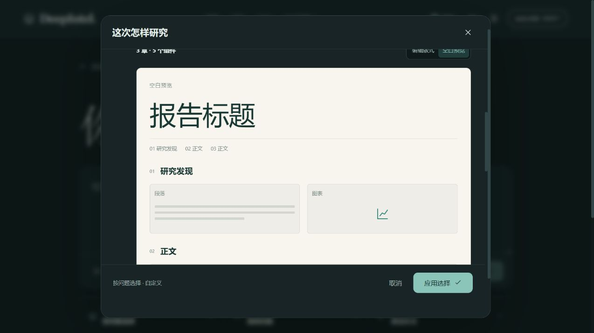
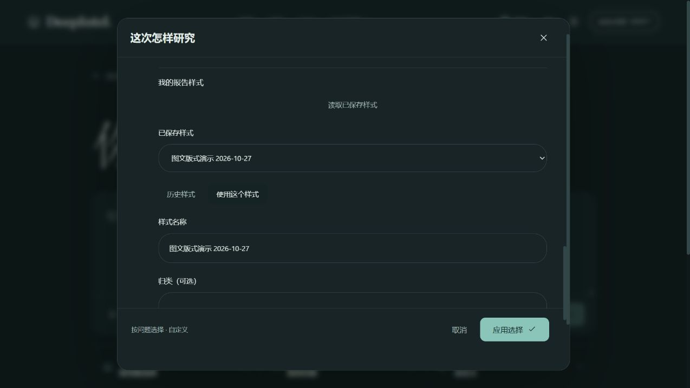

# 报告版式编辑：浏览器操作记录

2026-10-27，在本机当前分支及登录工作区，沿现有研究选项界面完成OpenSpec 19.3、RUN.17.3。操作使用一份为本次操作编写的合成HTML样例，未使用用户的研究报告作为输入，也没有启动研究任务。

原界面只有手动章节，没有导入和空白预览入口；完成后的界面在“报告样式 → 自定义”下提供导入样例、从空白设计、手动章节和个人样式。上传的样例包含虚构对象、数值、图形及脚本；实际预览显示通用标题、章节及空白段落／图表槽位，没有显示样例中的对象、数值或正文。样例的结构化提取及不执行脚本的实现证据沿用[19.2解析记录](layout-import-20261027.md)，本次没有以界面截图代替更广泛的跨主题研究验证。

实际操作：

1. 选择HTML文件并等待读取，看到3章、3个组件及空白预览。
2. 在编辑器将首章设为“研究发现”和两栏，新增段落、图表，将图表类型设为条形图并调整顺序；调整字体、密度与字号。
3. 以“图文版式演示 2026-10-27”保存样式；切换到手动章节再返回，草稿仍保留上述选择。
4. 使用该样式并应用研究选项；重新打开选项、读取样式库并再次选用，看到保存的两栏与图表设置。
5. 将图表改为折线图并更新，历史样式显示第1次和第2次保存；再次应用后，英文界面显示对应的版式控件和折线图选择，随后恢复中文。
6. 另在手动章节选择“近年演进”和时间线，使用“用章节类型和配图生成版式”，编辑器显示演进章节和时间线图表。

这次浏览器路径覆盖HTML；DOCX解析证据见19.2记录，未在本次界面中另行上传DOCX。未执行完整研究、跨对象数据绑定、最终报告输出、PDF／手机布局验收或既有回归。19.4数据绑定、19.5报告渲染和19.6解析任务进度仍未完成；目前选择带布局的研究在计划预览阶段沿用 `layout_binding_pending` 阻止启动。

## 约束与安全依据

沿用A2ABreak基线v1.0：A2AB-01《技能声明验证与委派准入》工程解决方案1、3、4，用于组件枚举与受控输出准入；A2AB-03《上下文归属与跨租户隔离》工程解决方案1—3，用于样例与个人模板的owner范围；A2AB-08《结构化授权请求与权限不放大》工程解决方案1—4，用于只传合规结构、不扩展研究工具权限。来源为Basic Memory main的`main/engineering/security/a2abreak/solutions/a2-ab-01-技能声明验证与委派准入`、`.../a2-ab-03-上下文归属与跨租户隔离`和`.../a2-ab-08-结构化授权请求与权限不放大`。

本次前端只将受控的布局结构提交给原接口，样例来源引用随个人模板管理请求提交；服务端归属和声明式校验沿用19.2。手动章节转换不将标题或问题写入布局。上述依据和单次操作不代表整个安全基线或跨主体浏览器隔离已经重新验证。
