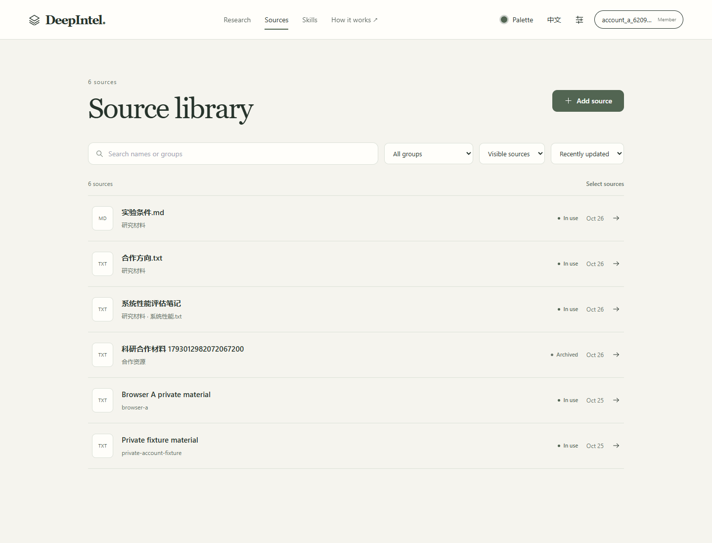
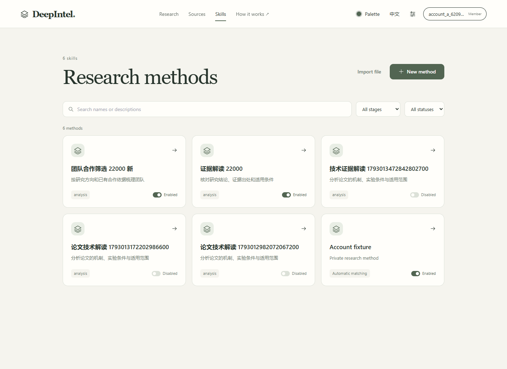
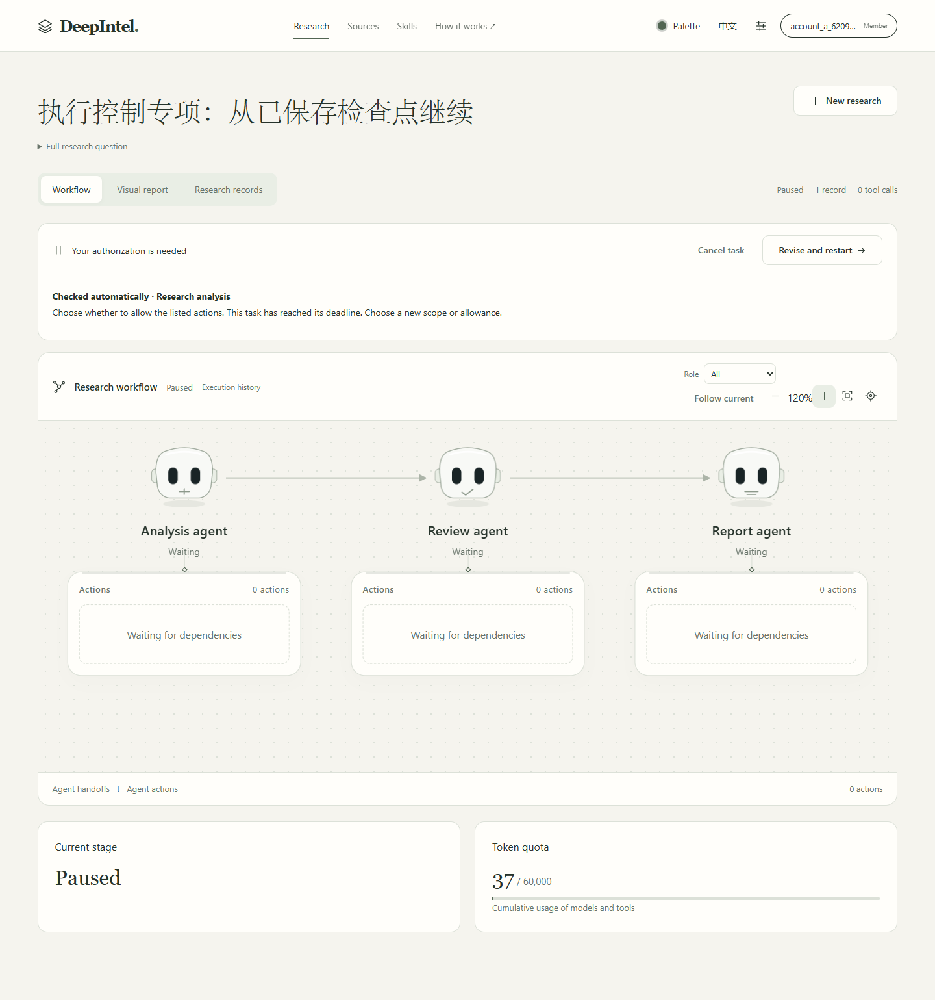
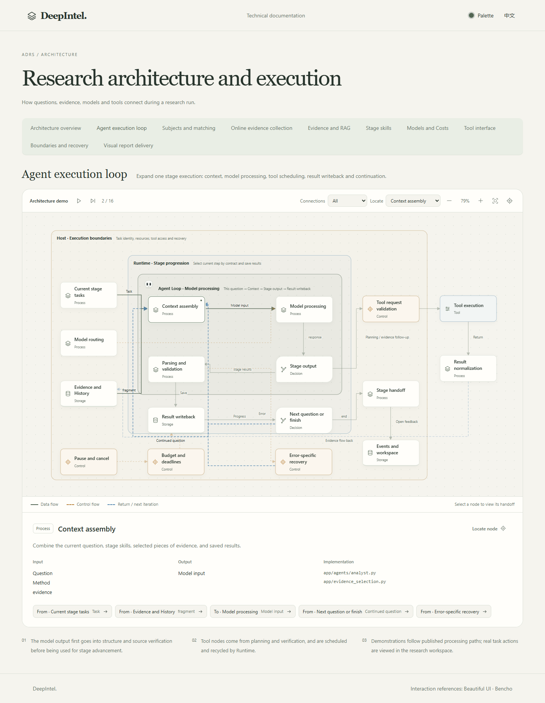
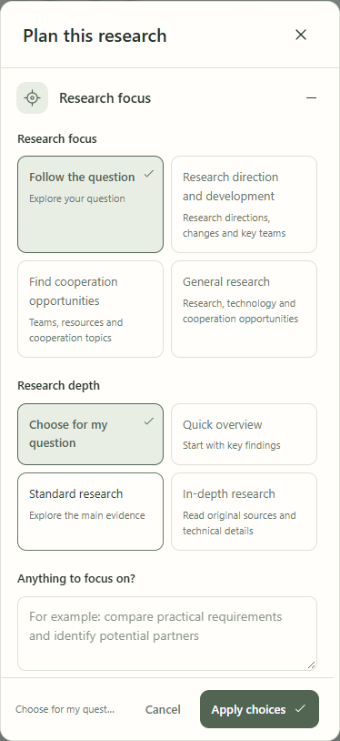
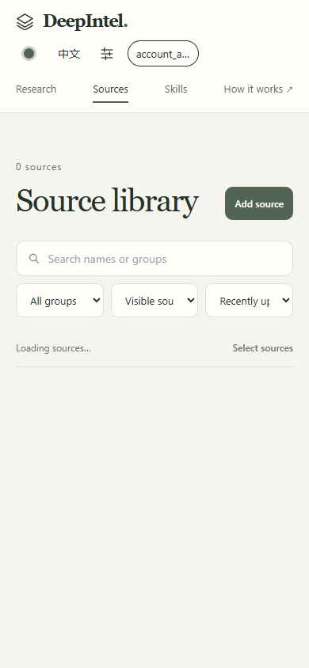

# 中英文界面：实现与实际操作

2026-10-26，在本机 Windows 沿用已有 React 前端和原 API 完成。OpenSpec `redesign-research-workspace` 第16组。用户指出原切换只覆盖导航、首页标题，而资料库仍显示中文。

## 交付

资料库、Skills、研究配置、执行画布与记录、模型和来源设置、账号／注册及技术窗口使用同一语言偏好。按钮、筛选、页签、弹窗、占位文字、状态、反馈及无障碍名称接入源码词条；日期随语言选择中文或美国英语格式。英文手机选项采用两列，给完整单词留出空间。

`i18n.ts` 通过 React 语言订阅重新呈现文字，沿用 `deepintel.appearance.v1` 的保存和同源标签同步。没有给页面增加语言 key、重新导航或 DOM 翻译观察器。模块内静态界面定义延迟取词，执行节点／反馈的派生缓存随语言更新；图的节点身份、暂停和视角保持。

`locales/en.ts` 保存英文文案，`locales/system.ts` 声明服务端固定诊断／恢复用语和模板。已显示的本地系统反馈可重新按当前语言呈现。服务端固定提示按明确模板转换；错误分组使用稳定原词，避免显示语言改变错误定位。没有运行时翻译服务或新增依赖。

资料名、分组、用户研究问题、正文、方法名称／指令、报告及具体原始主张保留原文。渠道和提供商目录中的系统标签另行翻译，不把 API 数据整棵递归翻译。

## 实际浏览器旅程

使用隔离 Edge、真实 API 与专用账号，桌面1440px和手机390px。没有替换网络响应。

| 当前功能操作 | 结果 |
| --- | --- |
| 资料库双向切换、搜索与状态筛选 | 控件同步，原中文搜索值与状态值保持 |
| 添加资料的粘贴草稿，另一标签切换语言 | 弹窗标题和按钮改变，名称及正文保持 |
| 新建方法后触发必填校验，再切换语言 | 方法名和编辑状态保持，已有错误跟随语言 |
| 浏览器实际断网后保存未提交方法，再切换 | 网络错误按语言显示，原草稿保持；恢复网络后取消 |
| 刷新及同源标签同步 | 语言保存并同步到当前窗口 |
| 选择高校、近三年并双语预览 | 选中对象／日期保持，原解释接口收到的两份请求相同 |
| 模型设置、账号、注册 | 目录与表单显示当前语言，注册用户名草稿保持 |
| Agent循环中选择上下文节点后切换 | 选中节点、暂停状态、画布位置保持，标题及详情改变 |
| 既有暂停任务切换语言并缩放 | 原任务仅阅读，角色及停止提示更新，视角保持 |
| 英文手机方法窗口、研究选项和资料库 | 主要操作可达；长选项不再被挤成三列碎词 |

成功旅程未出现浏览器运行异常。首次旧记录操作暴露未接入目录的服务端诊断，随后补齐固定提示／模板；辅助脚本的缩放／关闭定位曾使用猜测的英文名称，另一次未在切换后更新弹窗名称；修正控件名称及定位后完成相关路径。没有将该脚本失败记成功。

本次只操作这些界面与原确定性预览接口，没有创建或继续付费调研，旧研究／报告优化仍暂停。没有运行构建、类型、lint、schema、单元、回归或其他非E2E检查；现有记录阅读不等于新的实时研究交付。

## 维护

新增界面使用明确词条；输入、枚举与请求字段保持原值。增加服务端固定诊断时同步维护系统消息目录。翻译派生的缓存需要响应语言；画布、表单和筛选保留原身份。未知原始诊断不交给通用翻译器改写。

## 界面

