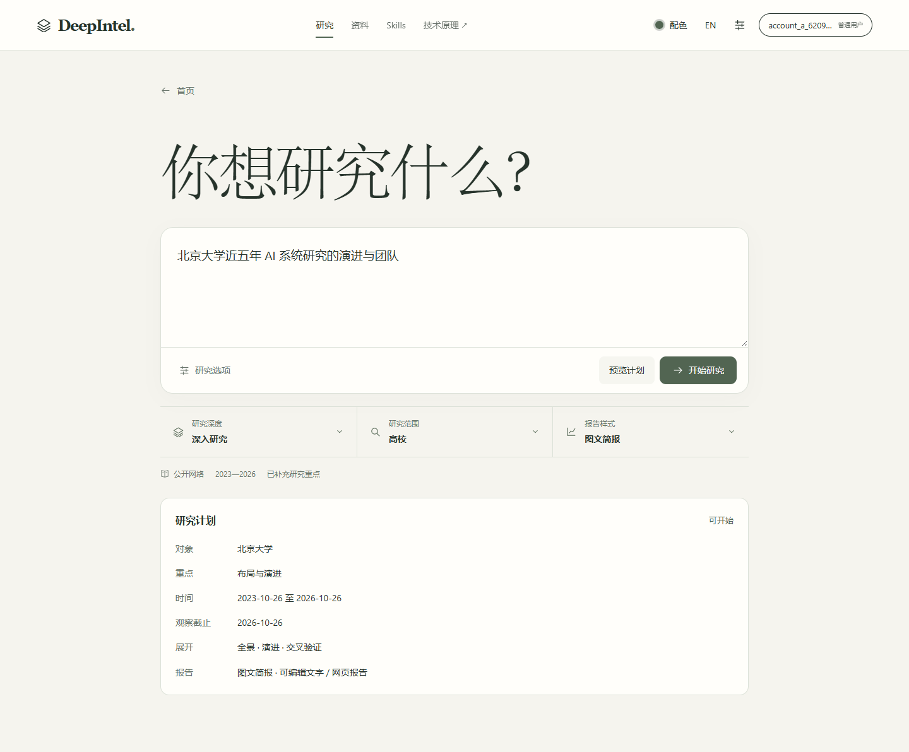
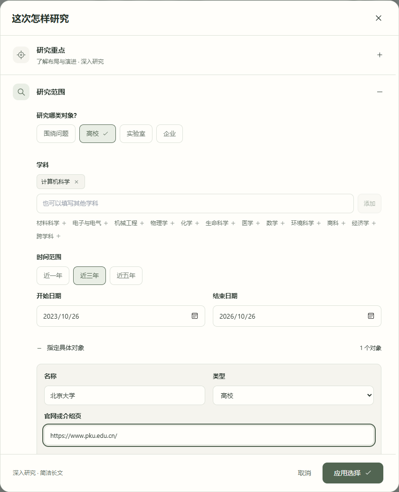
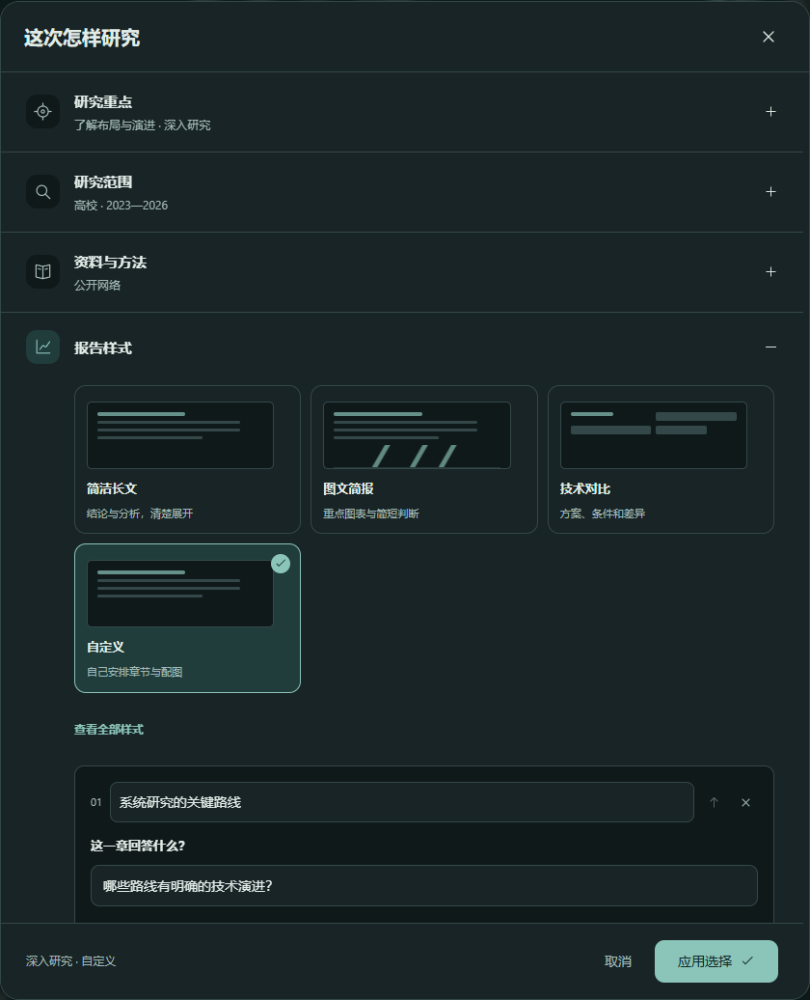
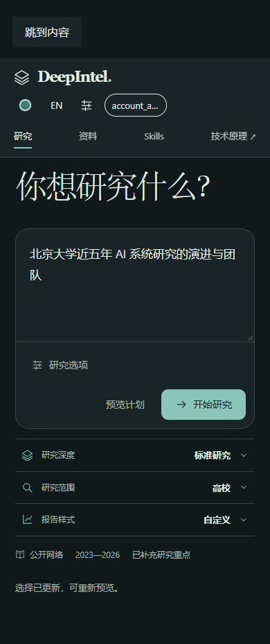
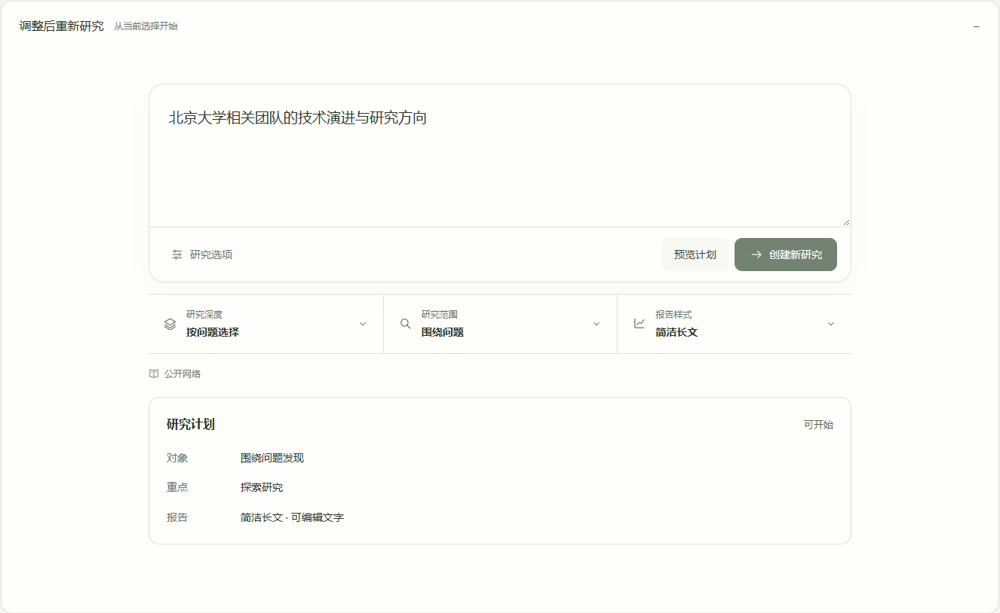

# 简约研究选择：实际界面与操作记录

2026-10-26，本机 Windows，专用 Edge 与现有 FastAPI／PostgreSQL。OpenSpec：`redesign-research-workspace` 第 14 组。使用专用账号与独立数据库执行本次界面旅程；资料和评分方案仍由原账号权限接口处理。

## 使用方式

写下问题即可预览或开始研究。输入框下直接选择研究深度、研究范围和报告样式，旁边显示当前资料来源及时间。打开选项后，一次展开一组内容；改动暂存，取消放弃，应用后才进入本次请求。

- 研究重点：目的、深度、关注问题与分析内容。深度联动原篇幅参数。
- 研究范围：高校／实验室／企业可多选；学科标签、快捷年份及日期、具体机构和介绍页。调整类型时保留已填写对象，冲突在应用时定位。
- 资料与方法：网络或网络加本人资料、具名来源、按条件筛选、网站与文档、研究方法及资料类别。
- 报告样式：七种预设和自定义入口，缩略图辅助选择；可安排章节、问题、图型、绘图方法和下载形式，保存本人常用样式。
- 更多选择：术语叫法、检索排序、时效、研究安排、技术分类与合作要求；采用表单与标签。原有扩展参数继续传递。

默认机构研究使用原服务端权重；不必等待精细权重面板。需要调整时再展开匹配重点和评价体系。已有个人方案按原保存记录读取，查看不会改写成默认配置。

重新研究位于“研究记录 → 调整后重新研究”，使用同一套控件。修改后先预览，当前预览可开始时才启用“创建新研究”；再改问题会使旧预览失效。预算、资料访问、模型权限和实际研究执行仍使用原服务端契约。

视觉沿用已确认的四色、字体和工作区控件。本次没有采用中国厂商的界面参考，也没有增加前端依赖。

## 本次实际操作

| 旅程 | 可观察结果 |
| --- | --- |
| 深度先修改再取消，再次修改并应用 | 取消保留原深度；应用后摘要、原篇幅和请求深度一致 |
| 高校、近三年、北京大学介绍页、图文简报 | 原解释 API 接受请求并返回正确对象、时间与网页报告形式，可开始 |
| 保留高校对象却移除高校类型；并行数填 20 | 应用被阻止，指向具体选择；纠正后可继续 |
| 自定义两个章节和问题 | 原解释 API 接受，章节顺序／问题和执行选择进入请求 |
| 保存个人评分方案，再次展开查看 | 引用仍为原方案和指定保存记录，不被默认配置替换 |
| 历史请求只存方案引用，不带前端有效权重缓存 | 浏览器实际读取该方案指定记录；应用及原预览 API 保留引用、对象信息与额外 `max_revision` 参数 |
| 旧任务可读编辑、预览，再改问题 | 创建入口依次禁用、启用、再次禁用 |
| 资料格式条件、术语叫法、自定义分类与合作要求 | 不完整条件在应用时拦截；补全后真实 API 接受资料筛选、术语、分类关键词、CCF 等级和既有合作项目条件 |
| 深浅主题与 390px 手机 | 常用选择可操作，弹窗可滚动，应用后主界面显示选择 |

完整路径使用真实浏览器、原请求转换和原 `/api/v1/research/understanding`，没有拦截替换响应。历史引用另使用本人专用数据库中的配置样例验证；不启动研究后台任务。所述完成旅程没有页面异常。

初轮历史入口定位到了尚未打开的研究记录面板；更正入口后由独立历史旅程完成。辅助脚本的中文定位名称和 UTF-8 读取问题已修正，后续只补走未完成的选择路径。本记录不把辅助脚本错误算作研究执行故障。

仅执行当前功能的实际浏览器操作和原预览接口。本轮未启动付费研究、模型或新的完整报告运行；未执行构建、类型、lint、schema、单元、回归或探针检查。

## 界面

实现提交：`c1f8eec`。本次文档与截图随后的同分支提交交付。
