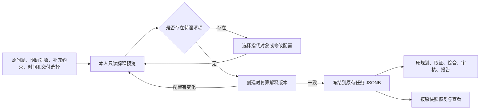

# 查询理解、澄清与任务交付快照

2026-10-22：OPT-07 已接入源码，未运行、未验收。实现为 [query_understanding.py](../app/query_understanding.py) 的普通函数和冻结数据模型，[research API](../app/api/research.py) 负责实际owner/配置读取，[查询面板](../frontend/src/components/QueryUnderstandingPanel.tsx)负责补充与显示。不新增Agent、模型、数据库表或依赖。全部ORG/OPT及跨模块实现后统一端到端，不能将下述接口描述理解为已上线证明。

## 链路与分工

规则模块解释明确字段与字面线索；已有Planner继续处理语义分解和未编译的自然语言要求。搜索/浏览/内部检索仍由原工具契约授权，不因解释结果放宽来源、owner、资料范围或预算。预览不会开始研究或产生模型/取证费用；注册表可使用已有读穿缓存，并非禁止一切缓存写入。真实运行价格、用量和能力是否足够仍需后续计量。

## 十项候选、采用方式与边界

| TODO | 当前选择与理由 | 其他方案及重新考虑条件 |
| --- | --- | --- |
| 07.1 意图 | 有界规则提取命中信号，用户可覆写类型，原Planner作后续语义规划 | 未新增分类模型或独立LLM解析轮；没有标注质量收益和成本依据，不能宣称分类准确率 |
| 07.2 实体 | 显式组织/用户字典及别名，保留原文Unicode位置、候选ID、未链接引号名称 | 不新增通用NER；链接是候选匹配而非官方身份确认。任意未配置名称仍由原问题/Planner解释，未伪造机构ID或官网 |
| 07.3 指代 | 当前明确对象及显式指定本人历史会话的对象状态；前/后者需两个有序候选，单数需唯一指向 | 不自动读取最近聊天、旧证据或完整历史；同名多个ID可手选，跨组织范围须先修改当前范围 |
| 07.4 槽位 | 问题、对象、学科、窗口、观察截止、目的、模块、深度、补充说明、来源声明与URL线索 | 自然语言补充说明保留为用户数据，尚非完整过滤DSL；取证前由后续规划/过滤契约落实，不声称规则已理解全部措辞 |
| 07.5 类型 | 事实、聚合、比较、多跳、探索；同时保存其他命中信号 | 自动优先顺序多跳→比较→聚合→事实→探索，用户覆写优先；类型不等于证据已充分 |
| 07.6 时间 | 静态/实时/历史，明确日期、ISO日期、年份/区间、今年/去年、近1–99年及近一至十年；参考日期冻结 | 不保证覆盖全部自然语言日期表达；“近N年”按包含本年的日历年起点至参考日期。实时默认72小时为新鲜度需求，不是已验证更新承诺 |
| 07.7 歧义 | 指代/别名/范围/时间/目的/模块/绘图选择冲突形成可见澄清；无歧义直接推进 | 不强制每次额外确认。结构化时间与问题日期不一致时可显式选择以字段为准；不悄悄扩大范围 |
| 07.8 复杂度/成本 | 按类型、对象数、模块数和深度形成简单/中等/复杂及分解建议，附原请求预算上限 | 不编造预计美元费用或模型自报置信度；预览额外LLM调用为0，最终价格和实际用量仍未知 |
| 07.9 快照 | 描述版本、问题/对象/时间/来源、输出长度、通道、资料开关、预算、真实组织配置身份及实际Skill版本 | 组织/评价/权重完整数据沿同一会话的兄弟organization_research保存，解释只保留其身份引用，避免重复复制大目录；不加载当前新版本覆盖旧任务 |
| 07.10 目的/深度 | 组织模式复用已选目的/模块，通用模式可明确选择目的、模块、简报/标准/深入 | 目的不由权重/模板推导，不默认加合作/产品分析；深度不自动增加预算，材料不足仍显示缺口 |

实体/指代位置是所在原问题中左闭右开Unicode字符范围，身份确认始终另行核验。显式字典最多40项，组织/历史对象各最多200项，提及位置最多展示300项，未链接引号名称最多20项，URL线索最多10项。未展示的提及不改变完整显式对象范围。

单个字面日期/年度可识别截至、之前和以来：截至记独立观察截止，不臆造起点；“之前/before”按不含所述日期/年度处理；“以来/since”从明确起点至冻结参考日期。不同边界同现则要求澄清，规则依据可见，不宣称能覆盖所有语言表达。

## ACI

`POST /api/v1/research/understanding` 接收与创建研究相同的请求体，只读返回解释，不创建任务。原 `POST /api/v1/research` 也会复算；客户端可提交预览返回的 `query_preview_id`。直接API调用未提交预览ID时仍须通过同一澄清判断。

新增 `query_options`：query_type、entities（ID/name/aliases）、context_session_id、reference_entity_ids、additional_constraints（1500字符）、time_mode、reference_date、as_of_date、start_date/end_date、prefer_structured_time、max_age_hours、purpose/modules、depth。日期窗口须成对有序，模块/对象ID不得重复；reference IDs须属于当前/显式历史对象。当前组织范围不能通过历史指代或额外字典扩大。空白问题拒绝。

新增 `delivery`：模板markdown-v1/visual-brief-v1/research-map-v1/custom，主题plain-v1/light-v1/dark-v1，最多24个页面（ID、标题、所属模块、问题、图表偏好），builtin/manual_skill/auto_skill，最多8个手选Skill，期望格式markdown/html/json/pdf/pptx。页面ID/格式/Skill不得重复，自定义模板须有页面，其他模板不接收自定义页面；页面不得引用未选模块，手选Skill须在本次实际解析结果中。未注册的本机Skill不能只填路径假装产品已接入。

输出 `schema_version=adrs-query-understanding-v1`、interpretation_id、ready、分类依据、槽位、实体提及、未链接名称、指代链接、历史配置身份/候选、时间、复杂度/预算、delivery、clarifications、notes、method_selection、task_snapshot。交付描述为 `adrs-delivery-contract-v1` 并保存实际Skill ID/版本、模板/主题版本及声明内容身份。自定义内容仅是有界字段，不接收任意HTML/脚本/路径或工具授权。

| 情况 | 返回与后续动作 |
| --- | --- |
| 预览成功但有歧义 | 200，ready=false，显示问题；无研究创建。修改对象/日期/目的或原问题后再预览 |
| 创建仍有歧义 | 409 query_clarification_required，附当前解释；不开始取证 |
| 预览身份变化 | 409 query_preview_changed，附新解释；不静默采用旧解释 |
| 本人上下文/预设不存在，或不属于当前owner | 404统一不存在，不泄露其内容 |
| 非法结构、未知引用ID、过大/重复字段 | 422；修正后重新请求 |
| 预览配置读取超时 | 503 query_preview_temporarily_unavailable；可重试，无研究副作用 |
| 创建解释准备超时 | 503 query_configuration_temporarily_unavailable；解释阶段在INSERT前回退事务 |

预览有15秒协作式异步期限；创建内解释准备同样有15秒期限，有限CPU处理仍由输入上限约束，不宣称协程超时能强杀任意CPU操作。数据库/服务故障不能解释为空候选或模型已完成。原创建与后台运行的其他故障/执行编号契约继续适用，不能用预览ID代替操作幂等或授权。

## 创建、恢复与界面

前端提供独立预览按钮；开始研究也会先预览。预览期间配置变化则不发送创建请求；已有预览过期仍可查看，但会显示说明且开始前复算。实体候选可多选；通用字典按“名称 | 别名”输入，组织模式使用原组织选择。模板/主题/页面/图表偏好与研究目的、模块和权重分别选择。手选Skill会显式加入会话启用项，与禁用项冲突须用户修正；绘图能力/格式适配仍须由后续绘图路由核实。

模板描述已保存不等于实际产物已生成。后续[交付视图](research-delivery.md)已接内置图文页面和数据/来源展开、HTML/JSON/打印；原生PPTX及专业Skill执行器仍待适配。面板明确状态，手选方案不得静默替换；真实能力仍以统一端到端结果为准。

创建将解释存入review_status并传给同一运行的ResearchState。规划/综合/审核/报告附加有界结构化契约；补充说明也参与原风控判断。RuntimePersistence及最终结果保存同一解释，SSE开始事件只发送摘要，不广播完整历史或评价目录。恢复从原状态读解释，不重新读取旧会话或按今天重算日期。旧任务没有解释时明确标legacy；旧待确认请求仅在新字段取默认值时忽略这些新增默认字段，不允许借兼容分支更改原操作。

未来新建研究可以重新解释；这与恢复原运行不同。restart_parameters保留query_options/delivery，未带旧preview ID；组织重排仍为新研究，并复算新配置。

## 安全方案及未验证状态

本次增量应用A2ABreak v1.0，沿用[已有11项评估](RESEARCH_WORKFLOW_DESIGN.md#9-安全方案与验证状态)。以下引用各条“工程解决方案”“验收办法”；本地工程方案待项目验证，不是官方修复声明。

| 方案 | 执行位置与最终端到端证据要求 |
| --- | --- |
| [A2AB-03 上下文归属与跨租户隔离](C:/Users/wblxr/basic-memory/engineering/security/a2abreak/solutions/A2AB-03%20上下文归属与跨租户隔离.md) | API只查实际owner的指定会话，传有限身份字段；双owner不得看到外部对象或建立引用 |
| [A2AB-06 并发状态版本与审批绑定](C:/Users/wblxr/basic-memory/engineering/security/a2abreak/solutions/A2AB-06%20并发状态版本与审批绑定.md) | 创建复算解释版本、原pending请求绑定、原execution fencing；预览改变及恢复不偷换配置 |
| [A2AB-08 结构化授权请求与权限不放大](C:/Users/wblxr/basic-memory/engineering/security/a2abreak/solutions/A2AB-08%20结构化授权请求与权限不放大.md) | 来源/工具权限仍服务端执行；模板、历史上下文、候选对象和Skill描述均不能授权取证 |
| [A2AB-10 委派环路检测与全链预算](C:/Users/wblxr/basic-memory/engineering/security/a2abreak/solutions/A2AB-10%20委派环路检测与全链预算.md) | 类型/深度只是规划输入，不额外申请预算或分类模型；真实成本继续累计到原任务 |
| [A2AB-11 中断任务租约与有界资源回收](C:/Users/wblxr/basic-memory/engineering/security/a2abreak/solutions/A2AB-11%20中断任务租约与有界资源回收.md) | 配置读取有界，恢复用原契约；超时不建立伪运行任务 |

01继续用已注册技能准入；04/05未改SSE鉴权和产物协议；02/07/09未新增Card、Webhook和跨组织多跳委派。这些适用性复用既有完整评估，不机械增加服务或协议字段。

六项纯实施及内容审阅见[OpenSpec任务](../openspec/changes/add-query-understanding/tasks.md)。未执行API/模型/数据库/浏览器、迁移、安装、build/type/lint/schema或任何测试；最终统一端到端须覆盖五类查询、别名/指代歧义、显式上下文、日期/模块冲突、版本变化、不同目的与交付、旧请求和恢复，仍保留完整目标而非只证明本模块。
