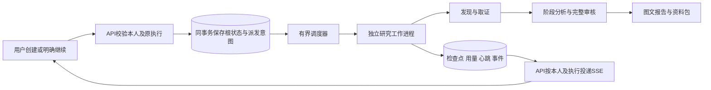

# 取证与长任务执行

2026-10-30。本模块对应TODO的REL.1—REL.3及OpenSpec 11.25—11.27；修复依据见[实际失败归因](RESEARCH_FAILURE_DIAGNOSIS_20261030.md)。采用现有Python、PostgreSQL、权限、检查点和账本；持久化派发与根状态共用事务，不增加模型Agent或队列框架。

## 执行结构

## 取证ACI

`HttpReader`只接受既有公开HTTPS GET／HEAD。每个重定向继续经过来源范围及公网地址校验，最多四跳；每跳至多三个去重地址，优先覆盖不同IP地址族。TCP／TLS和正文共享原期限，每次地址尝试使用同一`on_request`收据计数；不扩大来源、请求数、字节上限或根额度。TLS握手开始前登记可关闭socket，取消信号能关闭进行中的握手。Unicode路径按HTTP规则编码，既有转义和查询边界保留。

失败输出保留原类别和有限诊断：`stage`、白名单`kind`、HTTP状态、地址尝试序号、有限Retry-After秒数。没有异常原文、IP、凭据、响应正文或任意响应头。DNS失败与非公网／非法地址分开；证书校验失败保持阻断；HTTP状态不再全压成upstream_error。旧未知记录不补猜。诊断进入原工具安全记录、通道尝试和本人界面。

文本读取按响应头或HTML声明的受限字符集解码，支持UTF-8、GBK／GB2312对应的GB18030等常见编码，并记录实际字符集；无声明沿UTF-8，不通过插件或模型猜原文。避免将采用旧编码的机构页面一律按UTF-8替换损坏。工作进程日志也固定UTF-8，文字显示与实际证据分开判断。

新任务冻结`external_evidence.read_recovery_policy=bounded_public_read_v1`。auto模式为后续路径保留原额度与时间：明确的连接／超时／HTTP 5xx可尝试本人已启用的公开文本读取渠道，然后按需使用受控DOM。现有Jina渠道本就校验原目标DNS，仍按本人配置启停；未启用不擅自启用。第三方文本明确标为`page_text / external_reader_transcription_not_original_pdf`，不产生原PDF／原字节声明，不提升为整篇已读，也不加入原件归档运输白名单；实时性任务不走无法独立观察上游新鲜度的转写回退。

source-only、显式来源范围、带凭据网址以及认证／权限／风险／限流／证书拒绝不通过其他渠道绕过。既有DOM本身也使用同一HTTP安全网关，因此不把“换浏览器”当作另一条网络连接已经成功的证据。PDF仅从实际取得的原字节建立原件和原图页，搜索摘要、转写及图片链接均不能替代。

## 持久化派发与租约

`research_execution_jobs`按execution_id唯一记录本人任务、可信调用参数、创建时间、状态、claim token、工作进程及租约。创建、审批通过、用户继续、中断接续和分析／报告／审核续作均在原根状态事务内写入派发意图；响应失败或事务回滚不会留下已获准派发的记录。同执行冲突不产生第二个队列条目。

调度器使用PostgreSQL事务锁和SKIP LOCKED，最多两个活动工作进程。工作进程重新验证job／owner／session／execution／claim token及租约，模型配置按创建时冻结，原始起点取数据库created_at，队列等待时间也计入原期限。每个进程仅执行一个明确入队的研究，复用原账本、资料检查和旧执行围栏；不把历史running根自动入队。

工作租约120秒，每15秒续期；原执行控制器仍负责根心跳、撤权、取消和在途连接关闭。整个研究运行有原剩余时长的外层边界。根期限耗尽或工作租约失效后，调度器和本人读取入口会锁定原根，合并实际收据并保留失败状态；界面不再只因旧running字段持续显示执行。未知调用不清零，也不自动返还。只有满足已有安全边界、当前模型及来源不变且没有在途预留的进度才显示既有接续入口；不声称所有崩溃位置都能自动重放。

API退出不主动结束独立工作进程。Windows本地可用`scripts/start_research_api.ps1`隐藏启动API；研究子进程自身也脱离终端会话。Compose提供独立`research-worker`服务运行`python -m app.research_dispatcher`，API容器关闭自身派发器，工作容器持有任务执行。主机或整个工作容器退出仍须依持久化状态收敛，不承诺进程能跨主机断电存活。原数据卷、数据库连接和SECURITY_ENCRYPTION_KEY由既有部署配置提供，不复制模型Key进参数或仓库。

## 跨进程SSE

绑定执行的事件存入`research_execution_events`，单条载荷有界，按根保留约600条近期事件。过大载荷只投递明确的reload_saved_research缺口；完整研究快照仍在原存储。API使用`db:<id>`游标读回当前执行，并逐轮／逐条校验本人会话和执行；重连不依赖API进程内事件数组。worker不直接向外提供端口。取消、撤权和替换执行后的旧结果仍由原发布围栏裁决，事件不授予读取其他owner任务的权限。

## 普通启动与结构升级

同一整块旅程的API重启暴露了真实锁环：旧worker发布事务持有research_sessions共享锁，API每次启动都重复ALTER该表，事件写入另取连接又等在ALTER之后；仅结束API进程不保证数据库立即取消仍在等锁的语句。已按实际后台PID／数据库／语句精确取消这条遗留DDL，没有结束研究进程或重建任务。

结构生成版本由`app_schema_generation`管理。当前生成版本相同的普通API启动只建立运行连接，不再重复业务表DDL；结构变化必须更新生成版本。首次初始化和明确迁移用专用数据库锁串行，并拒绝在有活动研究时启动业务表升级。显式迁移使生成标记失效，之后的空闲初始化完整建立当前应用结构才标就绪。工作进程仅接入已有结构。

`DATABASE_SCHEMA_PREPARED=true`仅是操作者对“本版结构已经完整部署”的明确声明，不能用于空数据库；本轮业务表已由66568ec首次正常初始化，并真实存储了任务／收据／原件，因此恢复API时使用该声明登记版本，未对活动研究做业务DDL。事件持久化同时改为复用发布围栏持有的事务连接，消除跨连接自等的路径。正在执行的既有worker未热换源码，其同根继续证明API恢复与任务保留；新事务连接路径的全部竞争情形未单独验证。

## 本轮DeepSeek配置

### 完整结构响应与传输接续

同根接续后真实进入报告：首份结构草稿返回24,765 Token，合同修订流在18.969秒被对端提前关闭；该次58,331 Token按未知消费保留，不返还。旧处理只包装首次输出流，修订流的RemoteProtocolError落到通用workflow_error，原草稿未完成持久化。同时旧的进度防回退比较会因局部阶段尝试数较新，把明确交接的完整分析覆盖为局部暂停。

结构化报告及合同修订统一使用完整JSON响应，模型usage随完整响应结算；界面SSE仍推送阶段事件，报告仍在审核之后发布。传输失败在原账本及期限有足够单次预留时最多再请求一次，未知消费不退款，未完成输出不拼成报告。首次及修订传输异常统一保留阶段上下文和草稿。旧版本已存的通用传输失败，只在同owner／execution有真实报告调用收据且完整旧分析输入仍匹配时恢复写作；任意workflow_error不能跳阶段。

原未知写作消费继续占用总额。若其使静态审核预留几乎占满剩余总额，写作接续改为在当前剩余额度中最多预留60%给审核；总额、原期限和未知消费不变。额度分配是内部保留而非新增授权，完整审核未完成仍不能发布。持久化只对严格匹配current_binding和原局部修订快照的完整交接允许替换局部workflow，较新的实际收据仍优先保留。上述是同一旅程的后续修复，不构成另一份新研究验收。

### 已收到草稿的合同接续

完整响应接续实际消除了该次传输失败，随后停在`unbound_sample_ratio`：FastServe的“排队延迟可占总延迟90%”被误当成本轮论文样本占比。合同现在只把明确的成果／来源样本比例交给统计注册表约束；论文内延迟等实验比例进入正常逐项原文审核，不因此变为已支持。修订后的完整JSON保留为raw_model_response，受保护的报告合同接续重用这份完整草稿，重新装配、纠正和审核，不再次生成整篇。已有一次报告接续后只为这种有完整原草稿、原绑定仍匹配的合同问题额外允许一次；总账本与期限不变。

### 修订阶段的交接

同一原短问题的首轮完成16个分析阶段后，反思指出机构署名否定、技术名称和实验条件引用等实质问题。一次重规划取得更多正文，但随后又从第一组成果身份开始分析，累计305,398 Token时第六组输入空间不足；原总额630,000并未用完。不能把这个停止解释为缺少原文或模型额度耗尽。

修订规划、分析和反思统一释放额外预留，保留原审核及报告基础份额。打包若被较大输出空间挤空，在模型派发前先降低输出并重新选择原文。修订仍无法继续时，可交接已完成分析：严格校验原owner／task／execution、冻结范围／Skill及每份原始输入仍一致，资料访问仍有效；当前资料允许扩展但不允许原输入丢失或被改写。恢复执行时只重绑此前可信frame，原失败与消费均保留。引用按evidence_id重映射到当前号，部分修订另存于内部记录。交接明确是待纠正的候选分析，写作使用当前全文、署名开头及反思问题纠正矛盾，正常完整报告审核不可省略；这些内部恢复信息不进入报告主文。

部署后新研究使用DeepSeek当前正式模型名。当前官方[首次调用](https://api-docs.deepseek.com/en/)列出`deepseek-flash`和`deepseek-v4-pro`，Flash由V4.1-Flash-1017服务；[接口](https://api-docs.deepseek.com/api/create-chat-completion/)提供thinking开关并默认启用。本次使用Flash并保留原chat流程的非思考输出合同：预算网关仅在DeepSeek Flash未另行指定时补`thinking=disabled`，实际选项进入模型收据，阶段输出及总预算保持。这样不会把阶段的JSON输出份额全部用于另一个输出通道；不据此宣称模型质量优于其他配置。旧配置名称保留供历史识别，旧任务模型绑定不迁移。

## 设计引用与验收

复用A2ABreak **v1.0**既有11项适用性评估。采用A2AB-03《上下文归属与跨租户隔离》工程1—3落实在入队、领取、工作进程及SSE的owner／root绑定；A2AB-06《并发状态版本与审批绑定》工程1／3落实在根事务、单执行键、claim token、受信manifest执行重绑和迟到结果围栏；A2AB-08《结构化授权请求与权限不放大》工程1—4落实在原出站／资料范围及禁止错误回退扩权；A2AB-10《委派环路检测与全链预算》工程1／3、A2AB-11《中断任务租约与有界资源回收》工程1／4落实在原起点、同一账本、有界调用／进程、租约及明确停止。01／02／04／05／07／09没有新增Skill信任、Card换证、Webhook、产物传输或跨组织身份，沿原评估。知识库来源与既有边界见[额度ACI](research-budget-controls.md)及[中断恢复](research-interruption-recovery.md)；这些是来源核对的工程建议，不构成项目全部安全边界已通过的声明。

当前代码仅完成源码和调用链审阅；没有局部／回归／构建／类型／schema／探针或旧raw重放。附加一次Agnes只读源码审阅请求遇到RateLimitError，未获得或采用候选，也未重试。整块验收只启动一份新的原短问题DeepSeek研究，观察真实全文、归属、机制／演进／建议、完整审核、真实图文、HTML／资料包下载和重开；同一旅程可包含一次API重启以观察工作进程和SSE接续。验收记录将另行记载实际结果，未产出报告前不将M1／M2／M3勾选通过。
