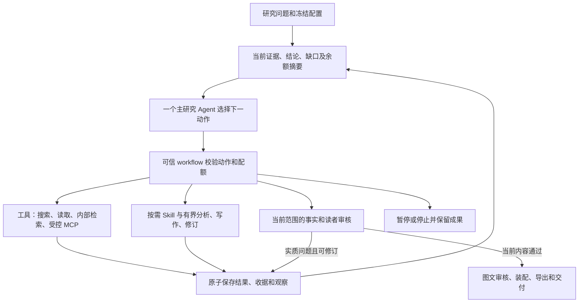

# Design

## Context

动机见 [proposal.md](proposal.md)。本设计对应用户已选择的“一个主研究 Agent＋按需 Skill／工具＋确定性 workflow”，本轮交付为方案，所有新运行行为均待实施。

全功能状态、暂缓清单、原任务去重及实际实施顺序以[完整实施计划](../../../docs/IMPLEMENTATION_PLAN.md)为总入口。本文件维护架构机制，D0保留概要；S0—S6／W／Q编号只在总计划定义，避免多套优先级。较新明确扩展已由总计划覆盖，包括同步／GitHub通知／CDC、显式视觉和文字处理、语义切块及可选稀疏／多向量／图文／BSR。

现有根图为 Planner → DAG 工具执行 → Analyst → Reflection／重规划 → Report；七个类不等于七个独立自治主体，也不能以是否独立进程定义 Agent。新的主 Agent 必须在观察结果后实际选择下一步，而不是给现有固定阶段换名。“确定性 workflow”指准入、调度、持久化和交付裁决可由代码控制，分析、写作及语义评审仍含模型调用，不承诺内容确定。

依据为当前工作区源码及保留记录，工作区已有大量未提交修改，实施须保留这些改动。主要入口：`app/graph/compiler.py`、`planning_control.py`、`tool_handoff.py`、`app/agents/*`、`app/skills/stages.py`、`research_context.py`、`report_composition.py`、`report_editorial.py`、`report_revision.py`、`claim_verification.py`、`report_quality.py`、`llm_budget.py`、`adaptive_budget.py`。

历史用量基线采用 `outputs/quality-e2e-20261101-runtime/session.json` 中执行 `f3404719-e4a7-4895-b9ed-dd8e8aad45bd` 的快照，不能把它当作当前在线状态或最终账单：

| 用途 | 累计记账 Token | 比例 |
|---|---:|---:|
| research | 501,101 | 8.97% |
| report | 2,481,169 | 44.42% |
| audit | 2,603,308 | 46.61% |
| 合计 | 5,585,578 | 100% |

该快照有 281 个不同调用 ID，其中 277 笔 settled 原生用量为 5,230,777 Token，3 笔 unknown 合计 354,801，另有 1 笔在途预占 78,817，后者不再加进上述合计。有原生用量的已结算请求约 91.08% 为输入。不同调用 ID 不能证明工作不重复；聚合行也不能再叠加到请求行。`docs/reader-cross-validation.md` 记载后续核心 250 项支持、8 项免核，以及读者通过时累计 6,027,431；该历史混有开发修复与多轮接续，不能作为普通新研究的标准成本，更不能据此承诺固定降幅。

Basic Memory 本次只读查询返回 `Memory worker exited`。相关历史与 A2ABreak 条目从已确认的本地 `C:/Users/wblxr/basic-memory` 读取；没有声称在线索引检索或写入成功。

## Goals / Non-Goals

**Goals:**

- 一个主 Agent 负责研究方向、缺口选择、综合判断和进入写作的决定；模型能依据工具或分析结果调整下一步。
- 执行边界继续由一个根状态、一个账本和当前任务权限管理；每次动作和终止原因可解释、可恢复。
- 核验强度与读者目的相匹配；保留核心事实真实性、必要条件和整体回答质量。
- 前置章节内容归属，降低重复写作与修改后的无效审核；完整保留已付费材料和历史失败。
- 默认新任务逐步切换，新运行合同、模型、Skill、质量范围和循环上限均冻结。

**Non-Goals:**

- 本期不引入自治子 Agent、Agent 群聊、跨组织委派、第二套记忆服务或图数据库。
- 不同时替换 Python／LangGraph／PostgreSQL 或供应方，不改动现有模型授权来追求便宜报价。
- 不把未核验标成支持，不以缩减必要研究内容或输出页数取得成本改善。
- 不升级当前 600 万 Token 历史根、不修改其质量结论、预算、恢复次数或截止时间。
- 本轮不执行付费研究、历史重放、回归或其他运行验证。

## Decisions

### D0. 原功能目录与暂缓边界优先

2026-11-01 用户提醒：此前已经确认并保留了大量尚未完成的功能。本架构变更只能调整这些能力由谁决策、如何调用及如何减少重复，不能用28项架构任务替换原功能路线图。

范围依据为[原TODO](../../../docs/OPTIMIZATION_TODO.md)、[实施账本](../../../docs/IMPLEMENTATION_LEDGER.md)、[研究交付方向](../../../docs/RESEARCH_PRODUCT_DIRECTION.md)及各原 OpenSpec tasks。状态须区分“已确认待实现”“源码已接待验收”“明确暂缓”“候选方法未选用”；运行参数的冻结是另一概念。不同状态不能相互替代，架构迁移也不改变原完成勾选。

| 原功能目录 | 新架构的承接位置 | 原范围与状态处理 |
|---|---|---|
| ORG：企业／高校／实验室，单多对象、跨学科、归属和研究家族 | 主 Agent 使用冻结问题，现有范围／身份函数和数据快照承接 | 保留原对象与学科支持目标、缺失数据及验收边界 |
| ORG：评价目录、硬筛选、权重、缺失区间、固定证据重排和个人预设 | 保持现有确定性计算、API和界面；主 Agent 消费其结果 | 不用模型主观排序替代既有评分；外部授权指标缺口仍保留 |
| ORG 7.4—7.8：关系、深读、演进、行动和统计 | 按问题调用分析能力，既有技术卡／关系／判断／行动及统计继续消费 | 目前原清单五项复合任务未勾选，源码接入不改称全部待编码或已验收 |
| OPT-01 资料接入 | 搜索／读取／上传、原证据账本和既有显式同步 | 保留较新已接入的手动／定时同步、GitHub签名入站及授权PostgreSQL事件箱CDC；本次不另建第二套接入服务 |
| OPT-02 解析清洗 | 原文获取后的解析workflow | 保留多格式、布局／表格、OCR、显式视觉及文字修复／语义对照；派生观察与原文分开 |
| OPT-03 分块 | 现有版本化原文、父子结构和定位 | 保留显式本地语义切块、抽取式摘要及实体候选；主Agent不改写引用身份，不强制全部资料编码 |
| OPT-04 特征 | 现有词面／结构／时间与获准可选编码 | 较新SPLADE／配对多向量／图文已接入待验收，复用实际配置；其他未选模型不因改造启用 |
| OPT-05 索引 | 现有数据库精确／词汇及版本化索引工具 | 大规模ANN继续暂缓；保留原待验收项目 |
| OPT-06 生命周期 | 原来源权限、版本、保留范围和显式维护 | 不因重写报告重建资料库，不新增维护daemon |
| OPT-07 查询理解 | 原预览、规则槽位、明确澄清及冻结配置 | 原始问题、时间／来源／对象和交付选择继续贯穿执行 |
| OPT-08 规划及Skill | 主 Agent 决策＋原DAG／handoff／Skill准入 | 本次直接改造范围；保留权限、并发、版本和显示计划 |
| OPT-09 查询／模型路由 | 原有限查询变体、渠道份额及授权模型路由 | 不自动换供应方、补额度或新增查询改写Agent |
| OPT-10 业务过滤 | 原类型化条件及当前owner／版本约束 | 各通道继续共用过滤，不为补满结果绕过条件 |
| OPT-11 候选召回 | 按需内部检索及原结构／词汇／可选通道 | 保留较新稀疏／多向量／图文／Beam Search Retrieval源码；GraphRAG社区摘要继续暂缓，不互相混同 |
| OPT-12 外网取证 | 搜索／原文读取工具、缓存和受控出站 | 公开研究联网及可选内部资料定位保留；不自动启用登录／凭据代理 |
| OPT-13 融合重排 | 原确定性融合与来源／近重复处理 | 未具备标签的学习式排序继续不启用 |
| OPT-14 上下文 | 当前问题／成果／结论的原文材料包 | 保留深读、必要条件、遗漏记录和阶段成果；本次只减少无关重复输入 |
| OPT-15 图文交付 | 写作Skill＋编辑／图表／模板／导出workflow | 主附录、原图、图文、预设／自定义模板、Skill、历史及导出原目标保留，未完成原生格式适配继续列缺口 |
| OPT-16 治理 | 原授权、模型外传、披露及发布执行点 | 保留安全边界，不新增KMS／SSO或治理服务 |
| OPT-17 质量与反馈 | 原质量视图、本人反馈及固定证据比较 | 保留真实用户价值核对；不自动训练、A/B或凭模型自评宣称用户认可 |
| OPT-18 运行计量与恢复 | 原根预算、收据、取消、租约、缓存及维护 | 本次减少重复请求与预测，不抹去未知消费或原待验收状态 |
| FLOW、R1—R8、REL及M1／M2／M3 | 上述能力组成的真实研究交付主线 | 内容质量、图文／导出／重开、可复用性和真人反馈仍按原事实取得，架构完成不能代为勾选 |

明确继续暂缓：行为推荐模型、大规模 ANN、GraphRAG 社区摘要、音频、无实际瓶颈的性能调优和新增框架；高级候选算法及多语言迁移继续后置。方法目录中的每种候选不自动转为必做功能，也不因为本次主 Agent 改造而视为获准。

实施按原主线安排，REL／研究质量阻断和M1／M2必要工作优先，M3维持原目标；把本次质量、写作和成本差量嵌入对应模块。新主控制循环只承接必要能力接口，剩余功能继续由原清单跟踪。若某项实际需要新增范围，需作为明确范围变更处理，不能借“按需工具”自动解冻。

### D1. 一个主 Agent 与受信执行循环

新增一个薄的 `ResearchAgent` 决策入口，优先落在 `app/agents/research.py`；根图继续持有调度、检查点和恢复。新节点只有“装配观察 → 请求下一动作 → 验证及执行 → 接纳结果 → 回到观察”的控制循环。现有专业操作通过普通函数或有界 workflow 调用，不各自建立自治循环。

动作使用封闭的类型集合：`search`、`read_source`、`retrieve_internal`、`call_registered_tool`、`load_skill`、`analyze_question`、`compose_report`、`revise_units`、`request_review`、`finish`、`pause`。一次决策可给一个动作或受当前并发上限约束的独立取证小批次。跨动作依赖复用现有 DAG，主 Agent 不能发送可执行表达式、脚本、任意路径或新的运行器。

模型提出 `action_type`、具体问题、操作参数／材料引用、行动理由和预期结果类型。可信根补入 task／owner／execution、operation_id、计划版本、实际工具名、权限、预算份额及期限；模型自报的这些控制字段没有授权效力。旧执行结果迟到仍结算实际费用，但不进入新状态。工具调用幂等与结果接纳继续使用原围栏，不允许第二个 Agent 状态或预算所有者。

“finish”仅表示模型认为研究已足够。可信 workflow 依据已选问题覆盖、必需主张审核、当前读者判断、图文范围和实际交付产物决定是否完成；不足时返回具体未满足项或暂停，不自动放行。

备选：保留现有阶段图并继续增加恢复分支，变化较小但研究控制仍分散；七个角色改为自治 Agent 会扩大协调与上下文成本。本设计保留有效组件，只集中开放研究的行动选择。

### D2. 七个组件的去向与所有权

| 现有组件 | 目标角色 | 复用及改动边界 |
|---|---|---|
| Planner | 主 Agent 的计划与下一步能力 | 复用问题契约和计划校验；由观察驱动提出下一动作，移除新运行中的独立 planner／replan 思考链 |
| Search | 搜索工具适配器 | 保留渠道、变体、融合和收据；已有明确查询时不默认再做一轮模型查询扩展 |
| Browser | 原文读取工具适配器 | 保留获取、解析、来源和出站限制；直接读取不强加页面理解模型轮 |
| RAG | 内部检索工具适配器 | 保留过滤、权限、版本和重排，只有当前问题需要且任务已授权才调用 |
| Analyst | 主 Agent 可调用的分析能力 | 复用身份、深读、关系、技术卡和判断函数；按当前问题或成果组调用，保留覆盖要求，不强制每次重跑全部分析阶段 |
| Reflection | 有界质量评审调用 | 复用事实及读者审核器；不保留新运行中固定的前置全量反思，再重复整稿相同事实审核 |
| Report | 写作能力＋交付 workflow | 复用结构、引用、编辑、图表和 PDF；写作只消费所属内容，发布和导出由确定性流程掌握 |

独立评审调用有不同目的和输入，但不拥有研究工具循环。默认沿用授权模型；同型号的另一调用不等于统计独立或专家反馈。必要的模型升级只沿现有冻结路由及累计名额处理。

旧类和 API 作为兼容适配器保留至旧任务可恢复；新主链不继续调用各自的全套控制逻辑。前端展示一个主 Agent 的行动时间线，搜索、分析、审核、导出显示为实际操作，旧事件使用兼容标签。

### D3. Skill 按需加载并保留显式约束

复用 `app/skills/service.py` 的可信选择与 `stages.py` 的冻结版本、阶段参考和权限交集。初始只给主 Agent 与本次目标相关的 Skill 名称、用途、输入输出、适用条件和预计上下文大小；根据具体动作加载需要的阶段指令及注册内联参考，退出阶段后不携带无关全文。

手选 Skill、模板和图表覆盖继续优先，其必要约束始终生效；容量不足时分段或报告冲突，不能为节省 Token 静默跳过。任务开始冻结可选目录及其版本，新装技能不自动进入运行。`load_skill` 只接受冻结目录中的 ID 和注册参考 ID，不读取来源网页指定的路径或执行 Skill 脚本。Skill 声明只能缩小允许范围，不能新增工具／模型／来源权限。

按需加载是上下文分配，不是每次加载再增加一个选择模型调用。主 Agent 已有决策可以同时指明所需 Skill；本地编译记录实际加载、遗漏、冲突和字节数。

### D4. 四类数据沿用原根保存

扩展现有 ResearchState、organization_result 和检查点，不创建通用知识图谱或独立控制数据库：

| 记录 | 最小字段 | 实际消费者 |
|---|---|---|
| research_control | 运行合同、当前目标、动作序号／状态、问题覆盖、缺口、已消费循环机会 | 主 Agent 观察、准入、恢复、工作台 |
| content_plan | 问题 ID、结论 ID、完整论证所属章、主附录职责、允许的简述角色、证据与前提引用 | 分章写作、编辑、读者审核 |
| claim_units | 稳定主张 ID、文字版本、实体／量词／时间／否定／条件、类型、必要上下文、来源位置、依赖、出现位置 | 核验、修改影响分析、图文消费 |
| review_record | 原事实判定、核验范围与理由、实质影响、所用合同／模型／资料版本、受影响范围与复用理由 | 交付裁决、审核恢复、成本归因 |

字段是在既有版本化记录上的增量，不复制原文。原始模型响应、来源和收据继续保存；紧凑观察从根数据派生，不能成为新的事实权威。主张和编辑动作的 ID 不由章节序号变化而更换；正式内容绑定保持既有机制，本轮不运行摘要或校验和比较来证明功能。

### D5. 核验范围与问题影响分别建模

在初始问题合同、内容计划和后续主张中建立 `required／supporting／advisory` 范围；依据实际用途动态调整，政策版本在根任务冻结。对事实仍记录 supported、contradicted、unverifiable、not_checked 等原状态；交付影响另记 `blocker／material／suggestion`。免核不改写成 supported。

| 范围／问题 | 规则与依据 | 交付处理 |
|---|---|---|
| 核心问题答案、身份归属、决定性比较、建议的事实前提 | 必须来源核验，涉及数字时连同单位、对照、条件及外推范围 | 缺依据或矛盾阻塞，不能由其他项高分抵消 |
| 支撑解释和次要事实 | 判断错误是否改变结论、选择或理解；不清楚时进入必需范围 | 实质影响则补证或修订；无实质影响则记录免核／建议 |
| 本报告提出的课题、协议、评价办法 | 核事实前提与明确的建议身份，不要求来源预先提出同一新课题 | 保证收益、虚构资源或错误前提仍是阻塞项 |
| 轻微复现、摘要预告、就地条件提醒 | 同一命题且同一读者功能，并实际挤占论证、造成误解或矛盾，才构成阻塞重复 | 其余保留编辑建议，不强制删稿 |

写作模型给出的“次要”标签只作建议。必答问题、主要结论及其依赖的事实前提强制进入 required，实际引用次要数字支撑建议会自动提升其范围。明确反证即使发生在次要事实也应修正或移除，免核不是保留已知错误的许可。

新增重要依赖、研究用途变更或新材料冲突时，可提升审核强度；不得因剩余预算减少或反复失败而自动降低核心标准。用户明确改范围时保存新范围版本、差异及影响；已经消费的费用和历史判定保留。正文、附录、表格、图注、原图解说共享同一核心范围，解释同一结论的图文不会再把已排除细节全部拉回逐句核验。

复用当前 essential-facts-v1、reader-purpose-v4 和 reading-impact 的实际经验，将“是否同命题／同功能／有实质影响”合并进入常规阅读评审。只对有争议的定位组允许一次有界影响复核，不每轮另建评审委员会。输出应给出问题、位置、依赖及最小修复操作；证据不足允许 unknown，禁止以格式有效替代判断有效。

### D6. 前置内容归属，采用局部编辑

写作前由一次综合／写作计划调用形成 `问题 → 关键结论 → 主张前提 → 所属章节 → 证据 → 其他出现位置的用途`；模型基于已完成分析提出计划，程序检查 ID、必答问题覆盖和去向。语义上的真正归属仍需评审，不能声称程序能证明命题唯一。

| 内容职责 | 主文展开内容 | 附录或其他章节的使用 |
|---|---|---|
| 全景 | 方向、瓶颈及布局判断 | 代表工作只作判断所需简述 |
| 演进 | 跨成果变化、取舍与有据演进 | 引用机制结论，不重述完整方法 |
| 关系 | 人员、团队、资源及关系性质 | 共著、继承、正式合作分别表达 |
| 深读 | 关键机制及决定性条件 | 每项代表工作保留一份完整技术解释 |
| 交叉验证 | 会改变结论的冲突、可比性和边界 | 必要局部条件保留在结果旁 |
| 行动 | 课题选择、资源、首个产出及评价 | 援引已建立的前提，不重复论文综述 |

章节输入为本章问题、归属结论、必要源片段、依赖结论和其他章节的简短目录；替代 `preceding_chapters=sections` 的全文累计输入。概要保留引用和未解决项，来源数字与条件仍使用原文，不只依赖摘要。摘要在正文稳定后最后生成。

正文按稳定内容单元引用 claim_id。每个单元保存职责和来源；允许摘要预告、导航及结果旁必要条件作为不同 reader_function 复现。编辑器可以移动内容单元，或在确定范围内删句／改句；禁止仅将重复段落搬到附录作为去重完成。

修订给出 unit_id、预期版本、原文字面范围、操作及影响理由。默认保持引用，确需新依据时先经授权取证、绑定新的来源并审核变化；不能以“引用永远不可改”阻止纠错。修订后程序重新计算覆盖及影响范围，旧稿和原判定保留。

### D7. 增量核验的安全复用边界

新语义主张使用稳定 ID，复用必须同时匹配：当前主体及任务、主张准确含义、实体／数值／量词／否定／时间／条件、必要上下文、事实／推断／建议类型、前提依赖、引用源及保留版本／位置、当前访问许可、统计口径、核验政策／模型／合同。单凭相似文本、向量距离、旧正判或一个 ID 不能复用。

把当前将整段文字纳入复用键的方式，逐步替换为显式必要上下文依赖。只移动段落、更新位置或删除不影响含义的重复句，且主张及上述依赖完全不变时可复用；指代、条件、引用或推断前提变化则使该项及其下游失效。无法可靠确定边界时回退审核对应段落／问题，不以缓存优先。

每条复用记录保存原判定、原引文和新出现位置；所有当前 required 主张都必须映射到有效判定，不能以复用比例代表支持率。对负判可保留原状态用于停止及诊断，不能借恢复改成正判。

初稿完成一次当前整稿的读者审核，以发现全局缺失、矛盾及重复。修改后依照实际变化处理：

- 纯排版或位置变化：重新核引用／定位，事实判定在依赖不变时复用；变化后的阅读顺序仍受影响检查。
- 局部改句：重核变化主张及其依赖结论；检查受影响章节与当前内容计划，复用未受影响的读者维度。
- 核心结论、结构、主要范围或依赖变化：使相关全局维度失效，进行当前整稿阅读评审。
- 图文：引用相同已审核主张时复用其事实依据，新解说、新数值或视觉推断单独审核。

最终组合审核结果绑定当前完整稿、各维度及其依赖清单；输入变化时不能原样沿用旧“整稿通过”。未改变的维度可以复用，不代表不审当前稿。

### D8. 上下文、模型与根预算共同控制成本

保留 `ModelTokenBudget`、数据库请求收据与既有动态预留作为唯一准入。实际 messages／输出空间必须计入控制器、写作、审核、修复和图文全部请求。阶段估算按未完成问题、实际内容单元和失效审核项计算，已完成范围不重新预留整套工作。

| 已确认成本问题 | 改动 | 可观察结果 |
|---|---|---|
| 同一证据和全卡重复输入 | 原文引用共享、按问题选段、阶段 Skill、章节归属材料包 | 各请求输入量、唯一／重复片段量、遗漏的必要材料 |
| 前章全文累计 | 只交接结论目录、依赖及所需原文 | 章节增长时输入不再默认累计全部正文 |
| 改句后大范围重核 | 主张依赖与范围失效 | 需要审核、实际新增审核及复用项分别计数 |
| 格式失败反复生成 | 可无损的字段投影在本地完成，完整保存响应；真正截断才有界再生成 | 格式生成次数、失败原因和实际消费 |
| 多阶段反复判断同一问题 | 移除固定全量 Reflection，统一常规事实和读者评审 | 同一主张／同一输入的新增调用原因可追踪 |
| 控制器本身增加开销 | 每次返回紧凑观察；一次调度已知独立工具批，不逐条无谓思考 | control 用量和有效动作数，不能从成本统计中隐藏 |

保守字节预占与供应商实际分词分开；native usage 优先，未知消费继续保留，缓存价格与命中信息只有供应方实际提供才展示。HTTP 原文复用、应用审核复用、供应商提示缓存分别记账，不能混称节省同一批 Token。

先保持现有冻结模型，按输入缩减和调用删除控制成本。后续只有既有已配置路由在当前任务能力和资料许可下合格，才可分阶段选用小模型；模型变化使相关审核缓存失效。大模型不作为 JSON 字段搬移工具，弱模型也不因便宜就负责决定性研究判断。

### D9. 全任务的修订收敛与恢复

新根冻结建议初值：主 Agent 最多 24 次决策；内容修订最多 2 轮；连续无实质进展最多 2 轮；同一操作因真正格式问题最多 1 次模型再生成。它们是待校准初值，不是厂商标准，不替代现有 Token／费用／工具／并发／时间限额；子工作流每次请求仍单独准入。取证 DAG 的既有节点和重规划上限继续适用。

内容修订机会在根级共享：事实、阅读和图文修订不能各自重复获得两轮，恢复和合同重审也不重置。系统调用前持久化操作及消费机会；真正未派发可按原记录继续，未知派发不得盲目重发。格式重试不返回已消费的语义机会。

有效进展是：获得当前问题需要的新证据、关闭一个未解决核心问题、补足必需论证，或在不引入同等／更严重问题且不丢覆盖的条件下降低已绑定缺口集合。文字改动、模型自评分上升、版本变化及重新编号都不算进展。连续空搜索、相同问题反复返回或缺口往返达到上限即停止自动修订。

上限后保存最佳有效稿、未决项、原判定及建议下一步，按现有状态区分完成与未完成草稿。模型不能改变根上限或自行启动新任务；用户后续明确的范围／额度操作继续沿原接口，并保留已消费机会，避免再次形成恢复分支续命。

### D10. ACI 与用户可见行为

| 接口 | 用途与输入 | 输出 | 执行约束与错误处理 |
|---|---|---|---|
| 下一研究动作 | 已授权问题、必要证据索引、当前结论／缺口、可选能力和余额 | 结构化动作、理由、预期结果 | 非法动作拒绝且不执行；当前状态冲突重新读取，已消费请求不退款 |
| 取证工具 | 查询或已批准 URL／内部过滤、来源范围、份额、超时 | 实际结果、原文版本、位置、收据与失败层 | 不接收其他章节全文；权限／过期拒绝；网络失败有界处理，空结果不等于不存在 |
| 加载 Skill | 冻结 ID、当前动作、注册参考 ID | 所需指令、版本、限制与冲突 | 不执行脚本，不读取任意路径，冲突明确返回 |
| 分析／写作／修订 | 指定问题或内容单元、必要来源与版本、合同 | 有来源绑定的候选内容及依赖 | 候选先保存再校验；预算不足保留缺口，原始回复不可被修复失败覆盖 |
| 请求审核 | 当前内容、必需范围、依赖及有效旧判定 | 事实状态、实质问题、读者维度与复用说明 | 未核／unknown 不能当支持；只给有争议组一次影响复核 |
| 完成与导出 | 当前稿、有效审核组合、图文产物与披露约束 | 同版本交付／导出或明确未完成原因 | 模型自报完成无权发布；导出失败与内容质量失败分开记录 |

工作台保留计划摘要、来源用途、当前行动及原因、计划调整、等待／运行／受阻状态。成本视图按 control／analysis／writing／fact_review／reader_review／media_review／format_repair 展示，保留原 research／report／audit 分类的兼容汇总。研究正文只显示研究内容、来源及必要方法，不插入这些运行标签。

### D11. 安全基线与本次适用性

依据 **A2ABreak 基线 v1.0**，参考本地索引 `main/engineering/security/a2abreak/a2-abreak-多-agent-安全基线与-11-项方案索引`。本次涉及主控制循环和 Skill 装载，因此重新评估全部 11 项。适用方案已读取完整条目；它们是来源核对后的工程方案，原条目 implementation_validation=not-run，本提案不将其升级为生产验证或声称 A2A 官方修复。

下表链接指向已确认本地 Basic Memory 原件；章节名称为“工程解决方案”和“验收办法”。所有验收均为未来实施的当前变更合同，本轮只进行文档与调用链审阅。未授权回归检查不因列入本表而获得执行许可。

| 编号／标题／版本／章节 | 适用性、执行点与未来观察目标 |
|---|---|
| [A2AB-01 技能声明验证与委派准入](<C:/Users/wblxr/basic-memory/engineering/security/a2abreak/solutions/A2AB-01 技能声明验证与委派准入.md>)／v1.0／工程1—4、验收T1—T3 | 新按需 Skill 入口适用：`skills/service.py`、`stages.py` 只装冻结注册内容，模型不能以能力声明扩权，输出须经业务审核；观察未注册／版本失效／格式正确但事实错误均不得自动采纳 |
| [A2AB-02 Agent Card可信密钥与身份绑定](<C:/Users/wblxr/basic-memory/engineering/security/a2abreak/solutions/A2AB-02 Agent Card可信密钥与身份绑定.md>)／v1.0／索引适用条件 | 本期无远端 Agent Card 发现或签名身份信任，具体机制不适用；已有工具提供方身份规则保留，未来引入远端 Agent 时重新设计 |
| [A2AB-03 上下文归属与跨租户隔离](<C:/Users/wblxr/basic-memory/engineering/security/a2abreak/solutions/A2AB-03 上下文归属与跨租户隔离.md>)／v1.0／工程1—4、验收T1—T3 | `research_context.py`、检索层和根检查点在取出模型上下文前核 owner／任务／来源权限，审核缓存同域；观察他人 ID 和缓存命中均不能读取或写入别人的研究 |
| [A2AB-04 长连接撤权与事件出口鉴权](<C:/Users/wblxr/basic-memory/engineering/security/a2abreak/solutions/A2AB-04 长连接撤权与事件出口鉴权.md>)／v1.0／工程1—4、验收T1—T3 | 主 Agent 新事件沿现有 SSE 授权及 execution 围栏；改变事件生产者不绕开出口鉴权；观察旧执行及失权主体不继续接收新事件，本轮未改长连接协议 |
| [A2AB-05 产物分块校验与断流恢复](<C:/Users/wblxr/basic-memory/engineering/security/a2abreak/solutions/A2AB-05 产物分块校验与断流恢复.md>)／v1.0／工程1—4、验收T1—T3 | 原 `persist_model_checkpoint`、报告候选和交付版本区分完整／片段；付费响应先存，缺块或混版不消费为完整内容；采用现有完整快照和绑定，不新增分块协议或执行校验和测试 |
| [A2AB-06 并发状态版本与审批绑定](<C:/Users/wblxr/basic-memory/engineering/security/a2abreak/solutions/A2AB-06 并发状态版本与审批绑定.md>)／v1.0／工程1—4、验收T1—T3 | 动作提交、编辑补丁、恢复和发布沿 execution／checkpoint／版本事务；同 operation_id 一次业务效果；观察迟到结果、并发修订和取消不能写入新状态 |
| [A2AB-07 Webhook归属验证与受控出站](<C:/Users/wblxr/basic-memory/engineering/security/a2abreak/solutions/A2AB-07 Webhook归属验证与受控出站.md>)／v1.0／工程2／4及既有接入ACI | 本次主Agent不新增任务出站Webhook；已有GitHub签名入站及仓库绑定、去重、撤销、限额和源读取继续保留。出站控制权证明不是入站通知的同一机制，不能据此删除既有能力；实际投递及边界待Q2／X05 |
| [A2AB-08 结构化授权请求与权限不放大](<C:/Users/wblxr/basic-memory/engineering/security/a2abreak/solutions/A2AB-08 结构化授权请求与权限不放大.md>)／v1.0／工程1—4、验收T1—T3 | `tool_handoff.py`、治理／审批入口在真实执行前按任务、工具及生效限制取交集；Skill、网页及模型自报理由不能扩权；原审批仅用于匹配动作，不重复索取已有授权 |
| [A2AB-09 多跳主体溯源与凭据防转用](<C:/Users/wblxr/basic-memory/engineering/security/a2abreak/solutions/A2AB-09 多跳主体溯源与凭据防转用.md>)／v1.0／索引适用条件 | 一个主 Agent、同根工具，无跨组织 Agent 多跳委派／凭据换证，本期具体机制不适用；工具凭据仍由服务端持有，不进入模型观察 |
| [A2AB-10 委派环路检测与全链预算](<C:/Users/wblxr/basic-memory/engineering/security/a2abreak/solutions/A2AB-10 委派环路检测与全链预算.md>)／v1.0／工程1—4、验收T1—T3 | `planning_control.py`、根控制器、`llm_budget.py` 和数据库收据约束 DAG、动作、修订与格式请求；观察合法并行可执行而重复空转和宽度膨胀受根限制；本期无多跳委派环 |
| [A2AB-11 中断任务租约与有界资源回收](<C:/Users/wblxr/basic-memory/engineering/security/a2abreak/solutions/A2AB-11 中断任务租约与有界资源回收.md>)／v1.0／工程1—4、验收T1—T3 | `research_jobs.py` 与原执行控制管理动作中断、未知收据和恢复；原起点／deadline 不漂移，旧租约不能继续派发，等待释放运行资源 |

### D12. 与现有 OpenSpec 的衔接

本仓库主规格为空，四个新能力是面向新运行版本的契约。本提案不覆盖其他在途变更文件。实施第一步完成如下接合，若前序变更已归档，则使用其真实主规格路径追加版本化要求：

| 在途能力／文档 | 保留内容 | 新运行需要收敛的差异 |
|---|---|---|
| `bounded-research-planning` | 计划校验、DAG、有界交接、单根所有权及可见计划 | 原固定阶段控制改由主 Agent 选择动作，工具仍走原准入；无新增自治子调度 |
| `stage-skill-compilation` | 注册内容、显式选择、阶段适用、权限交集 | 新增主 Agent 动作到旧阶段能力的映射；按需编译不能丢手选约束 |
| `research-model-budget` | 请求前准入、原生／未知消费、累计额度期限 | “重新审核整稿”在新版本表示覆盖当前全部必需主张，可通过有效增量判定组合；不跨合同复用旧正判 |
| `research-delivery-view`、R1—R8 | 问题覆盖、事实与读者双门、图文、草稿、引用与交付版本 | 完整审核采用当前已授权核心范围；轻微重复作为建议；受影响维度失效而非每次全量重做 |
| 架构层级／流程设计文档 | 有效工具与状态边界 | 上线时更新旧“集中式 multi-agent／四逻辑角色”术语，明确单主 Agent 与组件，不重写历史记录 |

若同一运行要求旧政策全量逐句核验，则保持旧行为；不可用当前提案解释为旧任务已经放宽。新版本范围、复用和状态模型一同冻结，不能只切换提示词。

## Risks / Trade-offs

- 主 Agent 增加决策用量 → 紧凑观察、独立取证批次、24 次建议上限，并单列 control 成本；若新控制层没有收益，不默认扩大覆盖。
- 误把决定性前提标为次要 → 核心问题依赖闭包强制 required，范围不明时核验；免核理由可追溯，明确反证仍处理。
- 语义重复无法由 ID 唯一性证明 → 前置归属、一次全稿审阅及实质影响标准共同工作，不以“一个 ID”冒充语义去重。
- 上下文缩减遗漏必要条件 → 主张依赖和来源条件随包交接，遗漏记录为缺口，超限按问题拆分，不能以摘要补造依据。
- 复用失效不足导致错误通过 → 精确语义及来源／权限／合同匹配，指代和推断依赖不明时回退局部或全局审阅。
- 同模型写作与评审相关 → 输入及职责分开、校准案例来自用户／原文；不声称模型自审等于独立专家验证。
- 新旧路径并存增加短期维护 → 每根冻结版本、明确兼容期限，以新根逐批切换；不长期让七个旧控制器与主 Agent 同时决策。

## Migration Plan

实施依赖由[总计划第5节](../../../docs/IMPLEMENTATION_PLAN.md#5-优先级顺序与完整业务验收)维护：S0范围／基线 → S1必要差量、审核／内容／复用及根成本 → S2工具／Skill、主Agent和交付 → S3主研究完整旅程 → S4资料／模板／账号尚未覆盖路径 → S5复用和真人价值 → S6明确格式扩展。冻结项不进入顺序。

根级预算／机会W05在主Agent接管前就位，不再按旧草案分组将它误排到主循环之后。只对新根逐步选择新运行版本，原功能、Skill和可选通道按总计划保留；不按28项分别开发和派发28轮研究。

回退只改变后续新任务的版本选择；正在运行的根保持冻结版本，必要时暂停并保留候选／收据。禁止将新检查点强行交给旧执行器、同时启动两套研究或重置已有账本。部署重启和现有端到端任务继续保持各自授权与期限。

未来编码执行沿项目默认云端偏好先核对分支和未提交内容的安全转移；本轮在本机完成规划，尚未派发云端编码。数据库、Windows 原图／PDF 及浏览器交付的实际接受结果仍需对应主机。该偏好不自动把本地聊天变为云端运行。

### Acceptance and evidence

本轮修订只进行规划内容与一致性审阅，不再次运行文档schema校验。既有TODO已记录用户要求：大模块完整实现后按原授权做一次完整真实端到端，子项期间不执行局部／TDD／回归／冒烟、构建／类型／lint／schema或探针。以下为相应完整旅程的观察目标，不是28项逐项测试的许可；历史命令不直接作为执行清单。

| 当前变更目标 | 用户可观察的成功条件 | 证据范围 |
|---|---|---|
| 真正的主决策循环 | 相同目标下，工具返回不同证据／缺口时选择不同下一动作，并给理由；预算／权限仍由根拒绝 | 仅新控制循环的行为合同 |
| 审核分级 | 已确认的不同读者功能重复不阻塞；核心归属／决定性数字错误仍阻塞；免核不标支持 | 本次误判样例与对应核心反例 |
| 内容归属 | 同一机制保留一处完整解释，摘要和就地条件合理复现，所有必答问题与成果去向仍覆盖 | 当前写作／编辑变化的具体输出 |
| 增量核验 | 不变主张迁移不新增事实请求；必要条件或来源改变时相应结论失效；当前稿审核组合完整 | 当前复用及依赖变化的最小行为 |
| 循环与恢复 | 相同缺口／格式问题不无限接续，恢复不重置机会；未知派发保留消费，旧执行结果不写新状态 | 当前动作及恢复边界 |
| 成本改善 | 相同当前内容单元输入下，前章全文和无关卡不重复传入；新增审核只覆盖失效范围；control 等开销全部计入 | 真实用量优先，缺 usage 与未知价格单列 |

实施中的 prompt／模型／工具政策变更先依据已有原始响应、原文及用户已确认的问题明确预期行为，子项仅做源码／内容审阅，不恢复evaluation TDD或局部验证。实际行为在原大模块完整旅程中取得证据；新增加的E2E、Windows视觉／PDF接受或不同模型比较沿已有明确授权，没有授权时不派发。

产品接受同时看完成的关键问题、重要错误及误拦、有效稿可读性、原生 Token／未知消费、请求数和完成时延；不能只看缓存率或 Token 下降。不设“600 万降到某固定数值”的验收，因为历史任务混有故障修复；批量 P50／P95 及供应方费用仅在有相应样本和价格后报告。

后续校准集保留用户已明确认定的阅读误报、边缘细节，以及会改变结论的必要条件反例；不把未经用户确认的模型意见当人工真值。建议初值需要据这些材料校准后发布具体政策版本，不另建常驻评审／记忆服务。
